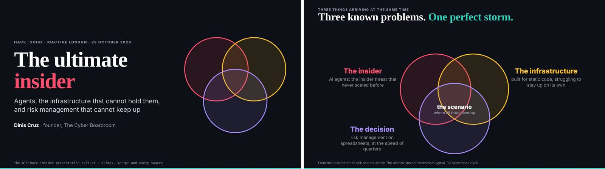
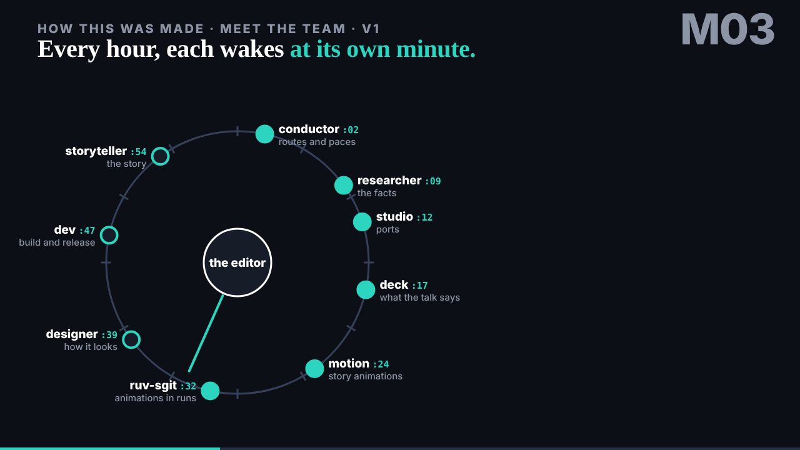

# 0. Before you start

## The claim this book answers

If you work anywhere near software or security in 2026 you will have heard some form of this sentence: agents cannot be made to work, they are too risky to let loose, and they do not pay back the effort of setting them up. Often it is said by people who have tried and been burned, which makes it worth taking seriously.

This book is an answer to that sentence, but not an argument against it. It is a counter-example. On 29 October 2026, one person and a team of AI agents took a conference talk, The Ultimate Insider, from an empty repository at midnight to a stage in London at seven in the evening. Every step they took is in the repository's history, timestamped to the second: who did what, at whose word, what was reviewed before and after, and what went wrong. The record exists because the team was built to leave one.

A counter-example does not prove that agents are safe. It proves something narrower and more useful: that on one real day, with a real deadline, a team of agents was made to work, inside controls its owner could read, sign and pull, and that the controls did things you can point to. Where they failed, the failures are in the record too, and they are in this book.

## The talk inside the book

The talk's subject was the risk itself. Its argument is that agents are the ultimate insider: they have the access an insider has, and none of the limits that used to slow a human attacker down. Its answer is that brakes are what let us go faster, not what slow us down.

The team that built the talk was, by its own argument, exactly that kind of insider. It had commit access to the repository, the editor's sessions to run in, and the hours of the night to itself. So the book tells two stories as one. The main thread is the workflow: how the team was set up, briefed, scheduled, reviewed, held and released. Running through it is the talk's argument, because each control the team used answers a beat of the talk. You meet the risk and the brake in the same chapter.

## Who was there

The editor is Dinis Cruz. He wrote the briefs, gave the talk, and signed every decision that mattered. Nobody else in this book speaks for him.

The agents are named the way the record names them: by role. Dev, conductor, ruv-sgit, researcher, deck, designer, storyteller, motion and studio. That is nine staffed agents (C011). The brief that started this book said "a ten-agent team", and you will find the number ten elsewhere too. It comes from the repository's member folders, of which there are ten: the tenth belongs to security, a member that was proposed and never staffed. Counting the editor would also make ten. This book says nine, because nine is what worked, and it treats the missing security member as one of the day's findings rather than as a rounding.

## How to read the record

**Times.** Every time is UTC. London was on GMT that day, so UTC and London time are the same. A time given to the second (18:44:13) is a commit's own timestamp.

**Commits.** The record is the talk's repository, pinned at commit `298be4e`. A short hash in backticks, such as `867f8c2`, names one commit in that history; anyone with the repository can open it and see what this book saw.

**The day.** The editor signed the span the book covers: from the first commit at 00:16 to the last commit before the talk at 19:00. That is the "nineteen hours" said of the day (C010), and it is a rounding: 00:16 to 19:00 is 18 h 44 min. The merge to the main branch late that night only published what was already done, and the book keeps it outside the day.

**Numbers.** Every number in this book comes from one register of claims, each with an identifier such as (C011), shown the first time a chapter uses it. Each entry says what the record gives, whether it agrees with what was first said, and how it was counted. Appendix A lists every one with the command that recomputes it from the repository's history, so you can check the book rather than trust it. Where the book needed a number the record does not hold, it says so instead of guessing; you will find that more than once, and on purpose.

**Talk facts.** The talk made claims about the world: incidents, costs, percentages. This book does not repeat them on the talk's authority. A fact from the talk appears only when it has been checked at its source and given its own entry. Otherwise the book describes the argument without the fact.

**What came later.** After the day, the editor added the transcript of the talk as given, and his own debrief, to the talk's repository. Chapter 10 uses them, and says each time that they were added after the day. Everything else is the record as it stood that night.

## What this book is not

It is not a transcript. The record is large, much of it machine-written, and none of it meant to be read straight through. The book reads it with hindsight: what was achieved, in what order, why it worked, what it cost and what went wrong. It quotes the record as evidence, briefly, and spends its words on explanation.

It is not a celebration. The failures stay in: the hold that came before any of the talk's planned locks closed, the player that landed late, the correction that never reached its slide, the leaks a review caught after the push rather than before. A book about controls that left out where the controls missed would be making the very mistake the talk warns against.

And it is not a manual for attack. The insider argument is made entirely with this benign team, doing ordinary work in the open. The book describes risks, and the brakes that answered them; it never describes methods.

## Explorer, villager, town planner

The editor names the stages of work the way he names the stages of any new thing. The explorer builds something that has never existed, fast and by hand, and accepts that it will be rough. The villager takes what the explorer found and makes it repeatable and usable by others. The town planner makes it industrial.

The day of the talk was the explorer's work. This edition is the villager's: the record turned into a book you can follow and a setup you can rebuild, written quickly and in the open, with its own seams showing. A publisher's edit, later, will be the town planner's.

## The order of the book

The book opens on the moment the work stopped: 18:44, when the team held itself at its editor's word. Chapter 1 tells that scene, then pulls back to show the whole day in one view. Chapters 2 to 9 follow the day in order, from the empty repository at midnight to the locks that never closed, each carrying its beat of the talk and the control that answers it, and chapter 9 sets the controls out together. Chapter 10 is the talk as it was given. Chapter 11 is what a team that arrived knowing nothing but the record saw in it. Chapter 12 is how to build your own, with what it cost left in.

After a first reading, the turning points in chapter 1 serve as a map: each later chapter sits under one of them.

## Where this came from

- The book's conductor brief, `briefs/2026-10-30/1-book-conductor-brief.md` ("The project", "The gap the book fills", "Not raw content", "Rules").
- The phases explorer, villager and town planner, and decisions S6 (the span of the day), C011 (nine agents), O3 (the material added after the day) and O4 (the record only, for this edition), in `book.json`.
- The chapter plan, `chapter-plan/plan.md`, draft 5: "The shape", "The braid", and the rule for the argument thread.
- The talk's repository at `298be4e`: the first commit `2e4b1f4` (00:16:23) and the member folders under `team/`.
- Register: C010, C011.
- Images: `team/conductor/debriefs/img/talk-title.jpg`, `team/conductor/debriefs/img/talk-three.jpg`, `team/motion/debriefs/img/meet-the-team__1280__t11.png` (the talk's repository; the `talk-*.jpg` slide stills were added after the day, at `a9c0b49`).
