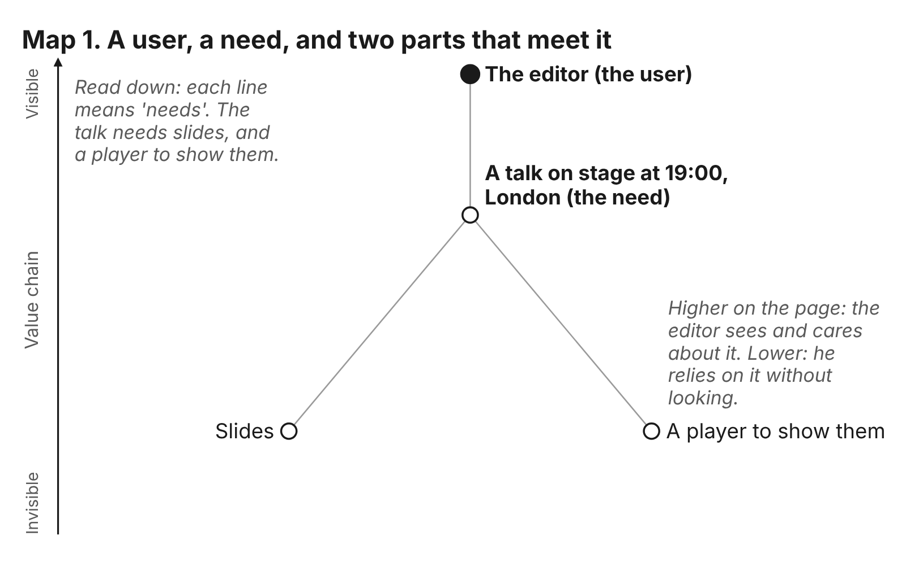
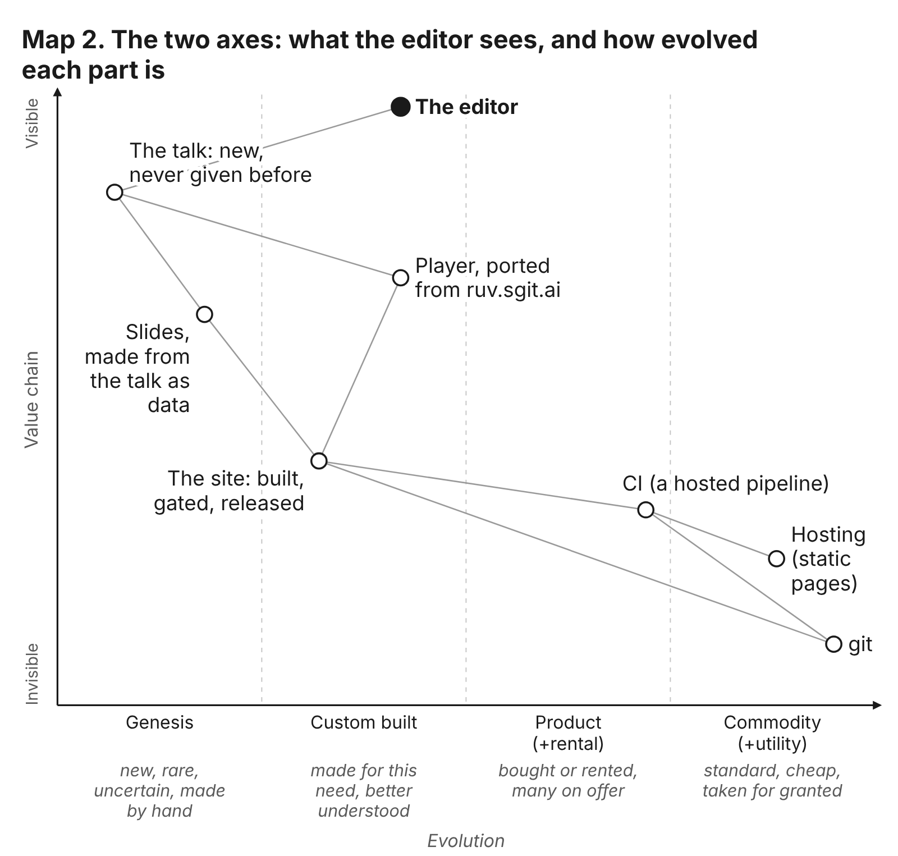
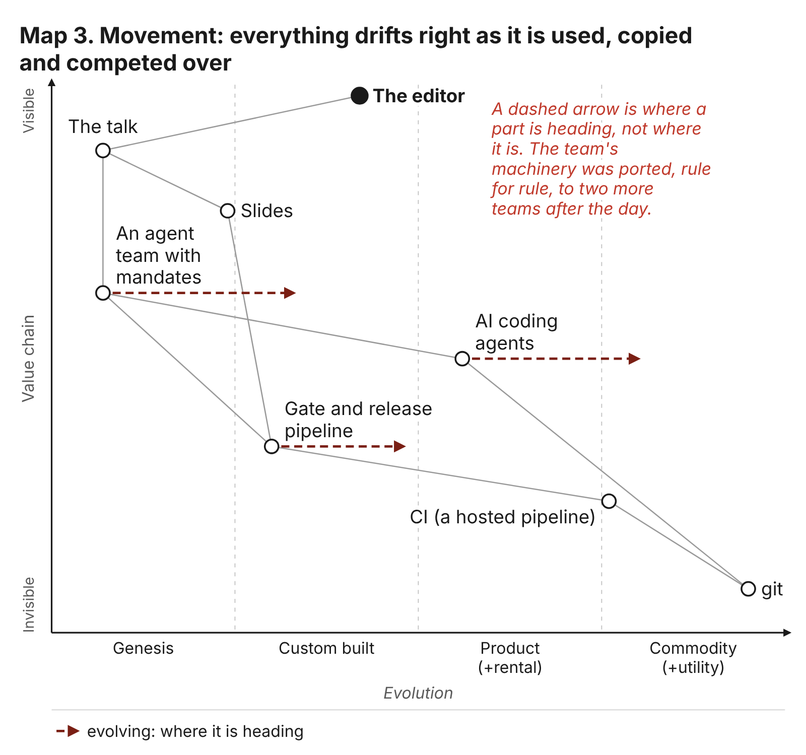
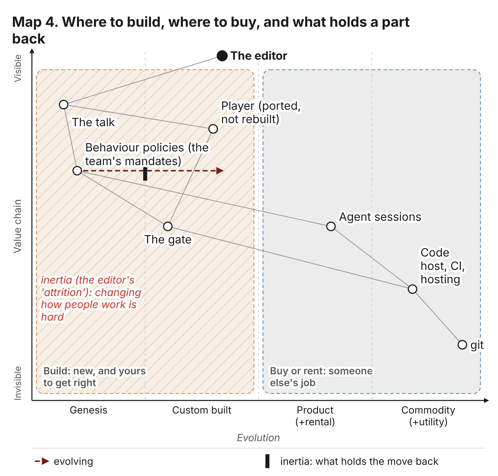
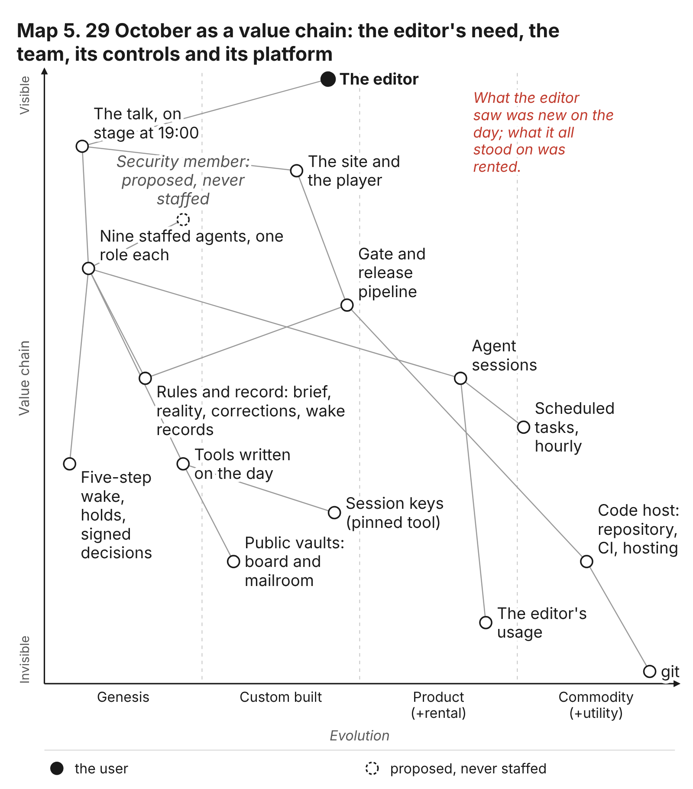

# How to read a map

This book draws its argument as maps. Before the story starts, this short chapter teaches how to read one, from nothing, in four steps. If you have never seen a Wardley map, you need nothing else; if you have, the last two sections show how this book uses them.

The method is Simon Wardley's. He developed it to help people see the ground they are making decisions on, and he has published it openly for anyone to use. This chapter explains it in its own words and quotes him nowhere; his own writing is the place to go further. The maps in this book are not his. The book's team drew them from the talk's record, and every position on them is a reading the team made, which the editor or any reader can contest. A map says "we think it stands here", not "we measured it here".

The editor has used maps for years: a talk at the Open Security Summit on how they changed the way he thinks; map walkthroughs inside a talk on threat modelling; the strategy for SG/Send drawn as a set of maps; and, in October 2026, an article called "Why I love Wardley maps", in which he describes a map as "a graph with two axes of context" and warns that it is "a map, not a measurement" (the researcher's dossier, "Wardley maps in his work"). On the day of the talk, the storyteller drew the talk's own maps, and you will meet them later in the book. In his brief to this book's team, he asked for maps to come early and to grow from simple to complex, because the rest of the argument rests on them. That is the order here.

## Start with someone who needs something

Every map starts at the top with a user and a need. Not a product, not a system, not a team: a person who wants something done.

Think of a café. At the top is a customer who wants a cup of tea. Below the cup is what the cup needs: tea leaves, hot water, a kettle. Below the kettle is what the kettle needs: electricity, and below that a power station the customer has never thought about. Each line from one thing to the next means "needs". Read down the page and you read a chain of needs, from what the customer can see and cares about, at the top, to what they rely on without looking, at the bottom.

That chain is called the value chain, and it is the whole of the first map.

The user is the editor, the dark dot at the top. His need, on 29 October 2026, was a talk on stage in London at seven in the evening. The talk needed two things: slides, and a player to show them in front of an audience. The lines go down from the editor to the talk, and from the talk to each part.

Two things are worth noticing, because every later map keeps them.

First, height means visibility. The editor cares about the talk and sees it every minute; he cares about the slides and sees them when he rehearses; he barely thinks about the player until it fails. The higher a part sits, the more the user sees it and cares about it. The lower it sits, the more the user relies on it without looking. This is not a ranking of importance. A part low on the map can stop everything above it, and in this book one does (chapter 1).

Second, left and right mean nothing yet. The slides sit on the left and the player on the right only so that their labels do not overlap. On this first map, a picture of who needs what is all there is. That is already useful: it tells you where to start (with the person, not the technology), and it makes you name each dependency instead of assuming it.

## Across the page: how evolved each part is

Now give the horizontal direction a meaning. Wardley's insight is that everything we use goes through the same stages as it matures, and that where a part stands in that journey changes how you should treat it. He calls the horizontal axis evolution, and it has four stages, from left to right.

**Genesis.** Something new. Nobody has made it before, or only a few people have. It is rare, uncertain and made by hand, and you cannot buy it, because nobody sells it yet. Most attempts fail. The first electric light was here.

**Custom built.** Something made for one need, by people who now understand it better. It is still made rather than bought, but the people making it know roughly what they are doing, and they can copy from the first attempts. A factory that wired its own lighting, to its own design, was here.

**Product, or rental.** Something many people sell or rent, with features to compare and prices to shop between. You choose one rather than make one. Light fittings from a catalogue are here.

**Commodity, or utility.** Something standard, cheap and taken for granted. Nobody asks how it works or who made it; they expect it to be there, and they only notice it when it is not. Electricity from the socket in the wall is here.

Put the same world on two axes and each dot now says two things at once: how much the editor sees it, and how mature it is.

Read it from the left. The talk is in genesis: it had never been given before, and it was being written that day. The slides sit just beside it, still near the left edge, because they were made from the talk itself, as data, and changed whenever the talk did. The site that held them is in custom built: made for this need, built and checked and released by the team, but from a way of building sites that the team already knew. The player is further right in custom built, because it was not invented on the day: it was copied from the talk player of ruv.sgit.ai, an earlier site in the same organisation, and adapted.

Lower down and further right sit the parts nobody on the team made. CI, the hosted service that runs the build and the checks every time something changes, is a product: rented from a provider, one of many on offer. Hosting the finished pages is close to a commodity. And git, the tool that records every change, is a commodity in every sense: standard, free, and so ordinary that nobody that day gave it a thought.

This is the step that turns a picture into a map. On map 1 the position of a dot was a convenience. On map 2 it is a claim. Say "the talk is in genesis" and you have said it is uncertain, made by hand, likely to change, and yours to get right. Say "git is a commodity" and you have said it is cheap, reliable and someone else's problem. The two claims call for opposite kinds of care.

You have met these stages already, in other words. Chapter 0 named the editor's explorer, villager and town planner. They are the people who work at each end of this axis: the explorer on the left, finding something new; the villager in the middle, making it usable by others; the town planner on the right, making it industrial. Wardley calls them pioneers, settlers and town planners, and the editor's words are his own for the same idea.

## Everything moves

A map is a still frame of something moving. Nothing stays where it is on the evolution axis. As a thing is used, copied, sold and competed over, it drifts to the right. Electric light moved from a laboratory to a socket in every wall. What is genesis now will, if it survives, be commodity one day.

Maps show this with an arrow. A dark dashed arrow from a dot points to where that part is heading, not where it is.

Three parts are moving on this map. The agent team with mandates, the thing the editor built on the day, starts in genesis: nobody had run a team quite like it, with these rules. Its arrow points into custom built, and the record says why. After the day, the team's machinery was copied, rule for rule, to the team writing this book and to a second team that read the talk's record without being told anything else about it (decision S8; chapters 11 and 12). Something that has been copied is no longer one of a kind.

The gate and release pipeline, the set of checks every change must pass before it is published, sits in custom built and moves towards product. The AI coding agents that the team ran in move towards commodity: many providers offer them, and they are becoming something you rent by the hour without thinking about which.

Movement is why a map is worth redrawing. A part that is expensive and fragile today, because it is new, will be cheap and dependable once it has moved. A good part of the reason the editor could build a team in a day is that many pieces he needed had already moved to the right, some of them through years of his own work. The chapter "What was already there" draws that history on a map of its own.

## Build, buy, and what holds a part back

Two practical lessons follow from the axis.

The first is where to build and where to buy. Things on the left are new, and nobody sells them: if you need them, you build them, and you should expect to get them wrong before you get them right. Things on the right are someone else's job: you buy or rent them, and building your own is usually a waste. A team that builds its own version of a commodity spends effort on what anyone could have rented. A team that tries to buy something still in genesis finds nothing worth buying, or buys a promise.

The second is inertia. Movement to the right is not smooth. Things get stuck, held back by habit, by cost, by the way people are used to working, by the success of whatever came before. Maps show this as a short black bar across a movement arrow: the part wants to move, and something is in the way.

The left half of this map is shaded as the place to build, and the right half as the place to buy or rent. The team built the talk, the gate and the behaviour policies (its mandates: what each member was for, written down, and later what it was allowed to write). It did not build the player from scratch; it ported one. It rented the agent sessions, the code host, the CI and the hosting, and it used git. On this map that division is not a policy anyone wrote. It falls out of where each part sits.

The behaviour policies carry the inertia bar. They are in genesis and moving: every team that adopts mandates like these pushes them a little further right. But they meet resistance at the line into custom built, and the reason is human, not technical. On the day of the talk, in his answers of 17:15 to the team, the editor gave the resistance his own word, attrition: "attrition in the Wardley maps is what prevents things from being commoditized", and among his reasons, attrition "in changing how people's work" (the talk's repository, `8fee7e3`). Changing how people work is hard. A mandate written for an agent is easy to write. Getting an organisation to expect one, read one, sign one and hold an agent to it is the slow part.

Keep the black bar in mind. Several later maps carry one, and each time it marks the place where the argument is not about technology.

## Why a map and not a list

Everything on the first four maps could be written as a list: the talk, the slides, the player, the site, the gate, the policies, the sessions, CI, hosting, git. The list would be accurate and would tell you almost nothing.

A list makes every item look the same. It does not say which items the editor sees and which he never thinks about; which are new and fragile and which are dependable; which the team should build and which it should rent; which are moving and which are stuck. Those are exactly the questions that matter when you decide where to spend your care. On a map, they are answered by where a dot sits and where its arrow points, before you read a single label.

Position and movement are the argument. When this book says that the inside of an organisation is less mature than its outside, a map shows it as two groups of dots, one further left than the other. When it says that what agents need to be held safely is still in genesis, a map shows it as dots on the left with arrows that have barely begun. A reader can disagree with a placement, and should: the point of drawing it is that the disagreement becomes specific. "I think that sits further right" is a conversation. "I think the list is wrong" is not.

The editor's own site on maps warns about the book's maps in particular. A model placing parts on the evolution axis, it says, "is generating consensus-shaped output with no underlying evidence" (the researcher's dossier, "Wardley maps in his work"). The book's maps were drawn by agents. So read every position in them as the team's claim, made from the record and open to challenge, and where a map's own note says a position is a reading, take it at its word.

## The whole day on one map

You can now read the map that frames the rest of the book.

Start at the top, with the user. The editor needs the talk on stage at 19:00, and beside it the site and the player that will show it. Below the talk is the team: nine staffed agents, one role each (C011). Next to them is a dashed, empty ring: the security member, proposed and never staffed. A map can show what is missing as well as what is there, and this one does.

Below the team, on the left, is what the team made for itself: its rules and its record (the brief, the reality file, the corrections, the wake records), the five-step wake, the holds and the editor's signed decisions, and the tools it wrote on the day. All of these sit in genesis or near it, because nobody had built them in this shape before. Further right sit the gate and release pipeline, the public vaults that held the team's board and mail, and the session keys each member made for itself, which are in custom built: made for this team, from pieces that already existed.

On the right, lower down, is what the team rented. The agent sessions it ran in are a product, and the hourly scheduled tasks that woke each member sit on the line into commodity. The code host, with its repository, CI and hosting, is close to a commodity, and git is one.

The note in the corner says what the whole map shows: what the editor saw was new on the day, and what it all stood on was rented. Read the map for a second time and look at one dot near the bottom: the editor's usage, the share of his subscription that every agent spent. It sits low, because nobody on the team watched it. It sits towards the right, because it is a rented allowance like any other. And it is the part that stopped the day, at 18:44. Chapter 1 opens on that moment. The map has already told you where to look.

## The maps still to come

From here, each later map adds one thing to what you have learned, and each is a step more complex than the last.

- **Chapter 3, A mandate you can read.** The protection stack: the roles and permissions built for human insiders are a commodity; what agents need (measured reach, a behaviour policy, a licence that can be suspended) is in genesis.
- **Chapter 5, The story before the slides.** The storyteller's first map for the talk: the outside of an organisation is mature and the inside is not, and agents are the new insider.
- **Chapter 7, Building the talk.** Spreadsheets to applications: a commodity spreadsheet swapped for a new application, many times over, each one starting its security on the left.
- **Chapter 8, The locks that never closed.** Two brakes on one map, and the line along which the stronger one stopped the other.
- **Chapter 9, The team was the insider.** The team's controls on one map, each placed by whether it was a setting or an expectation, and whether it sat inside the repository or outside it.
- **What was already there.** Two maps: the plumbing under the day (what the editor brought, what the team wrote on the day, what was rented), and the years before it, in which one piece led to the next.
- **Chapter 11, What the cold reader saw.** Two teams and one record, and the single direction in which findings were allowed to flow.
- **Chapter 12, Build your own.** Three maps: the method moving from explorer to villager in its second run, and the talk's own last two maps, on where security for agents sits today and what the next security products will be made of.

Each one is read the way this chapter taught: find the user, read down the chain, look at where each part sits, follow the arrows, and look for the black bars.

## Where this came from

- The method is Simon Wardley's, published openly under a Creative Commons licence; this chapter explains it in its own words and adapts none of his text or drawings. The maps are the book's team's own.
- The editor's brief of 30 October 2026, `briefs/2026-10-30__in-session/01-principles-maps-and-the-plumbing.md` (maps introduced early, simple to complex, rendered as images).
- The review of RC1 by the Gen ZX Founders team, `team/conductor/rc1/reviews/gen-zx-team.md`: sections 1.1 and 1.3 (readers do not know what a Wardley map is; a plain value chain first, then the evolution axis) and section 5, change 1.
- The maps and their notes: `team/conductor/rc1/maps/README.md` and maps 1 to 5 (`01-a-need-and-two-parts.json` to `05-the-day-as-a-value-chain.json`), drawn by `team/conductor/rc1/tools/wardley.py`; the placements of maps 6 to 16 in `team/conductor/rc1/maps/placements.json`.
- The researcher's dossier, `team/conductor/rc1/research/the-two-and-a-half-years.md`, section 3, "Wardley maps in his work": the editor's description of a map, the talks and articles where he has used them, and the warning from his map site, wardley-maps.sgit.ai, on placements made by a model. Its sources are his own articles, in particular "Why I love Wardley maps" (newsroom.sgit.ai, 12 October 2026).
- The talk's repository at `298be4e`: the editor's answers of 17:15, `team/conductor/briefs/2026-10-29__editor/6-answers-1715.md` (commit `8fee7e3`, 17:16:47), section 5, "Attrition, on the Wardley maps"; the player's origin in ruv.sgit.ai (chapter 7).
- `book.json`: decision S8 (the talk team's machinery ported to every team).
- Register: C011.
- Images: `team/conductor/rc1/resources/images/maps/01-a-need-and-two-parts.png` to `05-the-day-as-a-value-chain.png`, rendered from the JSON sources by `team/conductor/rc1/tools/wardley_png.js`.
