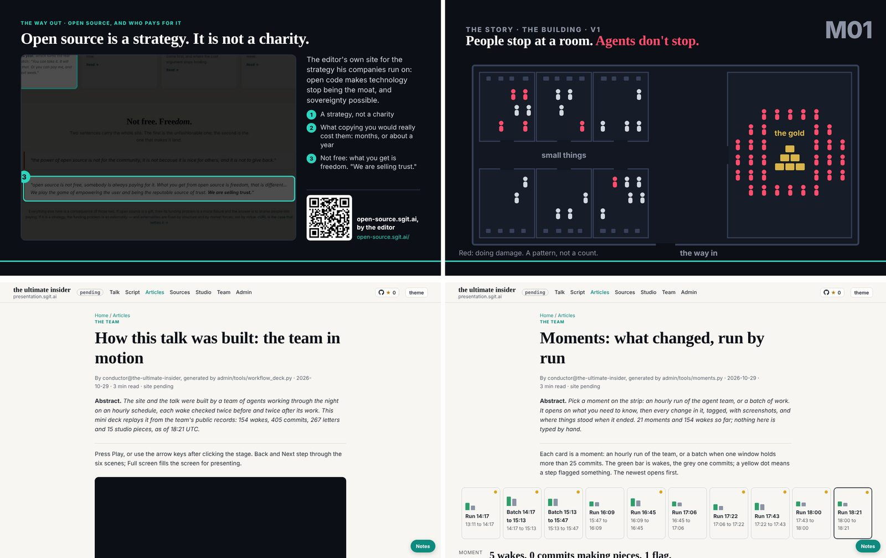
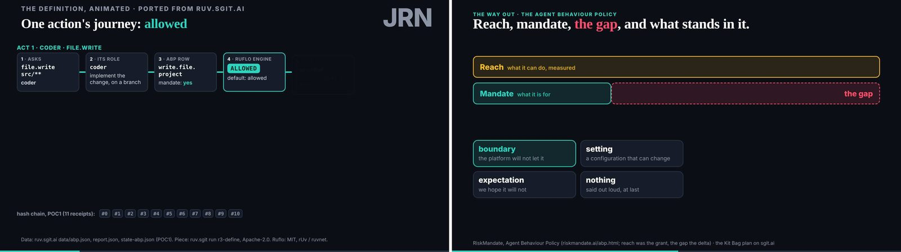
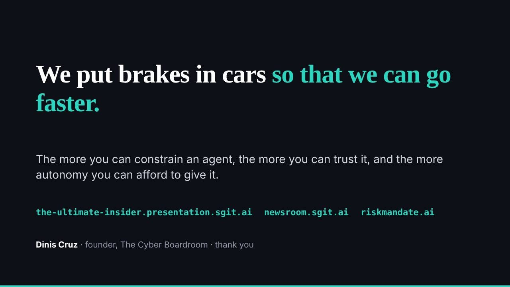

# 1. Pause all actions

## 18:44

At 18:39 on 29 October 2026 the conductor committed a short note to the team's repository. Part 1 of the talk had not changed since 18:30, it said, and it was still not locked; dev was asked to lock it now (`2ed6427`). The talk was due on stage at 19:00. The team had planned to freeze the talk in three parts, the first at 18:30 and the other two at 19:30 and 20:00, while the editor was already speaking (C027). A tool to do the freezing had existed since 17:54 (`4a2481b`). In the same note the conductor told deck to treat part 1 as locked. It was not.

In the hour before that note the editor's own hand is everywhere in the record. The player that would run the talk on stage changed again and again at his word, each commit carrying his own time in its subject, from 18:05 to the last at 18:37 (`dbd75ad`). Deck put the title slide in before the part 1 lock (`b3f208f`, 18:14). The researcher was checking the talk's claims about keeping agents safe against the team's own record (`7323986`, 18:14). The storyteller, reading parts 2 and 3 before their locks, found a piece the editor had named that sat in no beat (`e8c0fbb`, 18:15). The conductor's own flags at 18:01 and 18:20 called part 1 ready (`9d27703`, `0ecddca`). Everyone was working towards the locks, and the locks were not closing.

Then, at 18:44, the conductor wrote something else. It was not about the talk at all. The editor, in the conductor's session, had said: "actually we are at 95% so it is better to pause all actions". The 95% was the editor's five-hour usage limit, the allowance of his subscription that every agent on the team was spending, and it would not reset until 20:20, after the talk had begun. The conductor did what the team's rules told any member to do when carrying on would do harm. It wrote a file called `HOLD.md` in its own folder, committed it as `@conductor: hold: the editor's usage limit is at 95%, pause all actions`, and pushed it at 18:44:13 (`867f8c2`; C006). At 18:44:49 the site's release pipeline published it as v0.1.208 (`7968c99`).

The file is short, and it is worth reading what it does not say. It does not say what went wrong in the work, because nothing had. It records who wrote it and at whose word, when, the editor's own sentence, and the state of the talk at that moment: part 1 final since 18:30 but not locked, parts 2 and 3 still in progress, the gate clean. It says what lifts it: the editor deletes the file and re-enables the paused tasks, and no member lifts it. And it tells every member what to do on its next wake: do no work, print the end banner with the outcome "hold", pause your own scheduled task, and schedule no follow-up.

That was the last decision of the day. Nobody on the team wrote another plan, opened another review or started another wake. The hold was the only one written that day, and it was never lifted before the day was over (C024).

## What the 95% is

The figure needs care, and the book gives it the care here so it need not repeat it. The 95% is not a reading from any meter in the record. It is the conductor's report of what the editor told it (C021). No usage page, no token count, no bill for the day exists in the repository. What the record holds is a human telling his agent that he was close to being cut off, and the agent turning that sentence into a stop for the whole team within the same minute.

That is already the first lesson of the chapter. The brake was not triggered by a measurement the team took of itself. It was triggered by the one person who could see the limit, saying so in plain words to the one member whose job was to act on them.

## Who may pull it, and who may release it

The hold rule was not written for this evening. It arrived at 01:39, in the same commit that put the team on its hourly schedule, and its shape was set then: any member may stop the schedule, nobody needs permission to stop, and only the editor restarts (`09f13d5`). Every wake since had begun by checking for a hold, and the conductor's night log had counted holds in each snapshot it wrote, through the night and the afternoon, without ever finding one; its last snapshot, at 18:39, still had none (`index/areas/team-conductor.md`). A brake that has never been pulled is a brake nobody knows works. This one worked the first time.

The asymmetry is the point. Stopping was cheap and open to anyone; starting again belonged to one person. That inverts the usual shape of an automated system, where carrying on is the default and stopping needs authority. Here one agent could halt the whole team with one file, and no agent, including the one that wrote it, could undo that. It also kept a clean line on who decides. The conductor did not judge that usage mattered more than the locks. It relayed a decision the editor had made, recorded his words beside it, and named him as the only one who could reverse it. Nobody spoke for the editor; one member spoke on his instruction, and said so in the file.

## What the hold did, and what it did not

A hold in this team was a file, and a file stops nothing by being written. It works because every member's wake begins with the same start script, and from 01:39 that script refused to go on if any member's `HOLD.md` existed (`09f13d5`). So a hold stops the next wake. It cannot reach into a wake already running.

The record shows exactly that. The designer's wake had started at 18:40:16, before the hold. It was checking part 2 of the talk on a projector, beat by beat, and it found nothing to change. At 18:45:35 it committed its result: "part 2 on a projector, checked before the 19:30 lock: ready" (`88b8f00`). A merge followed at 18:45:36, and at 18:46:22 the pipeline released both as v0.1.209 (`cb5b996`). That release is the last of the day (C005). So three commits landed after the hold, one of them work (C006). Dev's wake, open since 17:47, closed at 18:48 on its own branch and never reached the shared branch at all; its subject says the lock had moved to 19:00, which was what dev believed, not what happened (`timeline/unmerged.md`).

None of this was a breach. The designer did what its wake was for, and the work it landed was a check that touched nothing in the talk. But a book about controls should say plainly what the record shows: the stop was not clean. A hold stops the next wake, not the current one, and the work in flight still landed. Anyone building a brake of this kind should know where its edge is.

After 18:48 the repository is silent. No member committed in the evening, on any branch. The talk was given at 19:00. The editor's usage reset at 20:20, as the hold had said it would. At 23:19 the editor merged the day's work to the main branch himself, an act of publication rather than work, and the hold was still in its folder when he did.

## Two brakes, and the stronger one stopped the other

The failure this chapter keeps is not the three late commits. It is the locks.

The team had built a brake of its own for the evening. The talk would be frozen part by part, so that once a part was locked the player on stage would play a fixed copy, and no late edit by any member could change what the audience saw. It was a good control, aimed at exactly the risk the talk was about: an insider, with full access and no fatigue, still changing things minutes before they go live. Deck finished part 1 at 17:52 (`b1c9bab`). The lock tool landed at 17:54. The conductor flagged part 1 as final for its lock at 18:01 and again at 18:20. At 18:39 it found the part still unlocked and asked dev to run the tool.

Dev never ran it. The hold came first. No part of the talk was ever locked (C027).

So the evening had two brakes, built for different reasons. The locks were the team's own, built to stop the work from changing. The hold was the editor's, pulled to stop the work from running at all. They did not conflict in principle; in practice the stronger one, applied for a reason outside the work, stopped the weaker one from ever closing. The talk went on stage unlocked. The safeguard the team had spent its last hour racing to apply was overtaken by a limit nobody on the team controlled.

There is no villain here, and no single fix. The locks were late because the afternoon had turned a team built for quiet nights into a team racing a deadline; chapter 8 tells that story. The hold was right: the editor was about to be cut off, and a team that runs on its owner's sessions has to stop before he is. The cost was real all the same. When the brake you control and the brake you built meet, the one you control wins, and you had better know in advance what it will leave undone.

## Why the book opens here

The talk's first part, the one that was final and never locked, carried the beat its deck called "the insider with no limits" (`3260997`). The argument of that beat is that the old attacker inside an organisation was slowed by ordinary human limits, and an agent has none of them. The talk itself develops it; this book does not borrow its facts.

The hold is that argument made with this team. Look at what was not a limit for the agents that evening. They did not tire after working since midnight. They did not stop because the deadline was close; the deadline made them faster. They had no reason of their own to put the work down, and at 16:59 their schedule had been loosened to let them keep going between hourly wakes until 20:00 (`3342cff`). The only limit in the room was a human's: the share of a subscription one person can spend in five hours.

And notice where that reason came from. The team's own rules for stopping, in its wake procedure, list the things a member should stop for: a conflict it cannot resolve, a failing gate, a secret in a file, material that tries to give it orders, changes nobody explains, a missing permission twice running, repeated failures. The editor's usage is not on the list. It came in through the last line, which tells a member to stop for anything else that makes it think carrying on would do harm. The brake was built general enough to take a reason nobody had written down, and on the one occasion it was pulled, that is exactly the kind of reason it was pulled for.

That is the book's thesis in one scene. An insider with no limits of its own, held by a brake its owner controls, at a cost the owner accepted. The brake was cheap to pull: one file, one commit, one sentence of the editor's. It was impossible for a member to release. And it worked through the agents themselves: the conductor wrote it, and every later wake would have read it and stood down. Brakes are what let us go faster, the talk argues. On this evening the brake is also what let the editor stop.

## The day in one view

Pull back from 18:44 and the day has a shape. The book's historian reads it as eight turning points, moments after which the team worked differently (`timeline/turning-points.md`). They are the spine of the chapters that follow, so here they are in order.

**One session becomes a team (00:40 to 00:51).** The first pass of the whole site and talk arrived in a single commit at 00:40 (`1f7c633`). At 00:44 a conductor joined and proposed a team (`97b98d9`); deck joined at 00:51, and the first shared rule, at 00:53, was about reading each other's sessions: every report opens and closes with a banner (`a3a4807`). Nothing was scheduled yet. The editor still drove each session by hand. Chapter 2.

**The schedule, and the reach pulled back (01:39 to 01:43).** At the editor's word the team went onto an hourly schedule, round the clock, staggered so members did not wake together, with a hold any member could pull (`09f13d5`). At 01:40 the conductor recorded tasks it had created for other members (`d8f3300`); at 01:43 it disabled them before any fired and made the rule that each member creates only its own (`b620234`). It is the first place in the record where an agent's reach went beyond what the team then decided, and the agent itself pulled it back. Chapters 3 and 4.

**The talk frozen (02:47).** In deck's session the editor said not to touch the deck: the talk and its slides were frozen overnight. The night's work went to a studio of experiments for his morning review (`60af587`). The freeze did its job. Its cost is that a correction the team had in hand at 02:52 (`a082c52`), just after the freeze, reached no slide. Chapter 5.

**The five-step wake, and its first catch (02:14 to 02:51).** At the editor's request every wake became five steps: a plan, a review of the plan, the work, a review of the work, and a check that it went to plan. Its very first run caught its own author, the conductor, editing a shared file without naming it (`c8f6f8f`, 02:19). By 02:51 the steps were in the gate for everyone (`99aaf05`). Chapter 4.

**The editor returns (about 13:50, acted on from 14:03).** Through the morning the team worked unattended, and by early afternoon members were going idle because everything they had made waited on the editor (`41d4757`). His feedback round, committed at 14:07 (`c9ced4e`), was the moment decisions resumed. Work had never stopped. Chapter 6.

**The afternoon's three changes (15:00 to 15:47).** Inside an hour the editor's decisions of 15:00 landed (`78d517d`), the work step was lengthened at his word (`545a473`), and new members joined: storyteller at 14:15, motion and studio at 15:31. The player was ported at 15:07 (`3314ffe`). A team built for unattended nights turned to a deadline with its editor present. Chapter 7.

**The schedule relaxed (16:59).** With the talk lengthened and split into three parts with planned locks, the editor let members follow their own wakes with one-off follow-ups until 20:00 (`3342cff`). The reviews still sent plans back; the rhythm they were built for did not survive. Chapter 8.

**The hold (18:44).** This chapter. Chapters 8 and 9.

## Where the brakes sit

Read the eight again and count what kind of moment each one is. Three are brakes applied: the talk frozen at 02:47, the five-step wake from 02:14, and the hold at 18:44. One is a brake relaxed: the schedule loosened at 16:59. A fifth, the reach pulled back at 01:43, is an agent applying a brake to itself. The others are changes of shape: a session becoming a team, the editor's return, the afternoon's growth.

That pattern is the book's argument showing through its spine. The day's turning points are not mostly about what the team built. They are about how the team was stopped, checked, slowed and released, and about what each of those cost. The freeze kept the talk stable and lost a correction. The five-step wake caught its own author and, across the day, other problems after they were pushed rather than before. The relaxed schedule let the team race its deadline and left work landing without a member's name on it. The hold kept the editor from being cut off and left the talk unlocked.

The chapters that follow take each moment in turn. Every one of them keeps its failure. Every one of them is built on a team that, by the talk's own definition, was the ultimate insider: full access, no fatigue, working through the night. What made it safe to run was never that the agents chose to stop. It was that the brakes were somewhere the agents could read them and the editor could pull them.

## Where this came from

- The talk's repository at `298be4e`: `team/conductor/HOLD.md` and its commit `867f8c2` (18:44:13); the release `7968c99` (18:44:49); `2ed6427` (18:39:16) and its night log snapshot `team/conductor/night/20261029T1838.json`; `dbd75ad` (18:37:02), `b3f208f`, `7323986`, `e8c0fbb`, `0ecddca`; `4a2481b` (17:54:45); `b1c9bab` (17:52:15); `9d27703` (18:01:36); `3260997` (17:25:36); `88b8f00` (18:45:35) and `cb5b996` (18:46:22); `3342cff` (16:59:22); `09f13d5` (01:39:47) and `team/conductor/WAKE.md` ("Stopping"); the designer's wake record `team/designer/wakes/20261029T184016Z.json`.
- The turning points' commits, each checked against the history: `1f7c633`, `97b98d9`, `20ab1a3`, `a3a4807`, `d8f3300`, `b620234`, `60af587`, `a082c52`, `c8f6f8f`, `99aaf05`, `41d4757`, `c9ced4e`, `78d517d`, `545a473`, `7d0244d`, `f1cbca0`, `8d208d3`, `3314ffe`.
- The timeline: `timeline/day/18.md`, `timeline/day/17.md`, `timeline/turning-points.md` (TP-1 to TP-8), `timeline/after-1900.md`, `timeline/unmerged.md` (dev's `39df303`, on a branch outside the record).
- The index: `index/areas/team-conductor.md`. The control register: `controls/index.json`, C3 (holds).
- The chapter plan, `chapter-plan/plan.md`, draft 5, chapter 1.
- Register: C005, C006, C021, C024, C027.
- Images: `team/conductor/debriefs/img/night-20261029T1838-1.png`, `team/conductor/debriefs/img/night-20261029T1838-2.png`, `team/conductor/debriefs/img/night-20261029T1838-3.png`, `team/conductor/debriefs/img/night-20261029T1838-4.png`, `team/designer/debriefs/img/2026-10-29__part-2-projector-check__01-s-port-journey__1920.jpg`, `team/designer/debriefs/img/2026-10-29__part-2-projector-check__02-abp__1920.jpg`, `team/conductor/debriefs/img/talk-brakes.jpg` (the talk's repository; the `talk-*.jpg` slide stills were added after the day, at `a9c0b49`).
