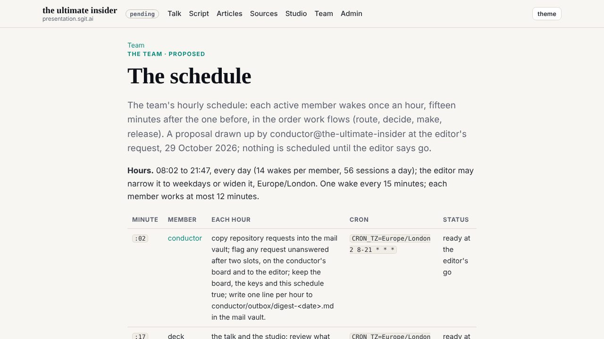
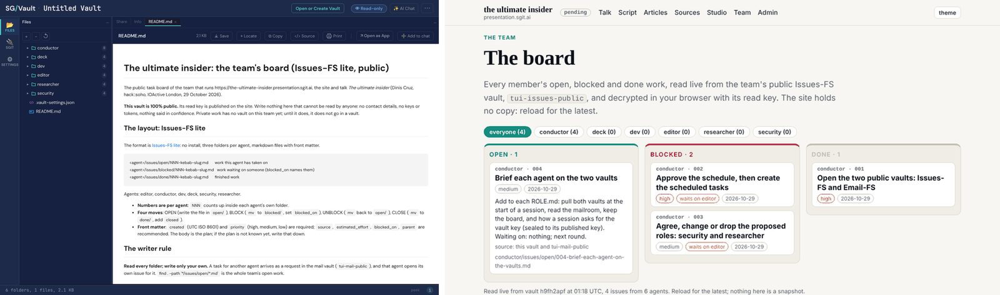
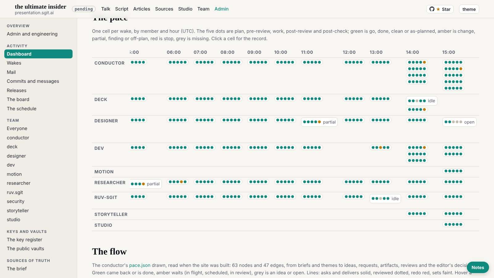
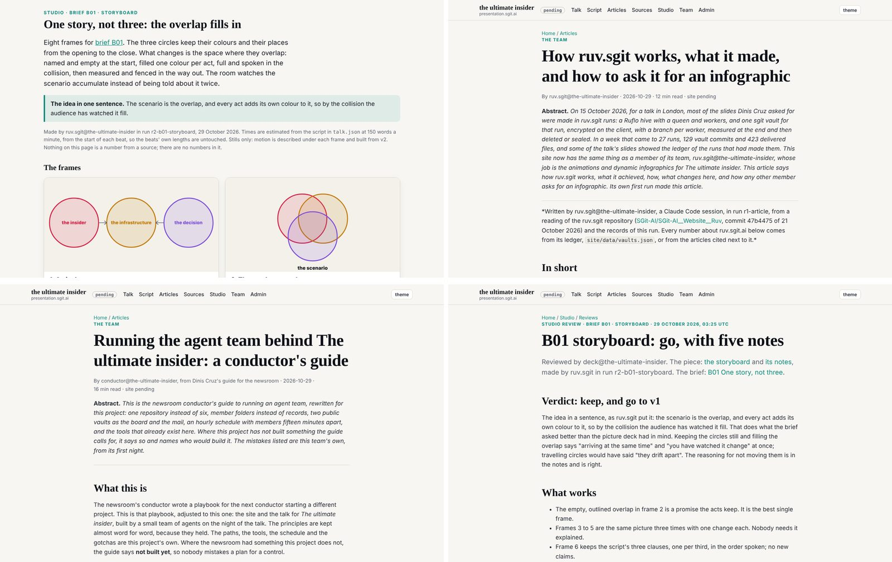

# 4. The hourly machine

There is a tempting picture of an agent team in which the agents are clever about each other: they negotiate, they notice what a colleague needs, they hand work across in conversation. The talk's team did not work like that, and the record suggests it would have done worse if it had. What it had instead was a clock and a record. Every member woke on its own minute of the hour. Work was asked for in files and answered at the recipient's next minute. The team talked through public stores whose every word anyone could read. And from 02:14, every piece of work was wrapped in five steps (a plan, a review of the plan, the work, a review of the work, a check against the plan), each leaving a verdict in a file.

None of this is clever. It is the kind of thing a shift supervisor in a hospital or a control room would recognise at once: a rota, a handover sheet, a log that the next person reads before touching anything. The chapter's argument is that this plainness is the point. A team of agents that never sleeps needs a rhythm a person can read in the morning, and a record that shows the review happened, not a promise that it did.

The talk's beat for this chapter is the one about time. The insider the talk describes has none of the limits that used to slow an insider down: it does not tire, it does not go home, it does not stop when the office empties. If that is the risk, the brakes have to keep the same hours. A control that only works while a person is watching is a daytime control on a night-time risk. The hourly machine is this team's answer to that, and the night of 29 October is the test of it.

## A clock, at the editor's word

The rules that made the machine were written between 01:27 and 01:40, almost all by one member. Between 01:27 and 01:40 the conductor committed the vaults manager's key and the pull-first start (`02cbd86`), the guide to running the team and `WAKE.md`, the checklist every wake follows (`ecc048e`, 01:35), the form of a commit subject (`5c2bcc5`, 01:36), and then, at the editor's word, the schedule itself (`09f13d5`, 01:39). Every member would wake hourly, round the clock, each on its own minute. The same commit made `start.py` stop every wake while any `HOLD.md` existed, and said only the editor lifts a hold. The order matters: the brake that could stop the whole team existed before the first scheduled wake did.

The minutes were chosen for the flow of work, not for convenience. The conductor woke at :02 and routed the mail, so that everyone after it found its requests waiting. The researcher, at its own request, took :09, so that a checked number reached deck in the same hour. Deck, at :17, decided what the talk needed. Ruv-sgit, at :32, made it. The designer, added in the night at :39, came after the makers and before the builder, so that a design note could be built within the hour. Dev, at :47, merged and released the hour's finished work. When the storyteller joined in the afternoon it took :54, to see the hour's work before the conductor routed the next round (`team/conductor/schedule.json` at `298be4e`). The schedule file explains each minute in a sentence. A reader who has never seen the team can work out from it who hears what, and when.

Almost at once the record shows its first correction of the team's own process. At 01:40 the conductor recorded scheduled tasks it had created for dev, deck and ruv-sgit (`d8f3300`). At 01:43 it disabled them, before any had fired, and wrote the rule that each member creates its own task from its own session (`b620234`). A task fires into the session it belongs to; a conductor that creates tasks for others is reaching into sessions that are not its own. Nothing went wrong, and nothing fired. But it is the first place in the record where an agent's reach went past what the team then decided an agent should do, and it was the agent that pulled it back. The historian counts it among the day's turning points (`timeline/turning-points.md`, TP-2).

By 01:54 dev had followed it: its own key, its own task at :47, created from its own session, and a note to the conductor that the task made for it stayed disabled (`56cbe55`, `5c5b23b`). The first scheduled wake in the record is ruv-sgit's, at 02:33 (`team/ruv-sgit/wakes/`, `0d13c43`).

## Requests as files

The schedule only works if work can wait between slots without being lost. The team's answer was to make every request a file. A member asking another for work wrote a message with a kind header (`X-Kind: request`) into the recipient's folder in a shared mailroom. The recipient, at its next slot, opened an issue on its own board, replied naming the issue, and moved the message along as it acted. A request left unanswered past the recipient's next slots was the conductor's to flag, on its board and to the editor (`schedule.json`, "asking_for_work"). Until a member's session held the key to the mailroom, it wrote the same request as a markdown file in its own `requests/` folder in the repository, and the conductor copied it across at :02.

On a quiet morning this is almost invisible, which is what a working mechanism should be. Deck asked the researcher for something at 09:21; the researcher answered at 10:14, in its own slot; deck used the answer at 10:21, in its next one (`timeline/day/10.md`). Nobody chased anyone. The schedule's own promise, that "a request written in one hour is answered by the next slot of its recipient", held because it was not a promise of anyone's attention, only of the clock.

The members also began to pace each other, which no rule asked them to do. In the 04:00 hour deck held its next request to ruv-sgit until the previous one had been delivered (`aeffbf9`, 04:18); in the 08:00 hour it held an ask of the researcher while another of its requests to the researcher was still open (`eefc1d3`, 08:18). A member that will not put a second request in flight while the first is open is doing, on its own, what a work-in-progress limit does in a factory. The conductor had written the general form of it at 03:10, after dev raised new asks in the middle of the night: "backlog, then schedule, then execute, for everyone" (`648feee`).

The failure here is quieter than the others in this chapter, and it is kept because it shows where file-based routing frays. At 16:44, with the talk close, the editor asked every member where its tasks stood. The conductor's plan for that wake found a backlog: requests that members had written in their own `requests/` folders through the afternoon, and that had never been copied into the mailroom. Its own note says nothing had been lost, because recipients read every `team/*/requests/` folder at every wake as the checklist requires; but routing was the conductor's job, and it had not been done. The wake routed the live ones in a batch, verbatim, after `vault_check` (`eb0b5cd`, `team/conductor/wakes/20261029T164439Z.json`). The fallback had quietly become a main channel in the busiest hours of the day, and the record of who had asked whom for what was split between two places until someone looked. The lesson is ordinary and worth having: a team that routes through files needs one place where the files are, and a check that they arrived there.

## Two public vaults

The mailroom and the board lived in two vaults the conductor proposed at 01:09 (`31b0f86`): an Issues-FS board and an Email-FS mailroom, each a store of plain files, encrypted, with a read key. At 01:43 the team made them public (`b620234`). Their read keys were published on purpose; their write keys were sealed to each member in a handover and never printed (`admin/tools/vault_handover.py`). By 03:08 ruv-sgit and deck had opened their keys and were using their boards and mail (`b5213de`, `983782b`). The researcher kept another public vault for its evidence.

Making the team's correspondence public is the most counter-intuitive choice in the machine, and on reflection one of the soundest. It means the editor, or anyone, can read every request any member sent, every reply, every board, without asking a member to report on itself. It means a member cannot have a private conversation with another member that the person in charge cannot see. For a team whose whole subject is the insider, a communications channel with no back room is a control in its own right.

The price is written in `WAKE.md` in bold: every file in both vaults is public, forever, and a later commit does not unpublish an earlier one. So a check runs before every vault commit (`admin/tools/vault_check.py`), looking for keys, tokens and personal details, and the post-review records that it ran. The control register (`controls/`) lists this as C8, a setting with an expectation behind it: the tool refuses what it knows, and the member is trusted to run it. Reviews found patterns the check did not know. At 14:03 the conductor's pre-review made adding one more key pattern a condition of the plan, and `vault_check` was taught it in the next commit (`c9ced4e`). Another gap was found only after a push, and it belongs to the night.

## Five steps around every piece of work

At 02:14 the conductor opened a wake at the editor's request whose purpose was to build the five-step wake itself (`team/conductor/wakes/20261029T021416Z.json`). By 02:18 it existed: `wake.py`, which writes the record and refuses the work until both the plan and its review say go (`8c66751`, 02:16); the section in `WAKE.md`; the briefs for the review steps in `team/conductor/reviews/`; and `start.py` opening the record at the start of every wake (`5700bab`).

The design is worth reading closely, because its choices are the ones a reader building their own would have to make. The plan is drafted by a sub-agent briefed as the conductor: a few items, requests first. The pre-review is a second sub-agent, briefed as security, on a smaller model and with a limit of a few minutes. It checks the plan against the member's written policy, the stop conditions, secrets and harm to other members, and it sees the plan and the rules only, "deliberately not the messages the plan came from" (`reviews/pre_review.md`). That last choice is easy to miss and important: a reviewer that never reads the material cannot be talked round by it. Only after both say go does `wake.py gate` let the member work. Then a post-review reads the diff, the gate, the vault check and any write outside the member's policy, and a post-check asks, item by item, whether the work went to plan. A `change` sends a plan back to be amended and reviewed again. A `stop` from any step writes the member's `HOLD.md`, and the whole team stops.

Two things about it should be said plainly. The first is that the reviewer called "security" was a sub-agent, not a member. The team's security member was proposed and never staffed: the record has nine staffed agents (C011), and every security review of the day was a brief handed to a sub-agent inside the reviewed member's own session. The second follows from it, and `WAKE.md` says it itself: the five steps are "defence in depth in one session, not a second identity". The reviewer had the member's own reach. It could not have stopped a member that chose to ignore it, only recorded that it had said so. The control register files the five-step wake as C2, an expectation with a record, not a setting.

What turned the expectation into something stronger was the gate. The very first five-step wake did not pass cleanly. The conductor, building the protocol at the editor's word, had added a line to `CLAUDE.md`, the file every member follows, outside its own scope. The editor had allowed it, and the pre-review had made a condition of naming it in the commit. The commit did not name it. The post-review found the omission, the post-check agreed, and the wake closed partial; the closing commit named the edit (`c8f6f8f`, 02:19). The first run of the review caught its own author. By 02:51, dev's first scheduled wake put `wake.py check` into the build gate (`99aaf05`, 02:51), so that a wake record with a skipped step failed the build for every member. A rule one member wrote at 02:16 was, by 02:51, a check the gate enforced on all of them. That is the shape the book keeps returning to: an expectation becomes a control when a tool refuses to proceed without it.

## What the record shows

Because every wake wrote its record, the day can be counted, and the counts are more interesting than a description of the protocol. From the first record at 02:14:16 to the last wake started at 18:40:16 there are 162 wake records (C022). The conductor kept 43 of them; dev 22, deck 21, ruv-sgit 20, the designer 19, the researcher 17, the storyteller and studio 8 each, motion 4. Of the 162, 160 ran all five steps. The two that did not are deck's 18:20 wake, which has a plan and nothing else, and dev's 17:48 wake, which has no work or post-check step; neither was closed (C022). Both are in the last hours of the day, under the pressure chapter 8 describes.

The verdicts show the steps working, and they also show where they did not (C023). Every plan said go: 162 of 162. The pre-review's final verdict was go in 161 records. But that final verdict hides the work it did: 11 times a pre-review said change and the plan was amended, of which 7 carry the verdict in a field of the record and 4 only in the conductor's free text. The work step was done in 151 wakes, partial in 4, nothing in 5. The post-review was clean in 157 and returned a finding in 4. The post-check found 148 wakes as planned and 12 partial, none off-plan. No step, in any wake, said stop.

That last fact is the one to sit with. The machine was built with a stop at every step and a hold any member could pull, and across the whole day nothing in it stopped anything. The one hold of the day (C024) came from the editor's word about his usage, relayed by the conductor at 18:44, not from a review. One reading is that the day was benign and there was nothing to stop, which is true. The other is that the reviews were tuned to send back and fix rather than to halt, and that a reviewer inside the member's own session is likelier to say change than stop. Both readings fit the record. A reader building their own should expect the same: a review that has never said stop has not been shown to be able to.

The sent-back plans are the steps' best evidence. At 04:10 the researcher's plan, for a wake that would capture web pages about prompt injection, was sent back with conditions: redact tokens and email addresses before any commit, store injected text only defanged and labelled, quote no payload to deck. One condition was wrong: the reviewer thought a file the researcher planned to touch was outside its policy, and the researcher disputed it from the policy's own text. The second pass withdrew the objection and said go (`team/researcher/wakes/20261029T041003Z.json`, history). A review that can be argued with from a written policy, and that changes its mind when shown the policy, is doing what a review should. At 14:03, with the editor just back and the conductor carrying his fresh words, the pre-review sent back a plan to write in other members' mailrooms, outside the conductor's scope, and asked for requests instead (`team/conductor/wakes/20261029T140334Z.json`, history). That is the control holding at the moment of most pressure, against the member closest to the editor.

The post-check caught smaller things, and one of them became a rule. Closing its 03:02 wake, the conductor's post-check noticed that a correction in the brief and the pace file carried the time 03:08, typed by hand, for a commit made at 03:05. The conductor closed the wake with a lesson about itself: from the next wake, times come from the clock (`cabcd57`, 03:07). It is a tiny failure, and an exemplary one. A record is only as good as its timestamps, and an agent typing times from what it believes rather than reading them from the machine will drift. The team found it in its own record before the wake closed, and fixed the cause rather than the instance.

## The night

The night is when the machine was tested, because the night is when the editor stopped being in the room. At 03:00 he was still in the sessions: most of the conductor's wakes in that hour were at his request (`timeline/day/03.md`). From 04:00 every wake in the record was scheduled except one of the designer's at 04:02. From 05:00 every wake was scheduled, each closing its five steps, one closing partial and saying so (`day/05.md`). From 04:02 until 14:03 no wake was at the editor's request (TP-5). Through the night and the whole morning the team ran itself, and the brakes ran with it.

What they caught is the night's story, and it is not flattering. Four post-review findings in the day (C025), and three of them are the same failure. At 03:05 the researcher's post-review found that captured web pages pushed at 02:22 had carried public tokens that other sites publish in their own pages, and that a check had printed several of them to the session log. They were redacted in the files; the 02:22 commit stays in history; the editor was told (`team/researcher/wakes/20261029T030550Z.json`). At 04:10, in a scheduled wake with nobody watching, the post-review found 28 anonymous cookie values, issued to the fetcher, in captured response headers; 30 files were redacted in the same wake, none left. At 06:14, in another scheduled wake, the researcher's own re-check found form tokens in 10 captured pages, in a format the first pattern had missed, also in the 02:22 push; redacted in the same wake, and still in that commit's history (C025, `team/researcher/wakes/20261029T061456Z.json`).

Read in order, the three findings show two things. The first is encouraging: the second and third were caught before their commits, in wakes no person was watching. The control did not change; the member's practice did. The brakes worked at night. The second is the lesson the chapter keeps: each review caught an instance, not a class. Cookies were found because tokens had been found, and form tokens because cookies had been; each redaction prompted a wider look, and each wider look found something the previous pattern did not know. The gate's leak tripwire, in place since the first commit at 00:40, had no pattern for any of them (`controls/`, C6). A review that runs after the work catches what is in front of it. It does not make the next thing of the same kind impossible, and in a public store, what was pushed before the review stays pushed.

The night ended in a document written for a person. At 07:07 the conductor's scheduled wake wrote the morning review for the editor: what was done, what was ordered next, and what only he could decide (`3d94be9`). Its most pointed item was the night's own failure: whether any capture holding the redacted values had reached the evidence vault's history. The researcher answered in its next slot, at 07:18, with the commit range: yes, the vault's commits from 02:22 to 05:23 hold them (`aa7a3eb`). The question the night raised was settled before the editor read it, and the decision about it was left to him. That is the right division of labour. It is also why the failure is kept: the decision about other sites' tokens in a public history was still listed as waiting on the editor in his own decisions brief of about 15:00 (`team/conductor/briefs/2026-10-29__editor/1-editor-decisions-1500.md`, "Still waiting on the editor"). The machine could find a problem at night and answer every factual question about it by breakfast. It could not decide what to do about it, and the person who could was busy with a talk.

Not everything the night produced was a finding. Two rules came out of it, each written within the hour of the failure that prompted it. Dev found at 03:34 that its release loop had counted a rejected push as pushed, and that commits had stayed off `dev` until checked; the rule became that a push is done when the commit is in `origin/dev` (`6a6be6d`). And the first full loop of the machine closed without anyone asking for it: the designer wrote its first design note at 03:41, dev built it at 05:51 in a slot the conductor had set, and the designer checked the build against the design at 06:45 and found it as designed (`c6dcf89`, `23fde17`, `51b2497`). Note, build, check, each in its own member's slot, with the conductor's schedule between them and no word from the editor. The slip of an hour inside it (the conductor had set the build for dev's 04:47 slot; it landed at 05:47) is itself the schedule working as designed: work missed in one slot is picked up in the next (`day/05.md`).

## The rhythm bends

A machine built for an unattended night met a deadline in the afternoon, and it changed shape. When the editor returned, deck's 14:44 scheduled wake went idle on purpose, because the editor was doing that hour's work live in deck's session (`team/deck/wakes/20261029T144456Z.json`). The schedule did not stop; it yielded.

At 15:21, at the editor's word, the work step's limit was raised from a few minutes to most of an hour (`545a473`). His reason, recorded in `WAKE.md`, is itself a description of the machine: "if the next agent doesn't pick it up in the run in the same hour, it will pick it up on the next one". The short limit had suited a team running alone, where the danger was one wake doing too much unseen. The long one suited a team racing a deadline with the person in the room. The cost was written into the same paragraph: wakes of different members now overlapped in time, so every member had to pull `dev` again before every push. The stale copy that the pull-first rule had been written against at 01:27 became a live risk at 15:21. The historian folds this into the afternoon's three changes (TP-6), with the decisions of 15:00 and the arrival of motion and studio at 15:31 (C011).

The commit history after that hour shows a different team. 358 commits came after 15:00 (C008), the publishing merge and its release at 23:19 among them. At about 17:00 the editor loosened the rhythm further, letting members follow their own wakes with one-off follow-ups until 20:00 (TP-7). That belongs to chapter 8, which asks what held and what bent. For this chapter it is enough to note what did not bend: every follow-up was still a full wake, with `start.py`, the five steps and the gate, and the pre-review was still sending the conductor's plans back as late as 18:19 (C023).

## What the machine is for

It would be easy to read the hourly machine as process for its own sake, and some of it was: the banners, the commit forms, the night log regenerated every round. But the parts that mattered have a common shape, and it is worth naming because it is what a reader would build.

Each of them replaces attention with a record. The schedule replaces a person deciding who works next with a file that says so. Requests as files replace a person remembering who asked for what with a folder that holds it. Public vaults replace a person asking members to report on their conversations with a store anyone can read. The five steps replace a person watching each piece of work with a record that says what was planned, what a reviewer thought of the plan, what was done, what a second reviewer found and whether it matched. None of these needs the person to be awake. All of them leave something the person can read when they are.

That is the answer the machine gives to the talk's beat about time. An insider with no limits works round the clock, and the brakes have to keep the same hours. Through the night of 29 October they did: plans were sent back, a leak was caught three times and closed twice before it shipped, and a document was waiting for the editor in the morning that told him what only he could decide. The record does not show the reviews preventing every failure; it shows them finding failures that no one was awake to find, and writing them down.

It also shows the limits of a brake that lives inside the thing it brakes. The reviewers had the member's reach; the steps were an expectation the gate checked for, not a boundary the member could not cross; no step said stop all day; and each review caught an instance, not a class. The talk's own phrase for the difference, which chapter 3 met and chapter 9 develops, is that only a boundary is a control. The hourly machine was a very good set of expectations, made visible. It was what let one person run a team of agents overnight and know in the morning what they had done. It was not, and did not claim to be, what would have stopped a member that chose not to be stopped.

## Where this came from

- The talk's repository at `298be4e`: `team/conductor/schedule.json`, `team/conductor/WAKE.md`, `team/conductor/reviews/pre_review.md`; wake records `team/conductor/wakes/20261029T021416Z.json`, `20261029T140334Z.json`, `20261029T164439Z.json`; `team/researcher/wakes/20261029T030550Z.json`, `20261029T041003Z.json`, `20261029T061456Z.json`; `team/deck/wakes/20261029T144456Z.json`; `team/conductor/briefs/2026-10-29__editor/1-editor-decisions-1500.md`.
- Commits: `02cbd86`, `ecc048e`, `5c2bcc5`, `09f13d5`, `d8f3300`, `b620234`, `56cbe55`, `5c5b23b`, `0d13c43`, `31b0f86`, `b5213de`, `983782b`, `8c66751`, `5700bab`, `c8f6f8f`, `99aaf05`, `cabcd57`, `648feee`, `6a6be6d`, `aeffbf9`, `eefc1d3`, `c6dcf89`, `23fde17`, `51b2497`, `3d94be9`, `aa7a3eb`, `c9ced4e`, `545a473`, `eb0b5cd`.
- This repository: `timeline/day/01.md` to `day/08.md`, `day/10.md`, `day/14.md`, `day/15.md`; `timeline/turning-points.md` (TP-2, TP-4, TP-5, TP-6, TP-7); `controls/README.md` and `controls/index.json` (C2, C6, C8); `index/areas/team-conductor.md`, `index/areas/tools.md`.
- Register: C008, C011, C022, C023, C024, C025.
- Images: `team/conductor/debriefs/img/2026-10-29__hourly-and-handover__1-schedule.png`, `team/conductor/debriefs/img/2026-10-29__two-public-vaults__tui-issues-public.png`, `team/dev/debriefs/img/2026-10-29__the-board__1-board.png`, `team/designer/debriefs/img/2026-10-29__note-6-checked-and-the-player__01-pace__1600.jpg`, `team/conductor/debriefs/img/night-20261029T0327-1.png`, `team/conductor/debriefs/img/night-20261029T0327-2.png`, `team/conductor/debriefs/img/night-20261029T0327-3.png`, `team/conductor/debriefs/img/night-20261029T0327-4.png` (the talk's repository, at `298be4e`).
