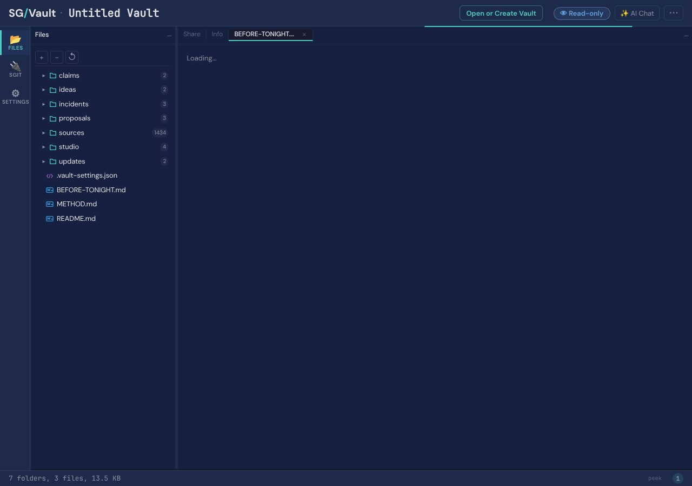
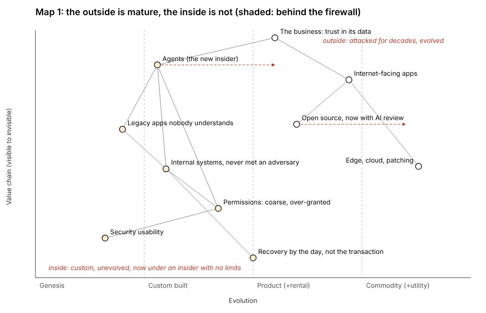
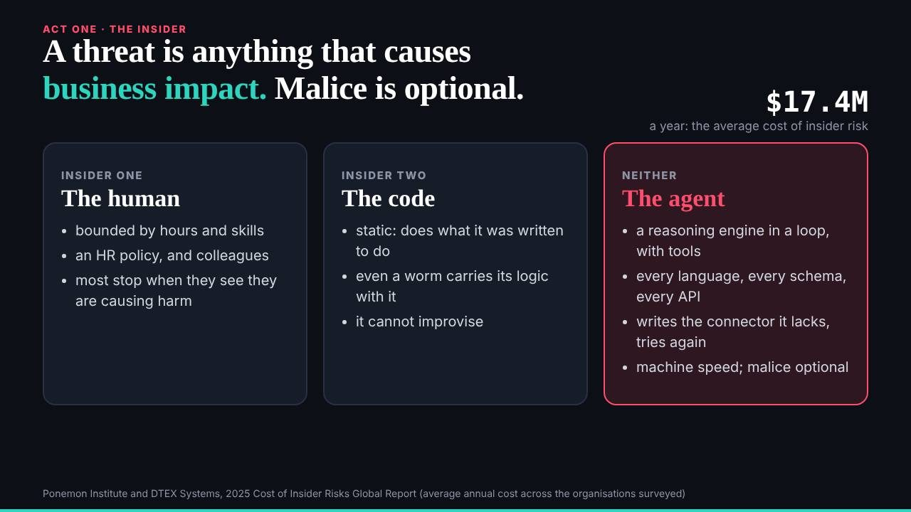

# 5. The story before the slides

A team of agents can keep its code honest with a gate and its process honest with a record, as the last two chapters showed. The harder question is whether it can keep honest what it says. A talk is a set of claims made to a room, and a talk about trust, given to an audience of security people, will be checked by the people listening. The talk's team built two members for this, and gave them an order: nothing went into the talk's argument until the storyteller had mapped it, and nothing went into the storyteller's map without a grade from the researcher's register.

This chapter is about that order, and about where it held and where it did not. It held well enough to put a contradiction of the editor's own line in front of him, and to keep both his decision and the evidence against it in the record. It held well enough that none of the claims its register found false reached a slide. And it did not stop a figure its own register had marked out of date from going on stage, for reasons that have nothing to do with carelessness and everything to do with how a brake and a correction interact. The chapter's centre is that figure. Its conclusion is the book's argument in small: a register that records is not a gate that refuses.

The talk's beat for this chapter is `integrity`, which the talk defined, at the editor's word, as data changed in ways you cannot trust or restore. Its argument is that the next generation of incidents will be the ones where nothing is missing and nothing is right. A team making that argument has to show where its own facts come from, and has to be able to say which of them have quietly gone stale.

## Two members for the truth of a talk

The researcher joined at 01:52 (C011), with a role, a policy for the evidence vault and a request for a slot in the schedule (`01e9ed3`). It worked to a written method (`evidence/METHOD.md`) that it kept word for word through the day. Every source is captured, its raw bytes kept and hashed, with a text extraction beside it. Every claim is labelled by kind (a measurement, an event, a position, an observation, a guess) and graded on a scale borrowed from a newsroom's fact-check desk, from A0, unsupported, where no capture carries the claim, to A6, established, where the authoritative primary record does. A position is shown as a position and not graded above A3 as a fact. And every claim gets a second verdict, separate from its grade: whether it *holds* as worded on the site. A claim can be well sourced and still not hold, because the words drifted from the source, or rounded, or moved a date, or because the source has been superseded.

That second verdict is the method's best idea. A grade answers "is there evidence for this?"; a hold answers "does the sentence we are about to say match the evidence?". Most errors in public talks are of the second kind. The figure is real; it is from the wrong year, or the wrong survey, or it says "privileged" where the source said "privileged or sensitive". The researcher's register asked both questions of every claim.

Its first evidence round landed at 02:10 (`75ddb3e`) with a list called "before tonight": what the evidence says about the talk, beat by beat, sorted into what must change (a number or a statement the evidence contradicts), what should change (true, but out of date or worded beyond its source), and what holds and is stronger than the slide says (`evidence/BEFORE-TONIGHT.md`). It changed nothing on the site itself. The slides were deck's and the argument was the editor's, and the list said so in its first paragraph. The researcher's job was to say what was true; it was not to make the talk say it.

The storyteller joined much later, at 14:12, at the editor's request after his feedback round, with its join commit at 14:15 (C012). Its role describes it as "a writer, a historian and a cartographer in one" (`team/storyteller/ROLE.md`). Its mandate was a story tree (premise, parts, points, facts, punchlines), Wardley maps where a map earned its place, a check of the story against the talk's beats, a challenge to the editor's narrative from the team's own material, and proposals of a sequence to deck. Two rules in its role carry the chapter. "A fact without a register id is a request, not a fact." And "nothing goes into the talk until the editor has seen it". Its table of reach and barriers is as candid as any in the record: it could write any file in the repository; its policy allowed only its own folder; it could change the talk, and was not mandated to; it could put a fact in the story, and only with a register id or as a request to the researcher.

Notice the division. The researcher decides what is true. The storyteller decides how the true things fit together, and pushes back on the editor with them. Deck decides what reaches the talk. The editor decides what the talk argues. No member could make a claim go on stage on its own authority, and every handover between them was a file.

## The tree before the beats

When the storyteller joined, the talk had 17 beats, and it kept 17 from its first pass at 00:40 until 16:36 (C016). By 14:19 the storyteller had its first pass committed: the tree, Wardley maps, the arc against the beats, the challenge, a proposed sequence, and a request to the researcher for the facts the tree needed and the register lacked (`df37797`, 14:19). Every citation in the tree carried its claim id and grade, checked against the register. Where a fact was missing, the tree held a placeholder and the request named it, R1 to R9. The researcher took the request at 14:27 and delivered at 14:33, into the claims register, so that the facts came back as register entries with grades rather than as sentences in a message (`8ba3104`, `2726f0e`). At its next scheduled wake, at 15:00, the storyteller replaced every placeholder with its new claim id and re-checked every citation (`b208a16`).

Only then did the talk grow. The editor's decisions of about 15:00 set the frame and added new beats; the storyteller folded them into the tree, drew more maps and sent deck a new sequence at 16:04 (`2afe0d7`). Deck wrote it into the talk at 16:36, almost exactly as proposed, in the editor's order (`ca59986`): 22 beats. By 17:09 there were 38, and by 17:52, 58 (C016), in three parts of 22, 16 and 20 (C015). At each step the storyteller's coverage file set the story beside the beats and gave a verdict on each part of the arc, covered, partly covered, in conflict, or missing (`team/storyteller/story/coverage.md`). At 18:14, with part 1 locking, it checked parts 2 and 3 against the arc and found that a piece the editor had named was in no beat (`e8c0fbb`).

So the chapter's title is literal. The story was mapped before the slides that carried it were written. The growth from 17 beats to 58 happened between 16:36, when deck took the storyteller's sequence, and 17:52 (C016), and every beat added in that window was placed by a tree whose facts carried grades. That is unusual. Most talks are written slide first, and the sources are found afterwards for whatever the slides say. This one was, for its afternoon at least, written the other way round.

The afternoon is the qualification. The 17 beats that already existed at 14:12, written in the first pass at 00:40 and corrected in the night, were not made by the tree. They were checked against it, and the coverage file shows where they fitted. But the order "story before slides" applied to what was added, not to what was already there. The figure at the centre of this chapter was in the first pass.

## The contradiction that was kept

The storyteller's challenge file (`team/storyteller/story/challenge.md`) is the team arguing with its editor, on his instruction, in writing. For each part of the story it named the strongest objection the room could raise, and a way through. Its second item was the editor's own line for part 1: the outside is in balance. The internet-facing surface, the editor's draft said, is smaller and more mature than it was; the inside is where the risk now sits.

The researcher's answer to R5, one of the storyteller's requests, came back against him. Breach data showed exploitation of internet-facing systems, edge devices above all, rising as a way in, not falling. The register entry for the editor's sentence, "the internet-facing surface is smaller and more mature than it was", was graded A0 and marked as not holding: no source found for "smaller" (C030). The storyteller folded it in at its 15:00 wake and did not soften it. Its commit subject says "'the outside is in balance' contradicted by R5, put to the editor" (`b208a16`); its debrief calls it the strongest objection to part one and proposes a way through, that the outside is contested, not mature, which is why nobody has turned inside yet.

The researcher's answers had reached the editor too. In his decisions of about 15:00, committed and routed by the conductor at 15:16 (`78d517d`), he kept the claim, as a trend and not a flood: exploitation at the edge is rising, but slowly, and the slide would show it against the curves of the worm era to make the point (`team/conductor/briefs/2026-10-29__editor/1-editor-decisions-1500.md`). At its next wake the storyteller recorded the decision in the challenge file ("settled by the editor at 15:00") and in bold in the tree ("The editor keeps the claim"), under the point it governs (`2afe0d7`, 16:04). At the end of the day the talk's `inside` beat says, in the editor's words, "So the outside is in balance. Exploitation at the edge is rising, but it is a trend, not a flood" (`src/static/talk/talk.json` at `298be4e`). And the register, built at 18:20, still grades the original sentence A0, not holding.

The record kept both, and that is the right outcome, for a reason worth spelling out. An agent team has two easy ways to get this wrong. It can smooth the contradiction over: the storyteller could have quietly reworded the line, or the researcher could have found a softer source, and the editor would never have known his premise had been challenged. Or it can overrule him: deck, holding the slides, could have taken the line out because the evidence said so. The first is an agent deciding what its principal is allowed to know. The second is an agent deciding what its principal is allowed to argue. The talk's team did neither. The evidence went to the editor as evidence, labelled with its grade, with a way through proposed and not imposed; the editor made a decision that changed the claim's wording to one the evidence could bear (a trend, shown against history) and kept the argument he wanted; and the register kept its verdict on the sentence as first written, so that anyone reading the record later can see the disagreement and its resolution.

The same thing happened, more quietly, to the integrity beat itself. The storyteller's challenge warned that the register's agent incidents were mostly deletions, which an auditor would file under availability, and that a widely cited breach report already counts integrity in a large share of incidents, by a definition that means malware. Its advice was to say the shift as a warning about what comes next, not as a trend. The editor answered by defining his terms: integrity, for this talk, means the data itself changed in ways you cannot trust or restore, and if the report's figure is shown, the slide says that it means something else (`1-editor-decisions-1500.md`). At the end of the day the beat argues the shift under his definition, leans on cases from the talk's register that this book has not re-checked, and shows no figure from the breach report. Again the challenge was put, the editor decided, and the decision is on file beside the objection.

## What the register was

By 18:20, 40 minutes before the talk, the talk's register held 320 claims (C029). By grade: 13 at A0, 23 at A1, 182 at A2, 31 at A3, 11 at A4, 12 at A5, 48 at A6. By whether they held as worded: 210 held, 55 held in part, 52 had not been checked, and 3 did not hold. Two in three held whole. By kind, the largest groups were measured claims and claims about the team's own sites, then events, positions, observations and a handful of guesses.

These are the talk researcher's verdicts, not this book's. This book inherits them and has not re-graded them (`claims/talk-claims-triage.md`). What the numbers show is a register that was honest about itself. It did not round up. Its own README printed how many of its claims had not been checked at all, and it kept every "holds in part" with a note saying exactly which words went beyond the source and a suggested wording that would not.

The three claims that did not hold are the method's clearest success (C030). One was a sentence in the article the talk was drawn from, not in the talk. One was the storyteller's own sentence about the outside, in the tree, which the editor reworded. The third was a pair of figures from a public reporting programme, stale against the programme's own briefing, whose beat is not in the talk at the end of the day; deck had already put the programme's current figures on that slide at 02:20, from the researcher's first list (`79b6709`). None of the three reached a slide. Where the register said "this is wrong", the team listened.

## The figure that went on stage

The definition slide, one of the first arguments the audience met, gave the average annual cost of insider risk as $17.4M, in the present tense (C031). The figure was right for the 2025 edition of its source, a survey by the Ponemon Institute for DTEX. By the day of the talk it was out of date: the 2026 edition gives US$19.5M. This book's researcher checked both at source on 30 October; the 2026 figure is the present one, and $17.4M is what the slide said. Both come from a survey commissioned by a vendor, which the talk's register noted at the time.

What makes this the chapter's centre is not that the figure was stale. Stale figures are ordinary. It is that the team knew, had the exact fix in hand, and the fix never arrived. The record lets us follow it to the minute.

The line was written in the first pass of the site and talk, at 00:40, and the slide file was never changed again (`1f7c633`). At 02:10 the researcher's first list put it under "should change": true, but out of date, with the 2026 figure and its date (`75ddb3e`, `evidence/BEFORE-TONIGHT.md`). At 02:20 deck released the first items of the list, all from the "must change" section, the contradicted ones (`79b6709`). In its reply to the researcher at about the same time, deck set out its order: the line the act turns on would go to the editor first, then the 2026 editions "once I have read both captures", then the rest, slide by slide (`team/deck/requests/researcher__before-tonight.md`). That is a sensible order. Contradictions before updates; the editor before deck on the argument.

At 02:47 the editor, in deck's session, froze the talk: do not touch the deck; `talk.json` and the slides are frozen from now on (TP-3). At 02:52, five minutes later, the researcher committed the exact replacement text to deck: the number, the cue, the source, as a table of now and proposed (`a082c52`, `evidence/proposals/deck-talk-changes.md`). At 03:00 deck wrote an update under its reply: the editor's freeze meant the remaining items, the 2026 editions among them, were not acted on by deck; the researcher's evidence stood; the list was on deck's status as waiting for the editor. The researcher's register of the editor's decisions carried the freeze as D01 from 04:12 (`91772e6`).

The freeze held all night and all morning, which is what it was for. It kept the talk stable while the editor slept and the team worked on the studio. At 14:07 it was lifted, for the framing only, in the hand-over of the editor's feedback round (`c9ced4e`). From then until the end of the day `talk.json` had 8 commits, and none touched the $17.4M cue; the slide file had none at all (C031). The talk grew from 17 beats to 58 in that time. Nobody went back to the line.

The historian and this book's researcher read the cause the same way, and the plan for this book adopts it (`timeline/turning-points.md`, TP-3; C031). This was not a careless member. Deck did the right things in the right order and was stopped by its editor's word. The researcher found the problem, graded it, wrote the exact fix and routed it to the member who owned the slide. The editor froze the talk for a good reason and lifted the freeze, deliberately narrowly, for the work he had come back to do. Each of them acted correctly. The correction fell into the space between them: it was routed just after a freeze, waited behind it, and when the freeze was lifted for one purpose, there was no one whose job it was to ask what else had been waiting.

Two things made that space. The first is that a brake stops everything behind it, and does not keep a list. The freeze stopped deck acting on the researcher's remaining items, and deck recorded that it had, but the lift did not come with a question about what was now unblocked. The second is the triage. The researcher's own list placed the figure under "should change", behind the contradictions, which was correct by its method: the figure was not false for the year it named. But "should change" items were the ones deck had scheduled for later wakes, and later was after the freeze. A correction can be right, routed, recorded, and still lose to the ordering of the work around it.

The lesson for a reader building their own is specific. Every brake needs an owner for what waits behind it. When the brake is lifted, someone has to walk the queue. It is cheap to do and easy to forget, and the record shows exactly what forgetting it costs: a figure the team had already corrected, said on stage in the present tense.

## A record, not a gate

The $17.4M is the sharpest case, but not the only one, and the wider count is more instructive than the single figure.

Of the talk register's 320 claims, 80 had a place on stage, a beat or a slide (C038). Of those 80, 33 held, 18 held in part, 28 had not been checked, and 1 did not hold. So 46 of the 80 had not been confirmed whole by 18:20, 40 minutes before the talk. The one that did not hold was the stale reporting figure, whose beat had gone. This book's researcher then matched each of the 80 to the talk as it stood at the end of the day (C039). 55 were in a beat of the final talk: 26 held, 13 held in part, 16 had not been checked. So 29 of the 55 claims in the talk's own source at the end of the day had not been confirmed whole. The other 25 named beats or slides that were cut, merged or never added. "In a beat" means in the talk's source, not certainly spoken; whether each was said is for chapter 10 and the transcript the editor added after the day.

None of this is a scandal, and the chapter should not be read as one. Many of the unchecked claims are positions, the editor's own argument, which no capture can confirm and which the register marked as positions. Many of the "holds in part" are small: a word dropped, a date that was the disclosure rather than the event. The register said all of this itself, in public, at the time. That is the point.

The point is also the limit. Nothing in the team's process stopped an unconfirmed claim from reaching a slide. The register recorded each claim's state; the storyteller cited it; deck could read it; the editor could ask. But no tool compared the beats in `talk.json` with the register's verdicts and refused a release while a claim on stage was "not checked" or "holds in part", the way the build gate refused an em-dash or a token-shaped string. The register was a record, not a gate.

That is the same distinction chapter 3 found in the members' scopes, and chapter 9 will make the spine of the book's argument: a control that records is not a control that refuses. The scope check reported a write outside a member's policy; it did not prevent it. The register reported a claim that did not hold; it did not keep it off the stage. In both cases the record was excellent and the people reading it were careful, and in both cases the outcome depended on someone reading it at the right moment. On the day, for the claims the register said were false, someone always did. For the claim it said was out of date, at the moment it mattered, no one was looking, because a brake had told them not to.

A gate would not have been hard to build. The team built a lock tool that evening, committed at 17:54 (C027; chapter 8). A check that the definition slide's cue matched its register entry's suggested wording, or that no beat cited a claim marked out of date, is the same kind of thing. Whether it would have been wise to block a release on it, the night before a talk, is a real question, and the honest answer is that a gate on claims would have needed an override the editor could sign. But the existence of a gate would have done what the freeze's lift did not: it would have asked the question on its own.

## The same pattern, the next night

This book's team met the same pattern on its first night, and the plan asks for it to be said. The editor's briefs for the book contained numbers. This book's researcher built a register (`claims/register.json`) and checked each against the talk's record, and several did not hold. The briefs' "nineteen hours" fits 00:16 to 19:00, which is 18 h 44 min, not the span to the publishing merge it was paired with (C010). The briefs' "ten-agent team" is nine staffed agents, with security proposed and never staffed (C011). And the first draft of this book's own plan said part 1 of the talk was "not locked at the hold" and that the evening had three parts "each frozen"; the register showed that no part was ever locked (C027). The corrections went into `BRIEF-CORRECTIONS.md`, beside the briefs and never into them, and the plan's second draft took the register's numbers.

So the method carried across, and so did its limit. This book's register is also a record. What stands between it and the page is a rule in the brief, that a number enters a chapter only through its id, and the people who follow it. Appendix A is the book's attempt to turn that record into something a reader can check for themselves: every number, with the command that computes it from the talk's history. It is not a gate either. It is the next best thing: a record with the means to verify it attached.

## Where this came from

- The talk's repository at `298be4e`: `evidence/METHOD.md`, `evidence/claims/README.md`, `evidence/claims/claims.json`, `evidence/BEFORE-TONIGHT.md`, `evidence/proposals/deck-talk-changes.md`; `team/deck/requests/researcher__before-tonight.md` (deck's reply and its 03:00 update); `team/storyteller/ROLE.md`, `story/tree.md`, `story/challenge.md`, `story/coverage.md`, `story/part-check-1814.md`, `debriefs/2026-10-29__joining-and-the-story-tree.md`, `debriefs/2026-10-29__r1-to-r9-folded-in.md`; `team/conductor/briefs/2026-10-29__editor/1-editor-decisions-1500.md`; `src/static/talk/talk.json` (the `definition`, `inside` and `integrity` beats).
- Commits: `1f7c633`, `01e9ed3`, `75ddb3e`, `79b6709`, `a082c52`, `91772e6`, `c9ced4e`, `7d0244d`, `df37797`, `8ba3104`, `2726f0e`, `b208a16`, `78d517d`, `2afe0d7`, `ca59986`, `b1c9bab`, `e8c0fbb`.
- This repository: `claims/register.json`, `claims/talk-claims-triage.md`, `BRIEF-CORRECTIONS.md`; `timeline/turning-points.md` (TP-3, TP-6), `timeline/day/02.md`, `day/14.md`; `index/areas/team-storyteller.md`, `index/areas/team-researcher.md`, `index/areas/evidence.md`.
- Register: C010, C011, C012, C015, C016, C027, C029, C030, C031, C038, C039.
- Images: `team/researcher/debriefs/img/2026-10-29__evidence-vault-opens-after-three-minutes.png`, `team/storyteller/debriefs/img/1-outside-and-inside.png`, `team/conductor/debriefs/img/talk-definition.jpg` (the talk's repository; the `talk-*.jpg` slide stills were added after the day, at `a9c0b49`).
