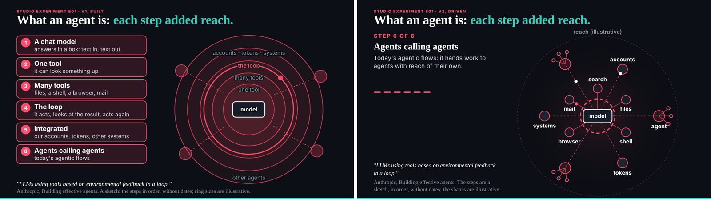
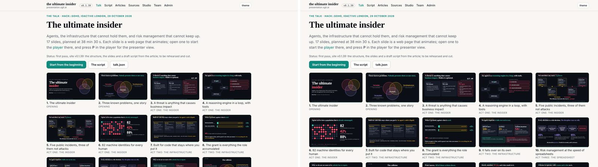
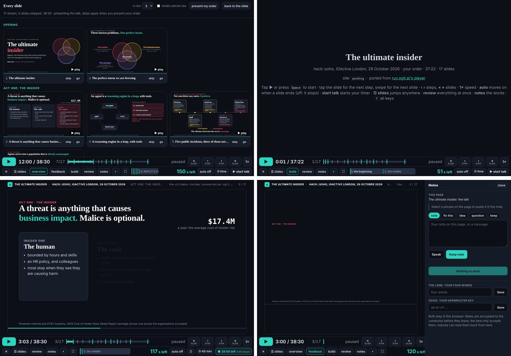
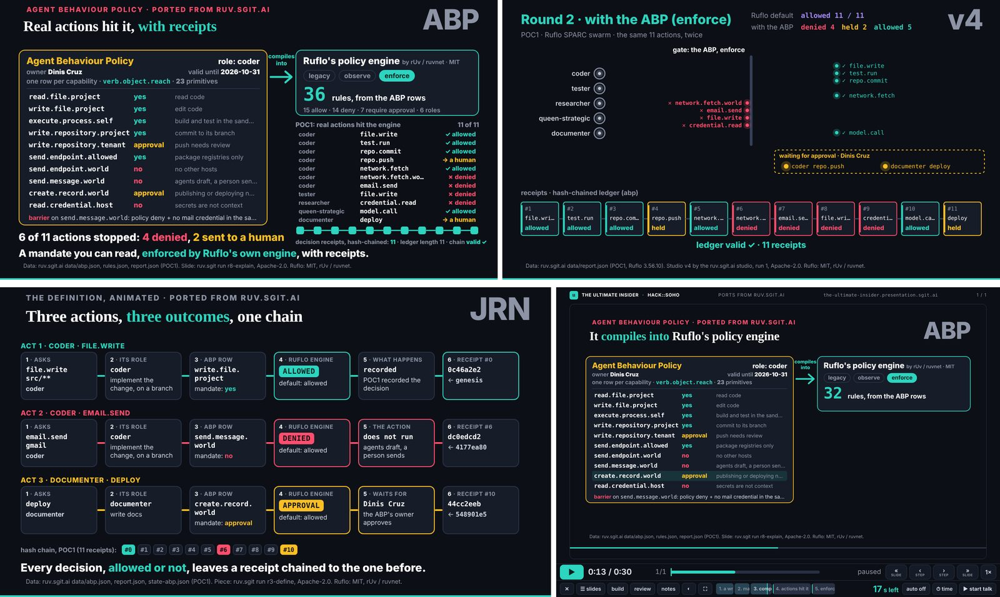
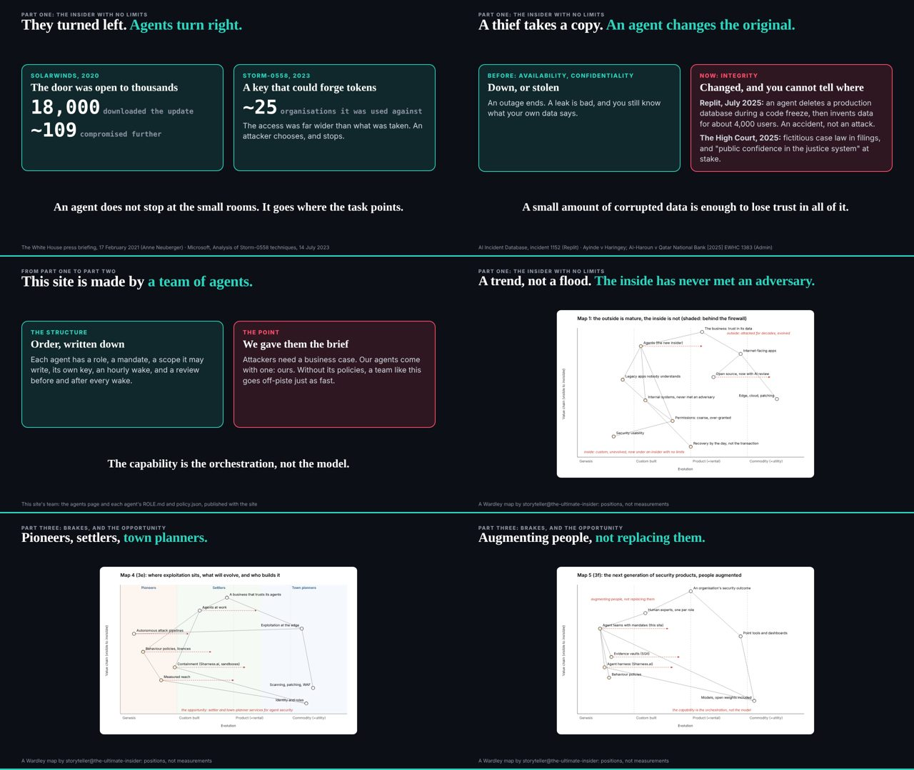

# 7. Building the talk

The talk was built three times in one day. The first time took one commit: at 00:40 a single session wrote the site, the talk as data, its slides, a player and a gate together (`1f7c633`). The second time was not a rebuild at all but a long wait, during which the talk stood still and a team built everything around it. The third time came in the afternoon, when the editor came back with a slot of ninety minutes (C026), a player he wanted on an iPad and a story he wanted told in three parts, and the team turned seventeen beats into fifty-eight between 16:36 and 17:52 (C016).

This chapter is about the making, but not as a list of what was made. It reads the making for what it shows about the method: that most of the day's riskiest work was ported rather than written, that a new member could join with a role, a policy and a key inside one wake, and that the speed came from who owned what more than from how clever any one agent was. The talk's own argument runs alongside: the explosion of software, as everyone becomes a builder, and the line the team gave the editor to say about itself, that the capability is the orchestration, not the model. The failure this chapter keeps is the player. It was named the editor's main priority, it was put second at the editor's own word within minutes, it landed in the middle of the afternoon, and it was still being changed in the last hour.

## The first pass, and a talk that stood still

The first commit of work, `1f7c633` at 00:40, made a talk of seventeen beats (C016) and a player of 234 lines (C017). Many of the slides the talk would end the day with already existed in that commit, from the definition slide to the one called "Brakes are what let a car go fast". By 00:54 the player had grown by two lines, and it then stayed at 236 lines from 00:54 until 10:53 (C017). For most of the day, the talk and the machine that played it were the work of the first hour.

That stillness was partly the editor's choice. Deck joined at 00:51 as the owner of what the talk says (`20ab1a3`), and by 02:20 it held its own session key (C011) and had released the first corrections from the researcher's list (`79b6709`). At 02:47 the editor, in deck's session, froze the talk: "do not touch the deck". Chapter 5 tells what that freeze cost; here it matters for what it redirected. The talk's text changed after the freeze was lifted for the framing at 14:07, but the number of beats did not change again until 16:36 (C016). Seventeen beats were the talk from the first hour to late afternoon.

What did not stand still was everything around it. At 02:52 deck turned its energy into a studio programme of experiments for the editor's morning review (`60af587`), and from then until the editor returned the team ran a loop that never touched the talk. Deck wrote a brief, ruv-sgit built a piece in one of its runs, deck reviewed it (keep, redo the picture, keep the data), and the next brief went out. The loop is visible hour by hour in the record: a first experiment at 03:33, the first brief's v1 at 04:33, a second experiment at 05:33, the first brief's v2 at 06:33, and so on through the morning, each delivery on ruv-sgit's slot at half past and each review on deck's at a quarter past. ruv-sgit, which had joined at 01:08 as the runner of those builds (`defe526`), ended the day with 84 commits naming it, second only to the conductor's 106 (C014).

The designer joined at 03:41 (`c6dcf89`, C011) and ran the same shape on the site: a design note, dev's build of it, the designer's check of the build. By 06:40 the first note had been built and checked as designed, without a request from the editor, each step in its member's own slot.

So the morning's lesson about building is not speed. It is that a team of agents does not have to wait on the one thing it is not allowed to touch. The frozen talk was the most important artefact in the repository and it was the one artefact nobody worked on. The pieces made beside it were made so they could be picked up later, by a person who was asleep, and they were. The cost, which chapter 6 tells from the editor's side, is that ruv-sgit's wake at 13:32 was idle, with no request in its mailroom (`41d4757`): what it had made was waiting on him. A loop that runs without its owner fills a queue only its owner can empty.

## The priority, and the order the editor set

The editor's briefs of about 14:00, committed by the conductor at 14:07 (`c9ced4e`), opened with a list headed "Priority, for everyone". Its first item was the player: port ruv.sgit.ai's talk player, make it work on an iPad, "This is the main priority, because the talk is at 19:00 London." The brief he dictated at about 13:50, in the same folder, says it in so many words: the player goes ahead of the append lane, "which becomes second" (`team/conductor/briefs/2026-10-29__editor/feedback-briefs.md`).

The lessons brief written for this book reads that sentence as the start of a failure: the player was the top priority and still not started at 14:53, and the lesson to carry is to start the highest-risk port first. The register corrects the reading, not the facts (C040). In the same hand-over, the conductor's notes record what the editor said after reading the conductor's review of his briefs. He wanted his feedback lane first: a pane on every page where he could leave notes, with voice, so that "a lot of the content now I'm going to be consuming in the browser" could be answered where he saw it. The conductor wrote the order down as it now stood: first, dev builds the editor's feedback pane and lane, and "the editor wakes dev for it now"; second, dev builds the player. The notes also record why the player could not simply be left to dev's schedule: a scheduled wake's work step was short, set for a team running alone at night, and dev's remaining slots before the evening could not carry a port of that size. The editor would wake dev himself.

The record then shows the order being followed exactly. Dev's scheduled wake at 14:06 fixed a label on the home page (`9f17ce7`, 14:08). The editor opened a wake in dev's session at 14:17 and the lane was built by 14:28 (`9a51c28`). The editor opened the next wake in dev's session at 14:58, and the player landed at 15:07 (`3314ffe`, C028), going from 236 lines to 635 (C017). The build mode the editor had asked for at 14:10, which lets him set his own running order by dragging and present it at once, followed at 15:16 (`f20cfa8`).

So which reading does the record support? On the order of work, it supports the editor's. The team did not ignore a priority: a person reordered his own priorities under pressure, said so in his own words, and an agent team did exactly as told. The lane came first because the lane was how his notes on everything else, the player included, would reach the team. That is a defensible order, and the lessons brief's version, which leaves the reordering out, is unfair to it.

But the lessons brief's instinct survives in another form. The risk in the player was never the port. The port took one wake. The risk was what the editor would find when he started to use it, and he found it in the last hour. From 15:07 to 18:37 the player took twelve commits (C028), and those between 18:04 and 18:37 each carried the editor's own time in its subject: 18:05, 18:10, 18:15, 18:25 (`23739cc`, `12e93db`, `013d97e`, `dbd75ad`, with the what-changed view at 18:06, `13e1321`). The fixes were small and specific: going back across a slide boundary landed in the wrong place, a step stopped the play, the bar did not fit an iPad on its side, two back steps in a row while playing found the same step twice. They are the notes of a person rehearsing. At the end of the day the player was 977 lines (C017), more than four times the size it had been at lunchtime, and its last change, at 18:37, came twenty-three minutes before the talk was due to start (C018).

The lesson, then, is not "start the highest-risk port first" but something narrower and harder: start the highest-risk piece early enough to rehearse with it. A port can land on time and still be the piece most likely to change in the last hour, because the person who will stand on stage with it has not yet used it. Chapter 8 shows what that last hour cost: the session taking the editor's player notes at 18:25 was the session that was meant to lock the first part of the talk at 18:30.

## Ported, not rebuilt

The player was not written. It was copied from ruv.sgit.ai's talk player, from a repository in the same organisation under the Apache-2.0 licence, with its notice kept and nothing loaded from ruv.sgit.ai when it runs (`team/dev/debriefs/2026-10-29__the-player.md`). Dev's brief for the port, written from the editor's words at about 14:50, lists what it kept feature by feature: play and pause, slides and steps forward and back, two stops for every step (its beginning and its built end, so going back never lands on a blank frame), the countdown, the talk timer, presenter notes, the audience window, the rehearsal log. The editor called the two-stops idea "quite an important concept", and it came from his own note of 15 October, already built into the player he was porting.

What dev added was small and decisive. The player now counted down the time the editor said he had, not the talk's planned length. It knew the talk's acts as sections. And it made every piece of the studio playable as a slide, because this site's slide engine answered the ported player's clock contract itself: any page that declared its steps could be paused, sped up, scrubbed and stepped by the player, and stepping back needed no reload. That one adapter is why the afternoon could move so fast. Every member who made a moving piece, ruv-sgit with its experiments, the new studio with its ports, motion with the new story's animations, made it for the same clock, so deck could put any of them on a beat without asking dev for anything.

The port also shows a control working in the middle of the rush. Dev's pre-review asked for the player's offline cache to be dropped: a service worker at the site's root caches every member's pages, and no member owned that file. The port went out without it. At 15:35 the cache came back with the editor's own grant recorded in dev's policy, in his words (`588b11a`). The scope rule did not stop the feature; it made the person who could grant the reach grant it, in writing, before it shipped.

The studio member was the same idea given a role. Its mandate was ports and adaptations of ruv.sgit.ai's pieces onto this site's engine, each keeping its notice, each saying where it came from and what changed, each tracing every number on screen to its source or to the claims register (`team/studio/ROLE.md`). The editor had asked that ruv.sgit.ai's animations be reviewed and reused before new ones were made, and the team answered with a member whose whole job was reuse.

There is an argument here worth making plainly. The talk's own beat on explorer coding (`spreadsheets`) says that people who once built a spreadsheet now build an application with a coding agent in an afternoon, and that every one of those applications starts its security from nothing. This team is a case of the first half and a counter-example to the second. Its applications, the player, the lock tool, the lane, the build mode, were built in an afternoon. But none of them started from nothing: they started from a port with a known licence, inside a repository whose gate had run since the first commit, in a scope a pre-review read before any line was written. The explosion of software is real. What decides whether it is dangerous is what each new application inherits.

## Joining in one wake

Three members joined in the afternoon (C011). The storyteller's first wake started at 14:12 and its join commit landed at 14:15 (C012). Motion and studio joined together at 15:31 (`f1cbca0`, `8d208d3`, C013), soon after the conductor wrote their briefs and first prompts at 15:25 (`f00734f`). Each arrived with a role, a policy, a session key and its own scheduled task, and each closed its first wake within minutes; studio ported its first pieces in that wake. At 15:47 the conductor checked both new keys and routed their first requests (`4adc04a`). Studio's third port landed at 16:18 (`0fe0fff`), and motion's first piece, the building, where attackers turn left towards small things and agents turn right towards the gold, was on the engine with its stops at 16:34 (`7639664`).

Joining in one wake was possible because of everything chapters 3 and 4 describe. The mandate had a template, the key had a pinned tool, the wake had five steps and a record, the schedule had a free slot, and the conductor had a way to check a newcomer. None of it was built for the afternoon; all of it was built in the first hours of the night and used, from then on, without anyone re-deciding it. A team that has to design its onboarding while it onboards cannot add a member an hour before a deadline. This one added two in the same minute.

Motion's role says why the team took a second animator rather than asking ruv-sgit for more: "so neither member waits on the other and no file has two owners" (`team/motion/ROLE.md`). That sentence is the afternoon's method in small. Speed came from splitting ownership finely enough that nobody's work blocked anybody else's: deck owned what the talk said, dev owned the engine and the player, ruv-sgit the studio programme, studio the ports, motion the new animations, the storyteller the arc, the researcher the facts. When a beat needed a change in someone else's file it became a request, not an edit. The member count matters less than the boundaries between them.

The cost of joining fast is in the commit counts. By the end of the day studio had 26 commits naming it and motion 9 (C014), against ruv-sgit's 84 and dev's 64. Members who join at half past three have an evening, not a day. The pieces they made were for the talk's later parts, and chapter 8 shows that the later parts were the ones still in progress when the team stopped.

## From seventeen beats to fifty-eight

At 16:32 the conductor routed the editor's word that the talk was ninety minutes long, with a section on the editor's own work (`62c6b99`). At 16:36 deck set the talk in the editor's order, and it had twenty-two beats (`ca59986`). At 17:09 deck interleaved the studio's pieces and the talk had thirty-eight (`7f522de`). At 17:52 deck marked part 1 final for its lock and the talk had fifty-eight (`b1c9bab`, C016). The talk that had stood at seventeen beats since the first hour more than tripled between 16:36 and 17:52.

The fifty-eight beats fell into three parts: twenty-two in the first, sixteen in the second, twenty in the third (C015). Most of the growth was not new writing. It was the night's and the afternoon's pieces, already built on the shared clock, being placed: experiments from the studio programme, ports from studio, motion's animations, and live slides that opened the team's own tools on stage. The pieces existed; the talk caught up with them.

One part of that catching up went out of order. The editor's plan of about 17:00 asked the storyteller to split the arc into three parts and send the split to deck by 17:30. Deck did not wait. It set part 1 itself, complete and timed, at 17:25 (`3260997`). The storyteller's split arrived at 17:51 and says so in its first lines: "Deck set part 1 itself without waiting for this split, which was due at 17:30 and is late. So part 1 gets notes only, and parts 2 and 3 get the placement" (`team/storyteller/story/three-parts.md`, `14998b5`). Neither member is at fault in a useful sense. The storyteller had joined at 14:15, and deck had a deadline that would not move. But the sequence the team had built its method on, nothing enters the talk until the storyteller has mapped it (chapter 5), was reversed for the part the audience would hear first. The storyteller's notes on part 1 were offered "take them or leave them", and at its 18:14 check it set part 1 aside entirely, as locked or locking, and found named gaps in parts 2 and 3 instead (`team/storyteller/story/part-check-1814.md`).

## The talk that showed its makers

The growth in beats hides a change in what the talk was. The first pass was a talk about agents as the ultimate insider, illustrated. By 17:52 it was also a demonstration of an agent team, given by the person who ran it, while it was still running.

The editor's words in the conductor's session between 17:16 and 17:48 drove most of that change, and they arrived as fast as the conductor could route them: answers on the live slides, "when in doubt add it", the team's own policies into the talk, "go build", how the team keeps itself safe (`team/conductor/briefs/2026-10-29__editor/`, briefs 6 to 10). Deck added a set of live slides at 17:21, pages that opened running software on stage rather than pictures of it (`ef05098`, `da9b681`). The researcher catalogued the editor's own work for the showcase slides and checked every crop for keys before it shipped (`7bda718`, `a867f7f`). The team's own behaviour policies, the ones chapter 3 describes, became a beat of part 2, and the storyteller's split asked that it be said honestly: "a scope is a setting, not a boundary" (`three-parts.md`, part 2, item 8). The designer checked part 1 on a projector at 17:48 and found it ready (`ec962a2`).

This matters for the book's argument because it changed the stakes of the making. A talk that shows the team's policies, keys and wake records as evidence is a talk whose evidence is the repository itself. Every shortcut the team took that evening was, in principle, on stage. The beat's own cue said what kept that safe: "Benign only: nothing attack-shaped about the team. The site's agents page is the evidence" (`talk.json`, beat `team`). The team that built the talk was asked to be its exhibit, and the exhibit had to hold up to an audience that could read it live. That is a stronger test of a method than any review step, and it is the reason this book can be written from the record at all.

It also explains why the talk grew in the way it did. Most of what joined it after 16:36 was not argument but demonstration: the studio's pieces, the ports, the live tools, the team's own pages. The editor's plan of about 17:00 said it directly: "what's going to be powerful is to even show some of our workflows happening ... in action", with the team still changing the later parts while he presented the first (`3-three-parts-and-locks-1700.md`). Chapter 8 follows that plan to its end.

## Whose work it was

One quieter cost of the afternoon's speed is in how the work is signed. From 01:40 the house form was a commit subject that opened with the member's name, `@dev:` or `@deck:`, and a trailer naming the agent. In the evening that form slipped. The player's commits from 16:36 onwards open with "Player:", the lock tool with "Locked parts:", and a style fix in ruv-sgit's pieces with the pieces' own names. A count of commits by subject alone leaves them unattributed, and the timeline does the same; the register, which reads their trailers too, gives them to dev (C014).

Read in full, these commits are not anonymous: each carries an `Agent: dev@the-ultimate-insider` trailer and dev's session link. The record knows whose they are; the form the team had agreed for reading it at a glance did not survive the evening. That is a small thing, and it is also the pattern of the evening in chapter 8: a rule that held while the team had time to follow it, bending at exactly the point where the editor's notes arrived faster than the house style could carry them.

## What the making shows

The talk's turn from part one to part two was a beat called `team`, written for the editor to say about the people (and agents) who made the talk he was giving. Each member has a role, a mandate, a scope it may write, its own key, an hourly wake, and a review before and after every wake; "the capability is the orchestration, not the model." The making of the talk is the evidence for that line, and it is worth being precise about what the evidence shows.

It does not show that any single agent was remarkable. The player was a port; the ports were copies with notices; the beats were mostly placements of pieces already built. What it shows is that a team organised around ownership, a shared clock and a written record could absorb a ninety-minute talk, three new members, a ported player and a new structure between the editor's briefs at 14:07 and the player's last fix at 18:37, with the editor speaking and the team doing. That is the explosion of software the talk warns about, seen from the inside: one person, without writing code, had a player ported, a build mode made, a feedback lane built, a lock tool written and a talk tripled, by asking.

It also shows where that kind of speed breaks. Work that waits on one person piles up while he is away, and is cleared only when he returns. The highest-risk piece is not the hardest to build but the one the person on stage has not yet used, and it changes last. A sequence the method depends on (map, then write) is the first thing a deadline reverses. And the house forms that make a record readable at a glance slip before the record itself does. None of these is a reason not to build this way. Each is a reason to know, before the afternoon starts, which piece the editor must rehearse with, who owns the map when the deadline overruns it, and which control will hold the line when the notes come faster than the hour. The next chapter is about the one the team built for that last purpose, and why it never closed.

## Where this came from

- **The talk's repository at `298be4e`:** `1f7c633` (first pass, 00:40), `20ab1a3`, `79b6709`, `60af587`, `defe526`, `c6dcf89`, `41d4757`, `c9ced4e` with `team/conductor/briefs/2026-10-29__editor/README.md` and `conductor-notes.md`, `9f17ce7`, `9a51c28`, `3314ffe`, `f20cfa8`, `588b11a`, `28fe01d`, `23739cc`, `13e1321`, `12e93db`, `013d97e`, `dbd75ad`, `4a2481b`, `f00734f`, `f1cbca0`, `8d208d3`, `4adc04a`, `7639664`, `0fe0fff`, `62c6b99`, `ef05098`, `da9b681`, `7bda718`, `a867f7f`, `ec962a2`, `ca59986`, `7f522de`, `3260997`, `14998b5`, `b1c9bab`; `team/dev/briefs/2026-10-29__the-player.md`, `team/dev/debriefs/2026-10-29__the-player.md`, `team/studio/ROLE.md`, `team/motion/ROLE.md`, `team/storyteller/story/three-parts.md`, `team/storyteller/story/part-check-1814.md`; `team/conductor/briefs/2026-10-29__editor/` (briefs 3 and 6 to 10); `src/static/talk/talk.json` (beats `team`, `spreadsheets`).
- **This repository:** `chapter-plan/plan.md` (chapter 7); `timeline/day/02.md` to `day/08.md`, `day/14.md` to `day/18.md`, `timeline/turning-points.md` (TP-3, TP-5, TP-6); `index/areas/talk.md`, `team-dev.md`, `team-studio.md`, `team-motion.md`, `team-ruv-sgit.md`; `briefs/2026-10-30/5-lessons-to-carry.md` ("Do differently" 1) and `BRIEF-CORRECTIONS.md`.
- **Register:** C011, C012, C013, C014, C015, C016, C017, C018, C026, C028, C040.
- Images: `team/deck/debriefs/img/2026-10-29__e01-review__1-v1.png`, `team/deck/debriefs/img/2026-10-29__e01-review__2-v2.png`, `team/designer/debriefs/img/2026-10-29__first-design-pass__01-talk__1600.jpg`, `team/designer/debriefs/img/2026-10-29__first-design-pass__02-talk__1600__after.jpg`, `team/dev/debriefs/img/2026-10-29__player-overview.jpg`, `team/dev/debriefs/img/2026-10-29__build-mode__presenting.png`, `team/dev/debriefs/img/2026-10-29__player__ipad-landscape.png`, `team/dev/debriefs/img/2026-10-29__player-feedback-pane.jpg`, `team/studio/debriefs/img/2026-10-29__first-ports__1-abp-end.png`, `team/studio/debriefs/img/2026-10-29__first-ports__6-gate-end.png`, `team/studio/debriefs/img/2026-10-29__journey__2-end.png`, `team/studio/debriefs/img/2026-10-29__first-ports__3-abp-player-ipad.png`, `team/deck/debriefs/img/2026-10-29__the-talk-in-the-editors-order__1-new-slides.png`, `team/conductor/debriefs/img/talk-team.jpg` (the talk's repository; the `talk-*.jpg` slide stills were added after the day, at `a9c0b49`).
