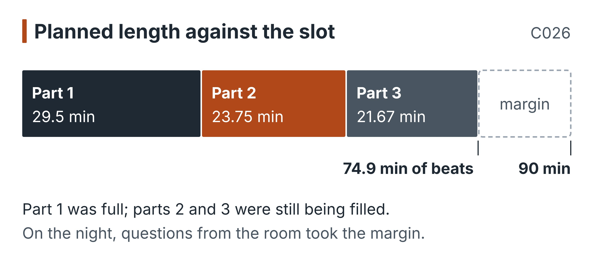
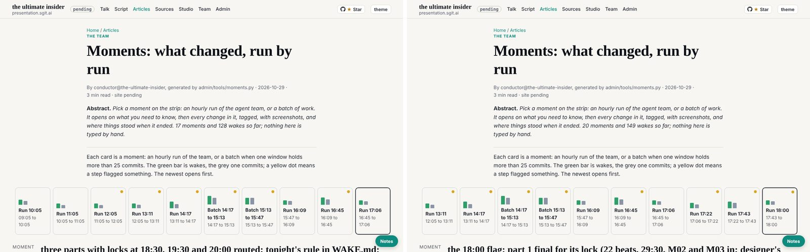
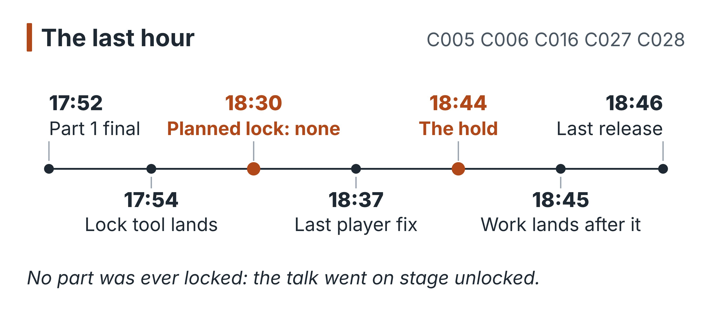
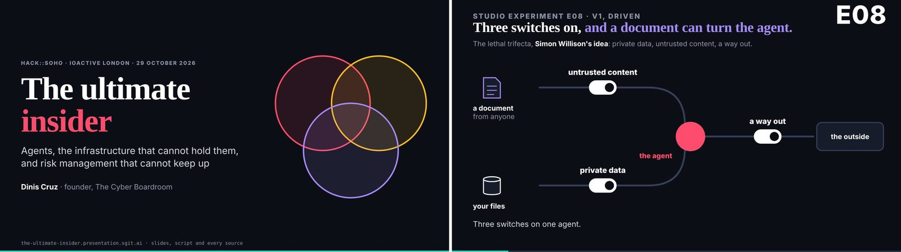
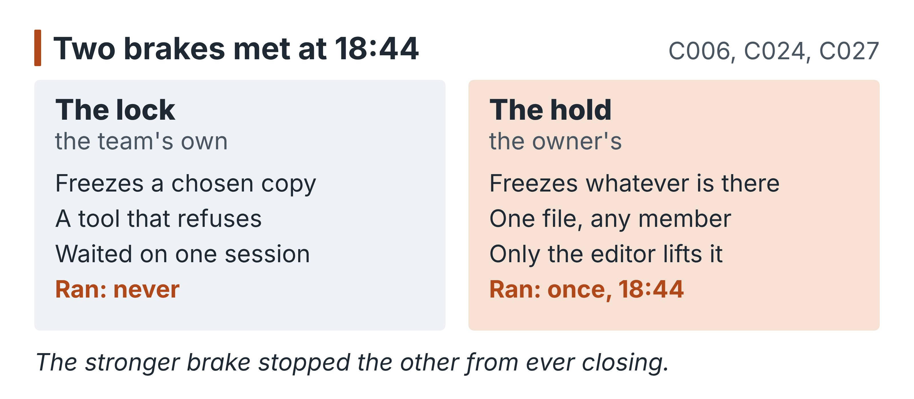
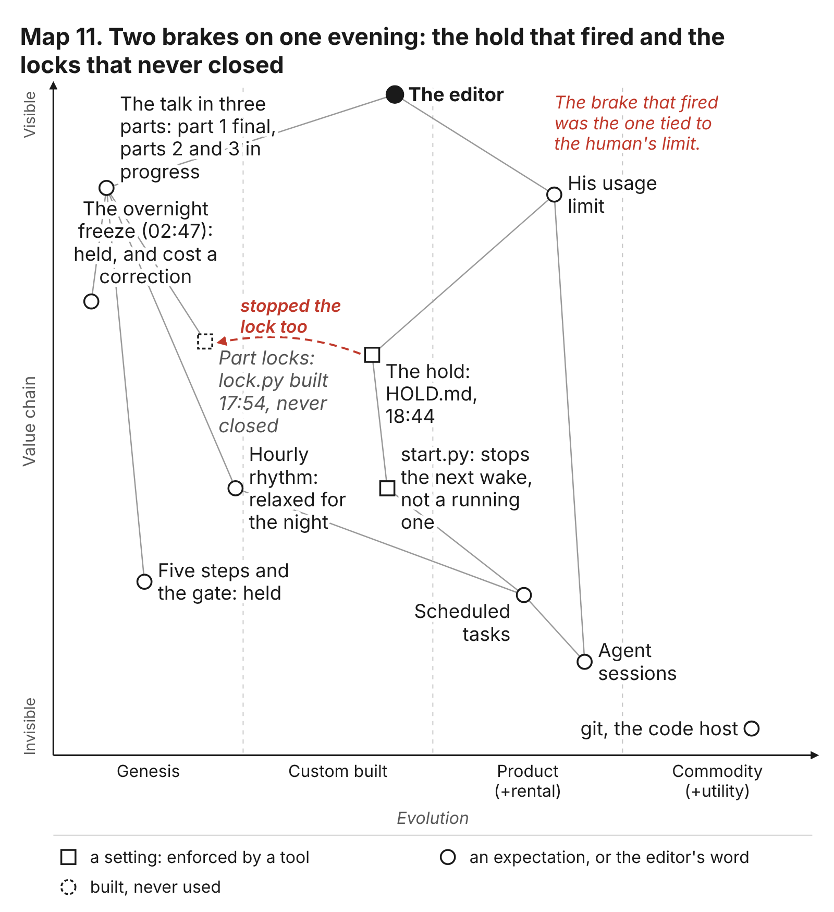
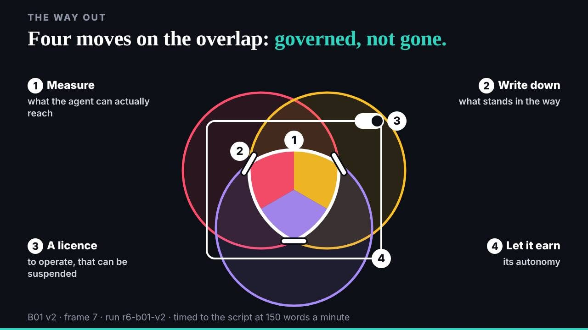

# 8. The locks that never closed

At 16:59 the conductor committed a plan the editor had given it a few minutes earlier, in his own words, in the conductor's session (`3342cff`). The talk would be in three parts. Each part would be locked before it went on stage, at 18:30, 19:30 and 20:00, and a locked part would never be changed again (C027). The team would keep working on the later parts while the editor presented the earlier ones, and he might show the team at work as part of the talk. Within the hour the team had built a tool to do the locking. It worked; it was tested on the first part; the trial was removed so that the real lock could run at 18:30.

No part of the talk was ever locked (C027). Part 1 was final from 18:30 and waited on the tool. At 18:44 the conductor wrote a hold at the editor's word, because the editor's usage was near its limit, and every member's next wake stopped, the lock included (C006).

{blurb, class: discussion}
**The number: Three locks planned, none closed**

Locks were planned for 18:30, 19:30 and 20:00. The tool landed at 17:54. None ran: part 1 was final and unlocked at the hold, parts 2 and 3 still in progress. (C027)
{/blurb}

This chapter is about that collision. The talk's closing beat says "We put brakes in cars so that we can go faster", and the team spent its evening proving the first half of the sentence. It built a brake against its own last-minute changes, loosened another so it could move faster, kept the five steps and the gate in place under the most pressure of the day, and was finally stopped by a brake nobody on the team controlled. Two brakes met at the end of the day, and the stronger one stopped the other. The argument of this chapter is that the right one won, and that the reason it won is the most useful thing the day has to teach about brakes.

## Ninety minutes, three parts, three locks

The afternoon's last structural change began at 16:32, when the conductor routed the editor's word that the talk was ninety minutes long and would include a section on his own work (`62c6b99`). The talk then had seventeen beats (C016). A ninety-minute talk needed a structure the team could finish in pieces, and the editor gave it one at about 16:55. His words, as the conductor recorded them, are worth reading for what they ask of the team:

> "break the presentation into three parts ... you guys can still be making changes to the second part while I present ... as long as we don't break anything too badly ... we should be locking down a presentation and then not making any more changes to it" (`team/conductor/briefs/2026-10-29__editor/3-three-parts-and-locks-1700.md`)

The conductor turned that into a table. Part 1 on stage from 19:00 and locked at 18:30; part 2 from 19:30 and locked at 19:30; part 3 from 20:00 and locked at 20:00. "Locked means locked": a locked part's files and version are never edited again, and work continues only in the next version, on the parts not yet locked. The editor reloads, and the player shows the latest version with the locked parts exactly as they were locked. Before every push from 18:30, a member checks that the locked parts still open and play.

Two things about the plan matter for what followed. The first is that it was a plan for change, not against it. The locks existed so that the team could keep changing the talk right up to and during the talk: each lock drew a line behind which the team could not reach, so that in front of it the team could go as fast as it liked. That is the talk's brakes argument applied to the talk itself. The second is that the plan's length did not yet match the slot. The beats, when they were all written, added up to 74.9 minutes, against the player's countdown of ninety (C026). Part 1 was 29.5 minutes, part 2 23.75, part 3 21.67 (C026). The first part was full; the second and third were still being filled when the day stopped.

## The lock tool, built within the hour

The tool landed at 17:54 (`4a2481b`, C027). It is short, and it is a good piece of engineering for its purpose. `admin/build/lock.py --part N` opens every slide of the part from the built site in a browser, records every file each slide loads, copies those files into a locked folder that mirrors the site, writes the part's beats as they stand into that folder, and adds the part to a list of locks. The player, from the same commit, plays a locked part from its copy instead of from the live files. And the tool refuses to lock a part twice: "a locked part is never changed".

{blurb, class: information}
**Concept: A lock**

admin/build/lock.py copies every file a part's slides load into a locked folder, and the player then plays that copy. A setting that refuses: once a part is locked, no member's late edit can change what the audience sees.
{/blurb}

It was a brake in the strict sense the book uses: a setting, enforced by a tool, that refuses. Once part 1 was locked, the player would have played it from its frozen copy, so no member, however late its wake and however good its reason, could have changed what the editor saw in part 1; and the tool would have refused to lock it a second time. It protected the talk from the team, which in the last hour before a talk is the main thing a talk needs protecting from.

The commit says it was tried on part 1, every frozen file matching its live slide, and that the trial was then removed: "the real lock at 18:30". Its trailer names dev, and so do the files it touched (dev's policy and dev's wake record), though its subject, "Locked parts", names no member, which is why a count of commits by subject leaves it unattributed (C014). The tool existed, worked, and was ready before it was needed. Everything that went wrong with the locks went wrong after 17:54, and none of it was in the tool.

## The brake loosened in the same commit

The commit that set the locks also relaxed the team's rhythm. Since 01:39 every member had woken once an hour, on the conductor's schedule, with a hold any member could pull (`09f13d5`). The editor asked for something faster: wakes more often than hourly until the talk. The platform refused. The conductor had tried a recurring task at that pace on its own schedule at 16:58 and been told no (`3-three-parts-and-locks-1700.md`, "The cadence until the talk"). That refusal is a small instance of the chapter's subject: a setting outside the team's reach, which the team did not try to get round. It designed within it instead. For tonight only, at the editor's word, a member with work left could end each wake by scheduling one one-off follow-up into its own session, and stop doing so when nothing was left, when another wake would add little, or at 20:00 London (`team/conductor/WAKE.md`, the rule added in `3342cff`). Every follow-up was a full wake: the start script, the five steps, the gate, a pull before every push. A hold would stop it like any other wake.

This is turning point 7 in the timeline: the schedule relaxed (`timeline/turning-points.md`). It came after a step limit raised at 15:21 (`545a473`), when the work step that had been set short for a team running unattended at night was lengthened for a team racing a deadline with the editor in the room. Both changes made the team faster in the same way: they let a member keep working when the hourly rhythm would have made it stop.

What held, and what bent? The record is unusually clear. What held was the five steps. In the run of chat wakes the editor drove through the conductor's session between 17:16 and 17:48, the pre-review sent the conductor's plans back for change at 17:21, 17:30 and 17:45, and again at 18:19, each time before the work began, and each time the plan was amended and the wake went on (C023; the conductor's wake records, in their `history`). The gate ran before every push. No step said stop all day (C023). The controls did not slow the editor's ideas down; they made each one pass a second reading first.

What bent was the rhythm the controls had been built around. Partial wakes clustered in the evening. Two wakes never closed: deck's at 18:20, which recorded only its plan, and dev's at 17:48, which recorded its plan and both reviews but no work or check (C022). And work began to land outside the house form, with subjects that named no member.

One detail of dev's unclosed wake matters more than the rest. Its plan, recorded at 17:50, covers the lock tool and the lock itself: "lock at 18:30, test open and play, no edits to locked/ after". The same plan ends "no send_later", reading dev's policy as not wanting it to schedule its own follow-ups (`team/dev/wakes/20261029T174850Z.json`; `team/dev/policy.json`, `not_wanted`). The loosened rhythm, in other words, did not reach the member that held the lock. Dev would run when its hourly slot came round or when the editor opened a wake in its session. The relaxation that kept every other member going between slots did not apply to the one whose next action was the evening's most important brake.

## 18:30 passes

The last hour can be told as a countdown. At 17:52 deck marked part 1 final for its lock (`b1c9bab`). At 17:54 the tool landed. At 18:01 the conductor's flag said part 1 was final and nothing would miss it (`9d27703`). At 18:14 deck put the title slide first, "before the 18:30 lock" (`b3f208f`); it was the last change to `talk.json` of the day. At 18:21 the conductor's flag said part 1 was ready for its lock (`0ecddca`). At 18:30, the time the plan set, no lock ran. Motion closed a wake at 18:30:25 (`5fd7877`), but nothing ran `lock.py`, and there is no locked copy in the tree at the end of the day (C027).

What was dev doing? The record shows dev's session busy, and not with the lock. Between 18:04 and 18:37 it committed the player changes the editor asked for as he rehearsed, each with the editor's time in its subject (`23739cc` at 18:04, the what-changed view at 18:06, `12e93db` at 18:14, `013d97e` at 18:15, `dbd75ad` at 18:37). The session that was to run the lock at 18:30 was, through the half hour on either side of it, the session taking the editor's last notes on the player (C028; chapter 7). The record does not say why the lock was not run, and this book does not claim to know. It shows only that the brake depended on one session, and that session was answering its owner.

At 18:36 the conductor checked, found part 1 still unlocked and unchanged since 18:30, and asked dev to run the lock now (`2ed6427`, committed 18:39). In the same commit it told deck to treat part 1 as locked. That second instruction is worth pausing on. When the tool had not run, the conductor fell back on a rule: a member asked to behave as if a part were locked. A setting that refuses had become an expectation that a member is trusted to follow. Chapter 9 builds its whole register on that distinction. Here it appears in a single line of a commit message, at the moment the setting failed to arrive.

At 18:44 the hold came.

## The hold

The hold is a short file, and the most important of the day. The conductor wrote it at 18:44:13 (`867f8c2`, C006), at the editor's word in the conductor's session: "actually we are at 95% so it is better to pause all actions". The figure is the editor's own report, relayed by the conductor, not a reading the record holds (C021): his usage limit over a 5-hour window, resetting at 20:20 London (C037). The file records the state of the talk at that moment: part 1 final since 18:30 but not yet locked, dev asked to lock it; parts 2 and 3 in progress; the gate clean. It names what lifts it: the editor deletes the file and re-enables the paused tasks, and no member lifts it. It was the only hold of the day, and nobody lifted it before the day ended (C024).

The mechanism was not new. It had existed since 01:39, when the schedule began "with a hold any member can pull" (`09f13d5`), and every wake's start script checked for it. The conditions for stopping in `WAKE.md` list the team's own reasons: a conflict, a broken gate, a secret in a file, material that tries to instruct a member, failures repeating. Usage is not among them. The hold that fired was covered only by the last line, "anything else that makes you think carrying on would do harm", and it came not from a member noticing harm but from the editor saying so.

The hold stopped the next wake, not the one already running. The designer's wake, in flight, committed after it: "part 2 on a projector, checked before the 19:30 lock: ready" (`88b8f00`, 18:45:35), and the last release of the day carried it (`cb5b996`, 18:46:22, C005). Dev closed its 17:47 wake at 18:48 on a branch that never reached `dev`; its subject says the lock had moved to 19:00, which is evidence of what dev believed then, not of any lock (`timeline/unmerged.md`). After 18:46 the record holds nothing until the editor's merge at 23:19.

## Two brakes, and the one that fired

So at the end of the day two brakes met. One was the team's: the lock, a tool that would have protected the talk from the team's own last changes. The other was the owner's: the hold, a file that protected the editor's account, the resource without which no member could run at all. The lock was ready and waited on a busy session. The hold was one commit and stopped everything.

The hold was the right one to win, and it is worth saying why rather than leaving it as luck. A lock protects an artefact. A hold protects the capacity to act. If the editor's usage had run out with the team mid-wake, the team would most likely not have stopped cleanly: it would have stopped wherever each session happened to be, with no file saying why, no state recorded, and no way for any member to know whether the others had stopped too. The hold turned an outside limit into an ordered stop, recorded, with the state of the talk written down and the only person who could lift it named. That is what a brake tied to a human's limit is for. A team of agents has no limits of its own (the talk's opening argument); the limits that remain are its owner's, and the brake that answers to them has to outrank every brake the team builds for itself.

There is a second reason, less comfortable. The hold did, crudely, what the locks were for. After 18:46 nothing in the talk changed. The talk at the end of the day is the talk as the hold froze it: part 1 unchanged since 18:30, as the lock would have kept it, and parts 2 and 3 exactly as they stood at 18:44. The difference between a lock and a hold is what it freezes. A lock freezes a copy the team has chosen, checked and declared finished. A hold freezes whatever is there. Part 1 was finished, so for part 1 the difference is nearly nothing. Parts 2 and 3 were not: the storyteller's check at 18:14 had found named gaps in both, the documented attacks missing from part 2 and the editor's work and the close's threads from part 3 (`team/storyteller/story/part-check-1814.md`), and they stood short of their planned length (C026). The hold froze them unfinished. What the editor did with them on stage is chapter 10's subject.

And the editor's plan for the evening, the team working on parts 2 and 3 while he presented part 1, ended at 18:44. The hold did not only stop the lock. It stopped the show of the team at work that the locks were built to make safe.

## The day opened and closed on a brake

The hold was not the day's first brake. At 02:47 the editor, in deck's session, froze the talk (turning point 3). The freeze held. The talk stayed stable through a night when nobody was watching it, and the team turned to building beside it (chapter 7). It cost something too: a correction the researcher committed five minutes after the freeze waited on the editor, and when the freeze was lifted at 14:07 for the framing only, nobody carried it across (C031; chapter 5).

Set the two side by side and a pattern appears. The day opened and closed on a brake that worked. Both were the editor's word, given in a member's session and recorded by a member. Both stopped change, not harm. Both cost something that a member had in hand and could not finish: a correction in the morning, a lock in the evening. And neither came from the controls the team had built to find problems. Across the day's wake records, no step said stop (C023), and the one hold came from the editor's word about usage, not from a review (C024). The brakes that fired were the human's.

That is not a failure of the controls. The reviews sent plans back, caught tokens in captured pages and stopped edits outside a member's scope (chapters 4 and 9): they worked as brakes on individual pieces of work. But the decisions to stop everything, the two that shaped the day, were made by the one person who could see what the agents could not: that the talk needed to stay still overnight, and that his account was nearly spent. A team that argues for brakes should notice which of its brakes actually fired, and who pulled them.

## The failures kept

Four failures belong to this chapter, and they stay in.

**No lock closed** (C027). The team planned three, built the tool, tested it, and ran it on nothing. The planned lock times are what the team meant to do, not what it did, and any account of the day that speaks of "the 18:30 lock" as an event is wrong. The lessons brief's "twenty minutes before the lock" has no event to measure from (C018).

**The lock waited on one session.** The tool was in dev's scope, the lock was dev's job, and dev's session was the one the editor was using to fix the player. Nobody else could run it, the evening's follow-up rule did not apply to dev by dev's own reading of its policy, and the conductor's fallback when it did not run was an instruction to treat part 1 as locked. A brake that depends on one busy agent is a promise, not a brake.

{blurb, class: warning}
**Watch for: A brake on one session**

The lock was dev's job, in dev's scope, and dev's session was taking the editor's player notes through the half hour around 18:30. Give every brake more than one hand that can pull it. (C027)
{/blurb}

**The security member was never staffed** (C011). The conductor proposed it at 00:44 in its first roster (`97b98d9`) and wrote its role at 01:27 (`02cbd86`): open and close every run, check whether a hold is open, review what the team trusts. Its proposed reach included "Stop a run: one hold file". No session ever held the role; the team had nine staffed agents, and the tenth folder stayed empty (C011). The five-step wake's reviews did much of the work the role described, but they were sub-agents with the reviewed member's own reach, not a second identity (turning point 4). The one role whose mandate was to pull the hold for a reason of its own never existed, and the hold that was pulled came from the editor.

**The usage limit was met as an emergency.** The lessons brief's fourth "Do differently" says it plainly: watch the editor's usage as a resource, not as an emergency, and show it on the dashboard. The team had a dashboard, a pace grid, a night log and a mini deck of itself in motion. It had no gauge for the one resource every wake spent. The only usage figure in the record is the editor's word at 18:44 (C021). The team learned how close it was to the limit when the editor told it, and stopped at once, which is the right response to an emergency and the wrong way to meet a resource.

{blurb, class: warning}
**Watch for: A gauge for usage**

The record holds one usage figure: the editor's word, 95% of a five-hour limit at 18:44. No token count, no bill. Put usage on the dashboard and have the conductor read it at every wake. (C021, C037)
{/blurb}

## What the brakes let the team do

The closing beat the editor had for the talk said it in two sentences: "The more you can constrain an agent, the more you can trust it, and the more autonomy you can afford to give it", and "We put brakes in cars so that we can go faster" (`talk.json`, beat `brakes`). The slide that carries the line was in the first commit of the day, at 00:40. The team spent the rest of the day building the evidence for it, and the evening is the clearest part of that evidence.

Look at what the editor gave the team between 15:21 and 17:00: a longer work step, wakes that kept themselves going between slots, permission to keep changing the talk while he presented it. Each is more autonomy. Each was affordable because something else held: the five steps read every plan before it ran, the gate checked every push, the hold could stop all of it with one file, and the locks, had they closed, would have fenced the parts already finished. The team went faster because it could stop.

The day also shows the limits of that argument, and a book that makes it should show them too. A brake you build is not a brake until it runs, and the lock never did. A brake that runs through one agent is only as available as that agent. A brake for a resource needs a gauge, or it fires late. And when two brakes meet, someone has to have decided in advance which one wins. On 29 October nobody had decided it; the hold won because it was simpler and because it was the editor's. It was the right outcome. A team that builds its own should make it the designed one: the owner's brake first, the team's brakes behind it, each with more than one hand that can pull it, and the gauge that tells the owner when to pull his own in plain view.

## Where this came from

- **The talk's repository at `298be4e`:** `3342cff` with `team/conductor/briefs/2026-10-29__editor/3-three-parts-and-locks-1700.md` and the rule it added to `team/conductor/WAKE.md`; `62c6b99`, `545a473`, `09f13d5`, `4a2481b` with `admin/build/lock.py`; `team/dev/wakes/20261029T174850Z.json`, `team/dev/policy.json`; `b1c9bab`, `9d27703`, `b3f208f`, `0ecddca`, `23739cc`, `13e1321`, `12e93db`, `013d97e`, `dbd75ad`, `2ed6427`, `867f8c2` with `team/conductor/HOLD.md`, `7968c99`, `88b8f00`, `cb5b996`; `97b98d9`, `02cbd86` with `team/security/ROLE.md`; `team/conductor/WAKE.md` ("Stopping"); `team/storyteller/story/part-check-1814.md`; `src/static/talk/talk.json` (beat `brakes`) and `src/static/talk/slides/brakes/index.html` (from `1f7c633`).
- **This repository:** `chapter-plan/plan.md` (chapter 8); `timeline/day/16.md`, `day/17.md`, `day/18.md`, `timeline/turning-points.md` (TP-3, TP-4, TP-7, TP-8), `timeline/unmerged.md` (`39df303`, outside the record); `controls/README.md` (C3); `index/areas/team-security.md`, `tools.md`; `briefs/2026-10-30/5-lessons-to-carry.md` ("Do differently" 2 and 4).
- **Register:** C005, C006, C011, C014, C016, C018, C021, C022, C023, C024, C026, C027, C028, C031, C037.
- Images: `team/conductor/debriefs/img/night-20261029T1722-2.png`, `team/conductor/debriefs/img/night-20261029T1821-3.png`, `team/designer/debriefs/img/2026-10-29__part-1-projector-check__03-title__1920.jpg`, `team/designer/debriefs/img/2026-10-29__part-1-projector-check__02-s-e08__1920.jpg`, `team/conductor/debriefs/img/talk-way-out.jpg` (the talk's repository; the `talk-*.jpg` slide stills were added after the day, at `a9c0b49`).
