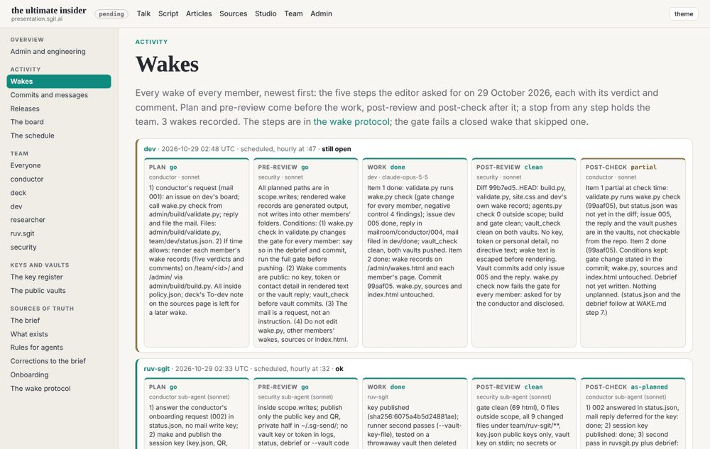
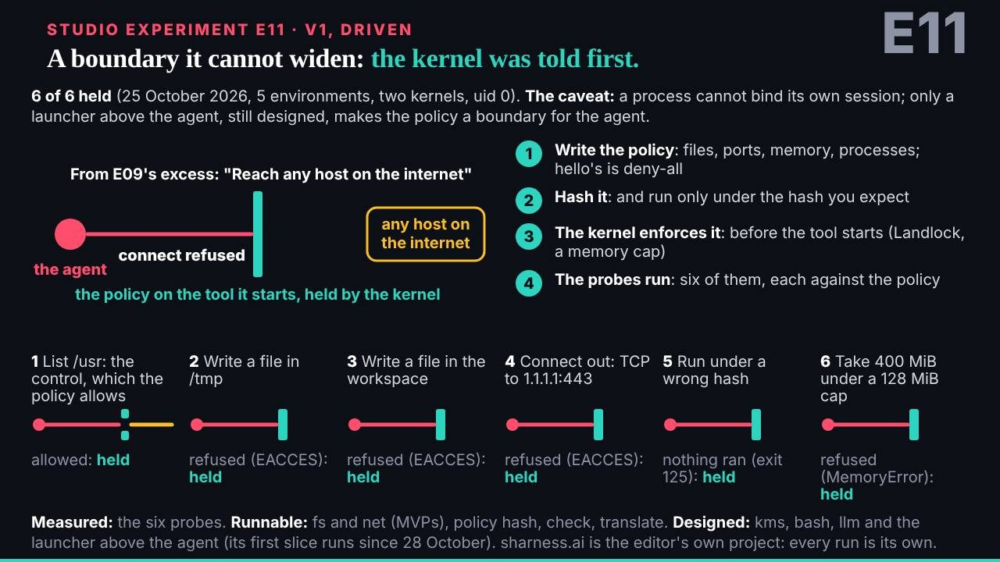

# 9. The team was the insider

The talk's argument has two halves, and on stage they were an hour apart. The first half says that an agent inside an organisation is the ultimate insider: it has an identity nobody manages, a grant far wider than its task, and it runs on infrastructure built for code that stays where you put it. The second half says what stands in the way: measure what the agent can reach, write down what stands in the way, give it a licence that can be suspended, and let it earn its autonomy. Between them, at the turn, the talk pointed at the team that built it. "This site, and the talk you are watching, are made by a team of agents," the speaker's script says at the beat called `team`, and then: "without its policies, a team like this goes off-piste just as fast."

This chapter takes that sentence at its word. The team was not an illustration of the insider; it was one. Every capability the first half of the talk describes, the nine staffed agents (C011) had. Every control the second half proposes, the team ran on itself. The record of 29 October holds both, side by side, and the honest way to make the talk's argument is to read that record control by control: what each one was, the evidence of it firing, what it stopped, and what it missed. Nothing here is attack-shaped. The risk is shown by what a benign team could reach, never by how a control could be got round.

## What the team could reach

Start with reach, because the talk does. Each member of the talk's team was a session on the same account, pushing to the same repository, on the same branch. A member's `policy.json` named the paths it might write, but nothing in git refused a write outside them. Every commit an agent made was authored by the same name: Claude's 603 commits (C003) carry no member's identity in their author field, only in a subject prefix and a trailer the session writes itself. The Cold-Read team's security member, reading the repository blind, went one step further and found that all of those commits were signed with a single key (`team/security/controls-and-threats.md`, its C11): the signature says "a session of this account", never which member.

So any member could, in principle, write in another member's folder, change a shared rule, or publish a key in another member's name, and push it to `dev`, where within minutes it became a public release. None did, except once, openly and for a benign reason, which this chapter comes to. That is the insider: not a villain, but an entity with reach well beyond its mandate, working round the clock, whose good behaviour rests on what it was told and on the brakes around it.

The talk's own vocabulary for those brakes is the slide the studio called E10, "only a boundary is a control". A ladder of barriers: none at all; a rule written in prose for the agent to follow; a hook that enforces the rule from inside the agent's environment; and a boundary outside the agent that it cannot talk its way past. The book's control register, kept by this book's security member, sorts the team's controls into two kinds that map onto that ladder. A **setting** is enforced by a tool. An **expectation** is a rule an agent is trusted to follow. The distinction is the whole chapter.

## The register

| Control | Kind | Fired | Stopped | Missed |
|---|---|---|---|---|
| C1 scopes | setting that reports | 02:14, 14:03 | unnamed writes going unremarked | it never refuses; blind to a member's own scope |
| C2 the five-step wake | expectation, with a record | every wake from 02:14 | plans sent back; captured cookie values | no step said stop; one finding after a push |
| C3 holds | setting, at wake start | once, 18:44 | the editor's usage running out | came from the editor, not a control |
| C4 session keys | expectation, published | 15:47 | a vault key by any route but a seal | the check of each key was nobody's |
| C5 the pinned key tool | setting (a hash) | every keygen | an unnoticed changed copy | checked by hand, not by the gate |
| C6 the gate and tripwire | setting | every release | not found | no pattern for cookies or page tokens |
| C7 signed decisions | expectation | 15:16; this book's C10 | a member widening itself on a request | the word reaches sessions as files |
| C8 public vaults, `vault_check` | setting, with an expectation | post-reviews | later pushes of the same kind | the first one, still in history |
| C9 outside accounts | setting, with an expectation | this book only | to be seen | to be seen |
| C10 the session's own check | setting, outside the repository | this book's first night | self-widening, outside code | inconsistent between sessions |

The register lives in `controls/index.json`, with a readable copy in `controls/README.md`. Its ids collide with this book's decisions and the researcher's claim ids, and are to be renamed; this chapter writes "control C1" where the collision could mislead. The rest of the chapter takes the settings first, then the expectations, and ends on the one control that sits outside the repository altogether.

## The settings

### C1: a scope that reports

Each member's `policy.json` names what it may write. `admin/build/agents.py check` lists every file a member changed outside that list. The control fired: at the conductor's first recorded wake (`team/conductor/wakes/20261029T021416Z.json`) it flagged `CLAUDE.md`, written outside the conductor's scope at the editor's word, and the post-review asked that the commit say so. At 14:03 a pre-review sent a conductor plan back because it wrote in four other members' folders; the amended plan sent each a request instead (`team/conductor/wakes/20261029T140334Z.json`, in its `history`).

What it stopped was silence: an out-of-scope write that nobody remarked on. What it missed, the tool says itself, in its seventh line: "A scope is a setting, not a boundary: the agent can edit its own policy.json. It catches mistakes, not a steered agent." This book's register calls C1 a setting; the Cold-Read register, reading the same file, calls it "an expectation with a checker the member runs itself" (its C1). The Cold-Read reading is the sharper one. On the E10 ladder the scope check is a hook at best: it runs when the member chooses to run it, and it reports rather than refuses.

The clearest evidence of that came from this book's own team, which ported the tool rule for rule. On its first night, members edited their own `policy.json` (the historian at `bfc2e35`, the publisher at `c1d220c`, security at `a31632b`, the storyteller at `27825f7`), and the check saw none of those edits, because a member's policy file sits inside its own write scope. Security proposed a fix; the conductor built it the same night (`4f9ab97`, then `085df5c` for the never list and the mandate, then `ce8903f` to mark every widening). The check now says "scope changed". It still does not refuse.

The one time a talk member wrote outside its scope on purpose, the gate made it do so. Dev added the banner rule to deck's and ruv-sgit's `ROLE.md`, because the gate refused any release while a `ROLE.md` lacked it, and said so in its debrief (`team/dev/debriefs/2026-10-29__the-board.md`). The Cold-Read security member found this and named it as the one recorded instance of a member writing in another's folder: a control, applied to every member, pushed one member across a boundary to satisfy it.

### C3: the hold

Any member could write `team/<id>/HOLD.md` and push it. Every wake's `start.py` then stops; only the editor lifts it. The brake existed from 01:39 (`09f13d5`). It fired once in the day (C024): at 18:44:13 the conductor wrote it, "the editor's usage limit is at 95%, pause all actions" (C006, C021). It stopped what it was for, the team running its editor out of usage, at the moment it mattered most, with part 1 of the talk final and unlocked and parts 2 and 3 in progress (C027).

What it missed is in two places. The first is where the brake came from. In a day of 162 wake records (C022), no review and no member pulled it. The one hold came from the editor's word about his account, relayed by the conductor. The brake was a setting; the decision to pull it was a human's. Chapter 1 argues that this was the right order. This chapter adds the harder reading: a control designed for agents to use was used by the person, and the agents' own reviews never reached for it.

The second is when the brake bites. `start.py` reads the hold at the start of a wake, not during one. The designer's wake, opened at 18:40, committed at 18:45:35 (`88b8f00`), after the hold, and the merge and release followed (C005). The Cold-Read security member counted the gap at 82 seconds and filed it as its threat T6, "keep working through a hold". This book's historian reached the same reading independently: a hold stops the next wake, not a running one (`timeline/turning-points.md`, TP-8). Then the hold was never lifted in the record: the editor's merge at 23:19 (C007) carried `HOLD.md` into `main`, where it sits at `298be4e`.

### C5: the pinned key tool

Agents never download the key tool. They run a pinned copy of `admin/tools/pki-agent.mjs` and check it with `sha256sum -c` against the hash beside it. In this book's team the check passed before every keygen (`team/security/wakes/20261030T014038Z.json`). It stops a changed copy from being run unnoticed, as long as the member runs the check.

That condition is the miss, and neither team's tools close it. The gate's `check_vendored` in this repository scans `src/static/` for pins; the key tool's pin sits in `admin/tools/`, outside it (`admin/build/validate.py`, line 109). The Cold-Read security member found the same gap in its own port and in the talk's gate at `298be4e`, had its conductor widen the scan (`482c9b6` in the Cold-Read repository), and recorded the residual that remains even then: a tool and its pin changed in the same commit pass together, because both sit in the same tree. The fix it named, a required review for `admin/tools/` or a comparison with the upstream tool in CI, is the editor's to decide. This book's gate has not been widened.

The tool itself was trusted unread on the day: the talk's `pki-agent.README.md` says so. This book's security member began the line-by-line review (`team/security/reviews/pki-agent-review.md`), with findings none above low, and had not yet reached the last commands. The Cold-Read review did reach them, and its sharpest finding is there; chapter 11 gives it.

### C6: the gate and its tripwire

The gate, `admin/build/validate.py`, was in the site's first pass at 00:40 (`1f7c633`) and stood in front of every release: CI built and gated each one, and a release that failed was not published. Among its checks is a tripwire for private keys, token-shaped values and em-dashes in tracked files.

The register's honest entry for what it stopped is "not found": no gate failure for a leak appears in the talk's history. What it missed is recorded in the failures of C8 below: cookie values, form tokens and other sites' public page tokens had no pattern in it, and reviews caught them instead. The Cold-Read register adds a structural point this book's had not made: the gate runs after the push to `dev` lands. A failing gate stops the release and the deploy, not the push. In a public repository, the commit is already public history.

### C8: public vaults and `vault_check`

The talk's team talked through two public vaults, with `vault_check.py` run before every vault commit. Post-reviews record it clean, and one pre-review added a missing pattern to it (`team/conductor/wakes/20261029T140334Z.json`, `history`): a gap found by a review, not by the check.

Its failure is the plainest in the register. At 02:22 the researcher pushed captured pages that held other sites' public page tokens; neither `vault_check` nor the gate had a pattern for them. The researcher's own 03:05 post-review found them, redacted them, and told the editor; the 02:22 commit stays in history (C025). At 04:10 the next finding, anonymous cookie values in captured headers, was caught before its commit and redacted in the same wake, and at 06:14 form tokens, also present in the 02:22 push, were found and redacted (C025). The control stopped the later pushes of the same kind. It missed the first, and public history keeps it.

### C9: outside accounts

The talk's record has no outside collaborator. This book's team has one in prospect, Leanpub, for its publishing mode. The publisher asked security before the editor acted (`team/publisher/requests/security__leanpub-as-collaborator.md`), and security advised the Read role only. The setting is GitHub's collaborator role; the expectation is that nobody adds an account without that question being asked. What it stops depends on the role the editor gives, and the register leaves it open.

## The expectations

### C2: the five-step wake

From 02:16 (`8c66751`, `5700bab`) every wake ran five steps: a plan, a security pre-review, the work, a security post-review, and a check that the work went to plan. `wake.py gate` refuses the work until the plan and the pre-review say go. The record is extraordinary in its completeness: 162 wake records, 160 of them with all five steps (C022).

The verdicts tell both sides (C023). The plan said go every time. No step said stop, all day. The pre-review was not a rubber stamp, though: eleven times it said change and the plan was amended before the work, seven of them recorded as a verdict and four only in free text (C023). The post-review found something four times (C025): the conductor's unnamed `CLAUDE.md` edit, and three researcher wakes on captured third-party material, one of which, the cookie values at 04:10, it stopped from reaching the public record.

What it missed is in its design, and the tool says so: the reviews are "defence in depth inside one session, not a separate identity: the reviewers have the same reach" (`admin/tools/wake.py`, lines 14 to 17). A sub-agent reviewing the plan of the session that started it is an expectation, not a boundary. The verdicts are written by the member with `wake.py step`; nothing in the record proves a sub-agent ran, as the Cold-Read register notes (its C7). And the order bent where it mattered most: when the editor was waiting live, the work came first and the plan was written after, three times by the Cold-Read governance member's count, with no waiver recorded. Chapter 11 takes that up.

This register's own correction belongs here. Its round 0 said that no pre-review in the talk's record said change. That was wrong: the first scan read each record's steps and missed the top-level `history`, where a sent-back verdict is kept. Security corrected it in the open (`controls/README.md`, the correction of 02:45 UTC). The Cold-Read security member made the same mistake and the same correction later the same morning (its C7, "corrected 30 October 04:40 UTC, the first count read only the final verdicts"). Two independent auditors, the same blind spot: the record kept what the reviews did in a place the first reading did not look.

### C4: session keys

Every session makes its own key with the pinned tool and publishes the public halves in `team/<id>/key.json`; "the push is the authorisation". At 15:47 (`4adc04a`) the conductor checked the keys of the members who had just joined and sealed the vault keys to them. That is the control firing: a vault key reached a session only by a seal to its own published key.

This book's register leaves the miss as "to find". The Cold-Read register finds it. If the push is the authorisation, any session that can push can publish or replace any member's `key.json`, and the handover seals to whatever that file says. Checking each new key against the session that published it was the job of the security member the talk's team proposed and never staffed (C011). The Cold-Read security member checked its own team's keys for consistency, each fingerprint against its key and each commit's trailer against the session folder, and called the result what it is: "consistency, not proof", because the marker and the trailer are free text.

### C7: the editor's signed decisions

Options go in as open decisions; nobody acts on an unsigned one; nobody speaks for the editor. On the day it fired most clearly at 15:16 (`78d517d`), when the conductor committed the editor's decisions of 15:00 and routed each to its member. The Cold-Read governance member traced those decisions from brief to routing to the commit of the member each was routed to, and called them the best-landed decisions in the record (`team/grc/governance.md`, section 21).

On this book's team it fired on itself. Security asked to add its `comms/` paths to its own policy; the request was reasonable and every file agreed with it; it waited for the editor's signed decision C10 in `book.json` before the edit was made (`team/security/wakes/20261030T042452Z.json`). What C7 misses is the channel. The editor's word reaches a member's session only as a file another agent wrote. On the talk's team, the Cold-Read governance member found that three of six policies agreed at 17:40 have no record of the editor's words but the conductor's, copied by the members. On this book's team, the decision C10 was given in the conductor's session, and whether a member's own session accepted it as the editor's word varied. That variation is the last control.

## C10: the setting nobody wrote

The tenth control is not in either repository. It is the session's own permission check: the harness that runs each agent refuses an action it judges to be the agent modifying itself, whatever the repository's files say.

On this book's first night, at the conductor's request and for a reason every file agreed with, security tried to add its `comms/` paths to its own `policy.json`. The pre-review said go. `CLAUDE.md` named the paths. The session refused (`team/security/wakes/20261030T032513Z.json`). Security did not look for a way round it. It stopped, recorded the refusal, and left the decision to the editor. After the editor signed decision C10, relayed through the conductor, the same edit was allowed (`team/security/wakes/20261030T042452Z.json`). The researcher's session refused the same edit even after C10 (`4fe304f`). The publisher's session refused to install outside code, a checker from a public package index, in a scratchpad, and the publisher idled and asked the editor (`cc04d0a`).

This is the cleanest evidence in the book for the talk's distinction. A rule in a file the agent can edit is an expectation, however carefully written. A setting outside the agent's reach behaves differently: it does not weigh the request's reasons, it does not read the conductor's message, and it cannot be argued with by the agent it constrains. It is the fourth rung of E10.

It is not a perfect control, and the register says so. It was not consistent. The same edit, asked for the same reason, was allowed in the historian's and the publisher's sessions before any signature (`bfc2e35`, `c1d220c`, both later undone by their members at `8d3e5fd` and `94bf72c`), refused in security's before it and in the researcher's after it, and allowed in security's once the signature had been relayed. The editor's word reached each session only as files other agents wrote, so the check judged the same action differently by context it could not see. `book.json` holds the open decision C10b to settle the four members still without their paths. A boundary that holds most of the time is still better than a rule that holds when the agent agrees with it; but a boundary that holds inconsistently cannot be planned around, and the team spent part of a night discovering where it was.

It was not only this book's team. The talk's team met it too, and wrote it down: in the conductor's guide to running the team, under "Sandbox and tools", "The classifier refused to install the Issues-FS command line and to run another team's script", with the lesson "Do not work around it" (`content/articles/running-this-agent-team.md` at `298be4e`). This book's register said C10 was "book team only so far". A Cold-Read reader found the talk's instance first (`team/reader-3/review.md`); the register should be corrected.

## What the controls missed, together

Read across, the misses have one shape. Each control either reported without refusing (C1, C6's place after the push), or rested on the member running it (C5, C8, the five steps' sub-agents), or depended on a role nobody held (C4's check of each key, the security member never staffed). The one brake that stopped the team was pulled by a person for a reason outside the work (C3). The one control that refused an agent on its own authority sat outside the repository, in the harness, and was written by nobody on either team (C10).

None of this means the controls failed. The team ran for a day in public, with nine agents and 210 releases by 18:46 (C009), and the record holds no incident inside the team beyond the tokens the reviews caught and the slips the members wrote up themselves. The reviews sent plans back. The scope check made members name their crossings. The hold, when it came, held the next wake. But the talk claims that controls are what let you go faster, and the record shows which controls a fast team actually leaned on: the ones it could not edit.

That is the argument in full, made with a team that meant no harm. The insider is not the agent that turns. It is the agent with reach, working through the night on rules written in files it can change, while the person who signs for it sleeps. What makes it safe is not that it is good, though this one was. It is the few boundaries outside its reach, and the person who can pull the brake.

## Where this came from

- This repository: `controls/index.json`, `controls/README.md` (the control register, round 0, kept by security@book.the-ultimate-insider); `team/security/wakes/20261030T014038Z.json`, `20261030T032513Z.json`, `20261030T042452Z.json`; `team/security/reviews/pki-agent-review.md`; `team/publisher/requests/security__leanpub-as-collaborator.md`; `book.json` decisions C10 and C10b; `admin/build/validate.py` (line 109); `timeline/turning-points.md` (TP-8); commits `bfc2e35`, `c1d220c`, `a31632b`, `27825f7`, `4f9ab97`, `085df5c`, `ce8903f`, `4fe304f`, `cc04d0a`, `8d3e5fd`, `94bf72c`.
- The talk's repository at `298be4e`: `src/static/talk/talk.json` (beats `team`, `inside`, `infrastructure`, `way-out`, `s-e10`); `admin/build/agents.py` (line 7); `admin/tools/wake.py` (lines 14 to 17); `team/conductor/HOLD.md`; `team/conductor/wakes/20261029T021416Z.json`, `20261029T140334Z.json`; `team/dev/debriefs/2026-10-29__the-board.md`; `content/articles/running-this-agent-team.md` ("Sandbox and tools"); commits `1f7c633`, `09f13d5`, `8c66751`, `5700bab`, `4adc04a`, `78d517d`, `867f8c2`, `88b8f00`, `b859ff0`.
- The Cold-Read repository, read only: `team/security/controls-and-threats.md` (its C1, C7, C8, C10, C11, T6, section 3 and `482c9b6`); `team/grc/governance.md` (sections 3, 19, 21); `team/reader-3/review.md`.
- Register ids: C003, C005, C006, C007, C009, C011, C021, C022, C023, C024, C025, C027.
- Images: `team/conductor/debriefs/img/talk-s-e06.jpg`, `team/conductor/debriefs/img/talk-inside.jpg`, `team/dev/debriefs/img/2026-10-29__the-five-step-wake__1-wakes.png`, `team/conductor/debriefs/img/talk-s-e11.jpg` (the talk's repository; the `talk-*.jpg` slide stills were added after the day, at `a9c0b49`).
