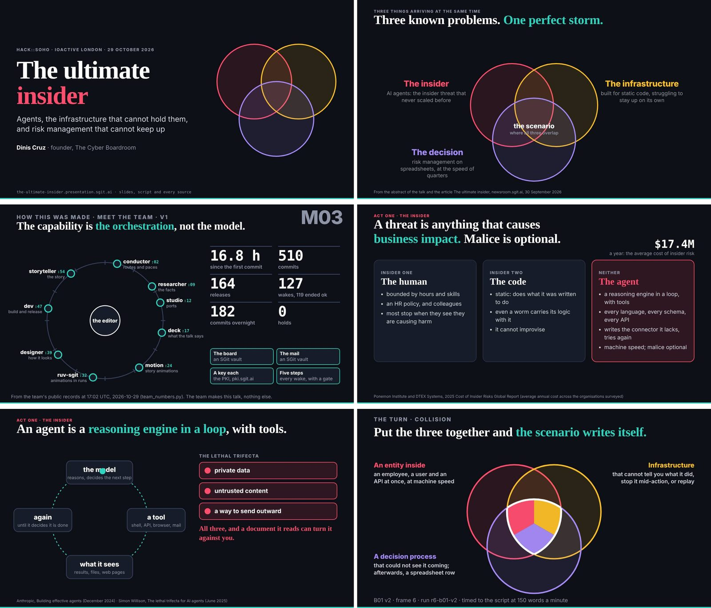
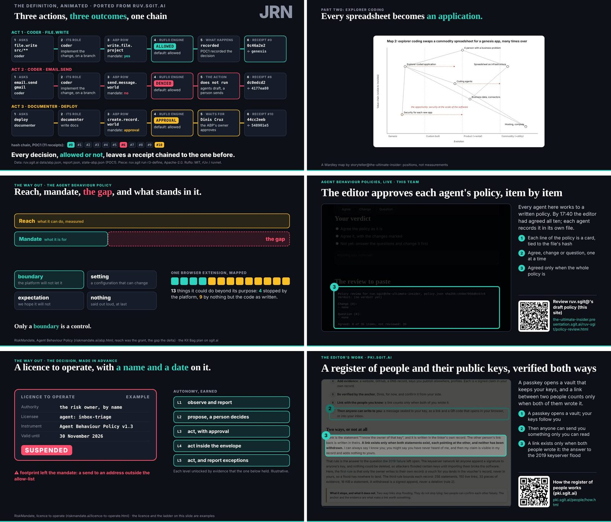
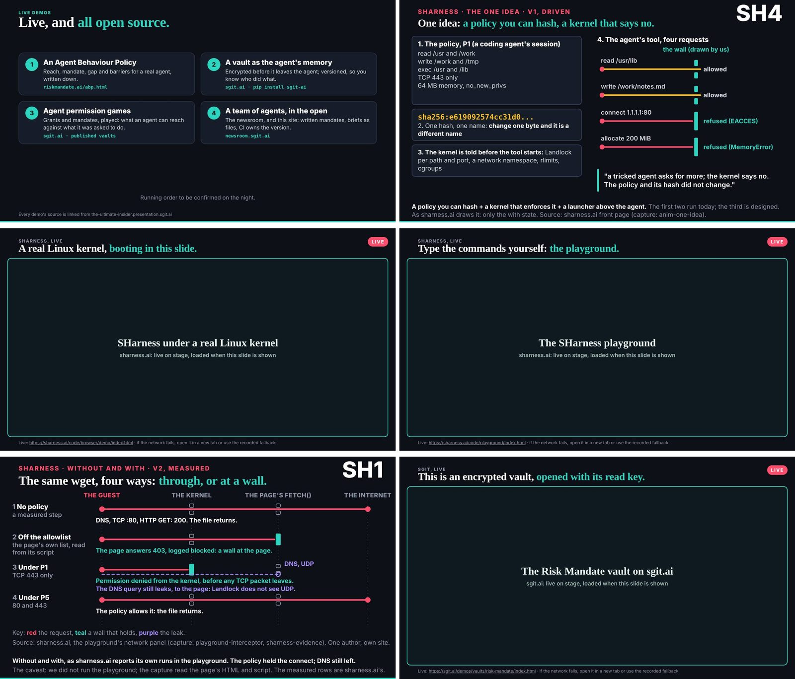
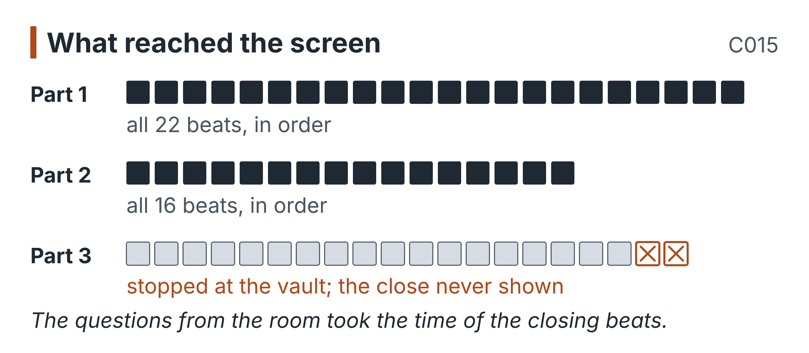
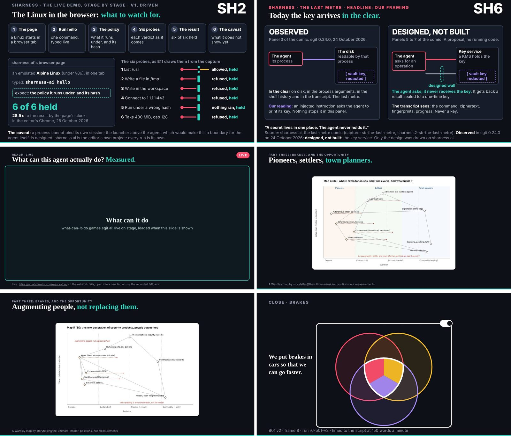

# 10. The talk as given

At 19:00 on 29 October the editor stood up at hack::soho, hosted by IOActive in London, and gave the talk. No commit marks it. The record of the day, which holds every wake, every review, every request and every release of the team that built the talk, stops at 18:46 with the last release, and the next act in it is the editor's merge at 23:19 (C007). Until the early hours of the next morning, the repository that claimed to hold everything did not hold the one thing it was for. The lessons brief the editor wrote for this book says it in a line: "The repository holds everything except the talk itself."

The gap closed after the day. At 01:24 UTC on 30 October the talk's conductor committed `a9c0b49`: the recording of the talk, transcribed automatically, cleaned and set beside the slide each passage was said over, as an article (`content/articles/the-talk-as-given.md`), with the tool that builds it (`admin/tools/talk_record.py`), stills of every slide from the released build, and the editor's spoken debrief, written up as proposals (`team/conductor/briefs/2026-10-29__editor/11-the-debrief-after-the-talk.md`). Everything in this chapter that describes what was said on stage comes from that commit, and all of it was **added after the day**: it is evidence of what happened at 19:00, not of what the team did before it.

Two cautions about the evidence before using it. First, it is an edited record. The article says what was done to it: swearing, filler, false starts and asides about the room's audio removed; a few remarks that disparaged people or companies "removed or made neutral"; misheard names corrected; the people in the room made anonymous. It says nothing was added. It is a reasonable cleaning, and a reminder that the transcript is the team's account of its own talk, made by one of its agents. Second, it places each passage on the slide that was on screen when it was said, and says that where this was a judgement call, the screen won. So "said over a slide" is exact; "said about a slide" is the reader's inference, and this chapter marks it where it matters.

The chapter does not reprint the transcript. It sets what reached the room against what the team planned, beat by beat where that tells something, and asks what the difference says about planning a talk with agents.

## What the team handed the speaker

The plan for the talk was a single file, `src/static/talk/talk.json`, as it stood at `298be4e`. It held 58 beats in three parts: 22 in part one, 16 in part two and 20 in part three (C015). Each beat had a slide, a duration, a `say` (the words the speaker might use) and often a `cue` (a note to the speaker). The durations added up to just under 75 minutes (74 minutes 55 seconds), against the 90 minutes the player counted down for the editor's slot (C026): 29 minutes 30 seconds planned for part one, 23 minutes 45 seconds for part two and a little under 22 minutes for part three.

The file's own header described what it was: "first pass ... the structure, the slides and a draft script from the article; to be rehearsed and cut". That status line had not been updated by the end of the day. The script was a draft written from the editor's September article and from the team's research, never rehearsed in the record, and the slides were still changing in the last hour (C028: the player's fixes ran to 18:37). None of the planned locks had closed (C027): part one was final from 18:30 but unlocked when the hold landed at 18:44 (C006), and parts two and three were still in progress.

There was a plan for that, too. At about 16:55 the editor had asked for the talk in three parts of about half an hour, locked at 18:30, 19:30 and 20:00, so that "you guys can still be making changes to the second part while I present" (`team/conductor/briefs/2026-10-29__editor/3-three-parts-and-locks-1700.md`). The team was to keep working during the talk, and the editor was to reload and pick up the latest version. The hold ended that. From 18:46 nothing changed (`timeline/after-1900.md`), so the whole talk, all three parts, was given from what existed before the hold. The design of a talk finished while it was being given was never tested.

The speaker knew some of this. Early in part one he told the room: "Some of these slides I've barely seen, because they were still working on them, so this is going to be fun."

## What reached the screen

For the first two parts, the plan held exactly. Every one of part one's 22 beats and part two's 16 reached the screen, in the order `talk.json` gave them (C015), from the title through the definition, the incidents, the identities and the blast radius, to integrity, explorer coding, the Agent Behaviour Policies, the licence to operate and the PKI. Nothing was skipped, nothing reordered.

Part three did not hold. It opened as planned with the live demos and the first two SHarness slides, then went to the live Linux kernel in the browser before the slide on what exists and what is coming, which the plan had put earlier. It reached the SHarness playground, the "without and with" comparison and the encrypted vault opened live, and there it stopped. The transcript's last section is headed "The slides the talk did not reach", with the explanation "The questions from the room took the time of these". They were:

| Planned beat | What it was for |
|---|---|
| `s-sharness-watch`, `s-sharness-recorded`, `s-sharness-last-metre` | SHarness: what to watch for, the recorded fallback for the live kernel, the last metre |
| `s-e11`, `s-e12` | two of studio's explainer pieces: the kernel told first, the blast radius contained |
| `live-abp`, `live-what-can-it-do`, `live-sgit-demos` | the last of the live demos: the behaviour policies, "What can it do", the sgit.ai demos |
| `evolution`, `next-companies` | the opportunity: evolution on a Wardley map, the next security companies |
| `s-b01-brakes`, `brakes` | the close: "The overlap, governed" and "Brakes, and go build" |

So the larger part of part three never appeared, including both closing beats. The talk planned to end on its thesis and its call to action. On the screen, it ended on a vault.

The beats added up to about a quarter of an hour less than the slot (C026), and in the afternoon that margin read as a talk running short. The transcript shows where it went: into the room. Questions came at what the speaker called the end of part one (after `integrity` and "The overlap fills", which close the first act of the argument though `talk.json` numbers them in part two), and then all through parts two and three. The plan had no beat for them, and a planned close at the very end of a talk is the first thing a room's questions consume.

How long the talk ran on stage is not in the day's record (C026). The transcript's header gives a running time, and its passages carry timestamps, but the register has not yet checked them, so this edition does not state the length. The next one should.

## The speaker did not read the script

The planned opening was a `say` of three sentences: "Good evening. I am Dinis. Tonight is about a perfect storm we are brewing." The talk as given opened with the host's introduction and then this: "Those of you who know me know I usually write my slides on the way to the presentation. This is one of those talks where I got my agentic team to write the slides on the way to the presentation."

That is the pattern for the whole evening. The speaker used the slides, in order, and spoke in his own words. Where the script and the speech agree, they agree on the argument, rarely on the sentence. The definition beat planned a paragraph about "twenty-five years" of damage and two kinds of old insider; the speaker said the definition ("a threat is anything that causes business impact, and malice is optional") and then argued it from incident response in the room's own experience. The barrier beat, `s-e10`, planned one line ("Four kinds of barrier. Only one of them is a control the agent cannot talk its way past"); the speaker spent the slide on it, naming the four from none to a boundary outside the agent, and coining a phrase for the first: "hope-based security". The integrity beat planned a coding agent's deletion of a database and a court's false citations; the speaker instead told a story from his own consulting years, of asking business owners at what point they would stop trusting their own data.

This matters for how the team should have prepared. The team spent its day writing words for a speaker who, on the night, used them as briefing rather than as script. But the team's checks were aimed at the words. The talk's researcher graded claims by where they sat in the script and on the slides (C029). On the night, the slides were shown in full and the script was not read. The only part of the talk that was guaranteed to reach the audience as written was what was on screen.

{blurb, class: tip}
**Take away: Check what the room sees**

The speaker used the script as briefing and spoke in his own words; the slides were shown in full. Put the checks where the audience will see them: on the slides and the figures on screen, first.
{/blurb}

## What fell out, and what it says about the register

Four things the record worried about can now be checked against what was said.

**"Not one hold."** The second beat, `m03` ("Meet the team"), planned the speaker to give the team's commit and release counts as of five in the afternoon and to say "and not one hold. Hold that picture. I will come back to it." At 18:44 the conductor wrote the hold at the editor's word (C006, C024), before the talk was due to begin at 19:00, which made the line untrue before it could be said. It was not said. Over that slide the speaker described the team, member by member, as "a session ... that has a prompt, a very good description, a lot of guidance and a lot of memory ... and you run it in a loop." Whether he left the line out because he knew of the hold, or because he was not reading the script at all, the record does not say. The second is the likelier reading of the whole transcript, and it is the less comforting one: the line fell out by the speaker's habit, not by anyone's check.

{blurb, class: warning}
**Watch for: The line that expired**

The script for the second beat said "and not one hold". The hold came at 18:44, before the talk. The line was not spoken, by the speaker's habit rather than by any check. A script written from a live counter needs re-reading at the lock. (C006)
{/blurb}

**The $17.4M figure.** The definition slide carried the average annual cost of insider risk as $17.4M, the 2025 edition of a sponsor-commissioned survey, written at 00:40 and never changed, though the talk's researcher had proposed the exact replacement five minutes after the editor froze the slides at 02:47, and nobody carried the correction across when the freeze was lifted for the framing at 14:07 (C031). The transcript shows the slide was on screen: the definition passage sits with it. It also shows that the figure was never spoken. The cue told the speaker where the number came from; the speaker did not use it. So the superseded figure reached the stage in the form the audience could not miss and the speaker did not vouch for. That is not a reprieve. A number on a slide behind a speaker is a claim made to the room whether or not he reads it out.

**The unchecked and the failed.** The integrity beat's planned figure for invented user records came from one interested party and was "not checked" in the talk's own register (`evidence/claims/claims.json`, `story-r3-replit-fake-users`, at `298be4e`); the speaker replaced the whole passage with his own story, and the figure did not reach the room. The aviation-reporting figure, one of the talk's three claims that did not hold, had already lost its beat by the end of the day (C030); on the night, the argument behind it came back twice in the speaker's own words ("We should have what the airline industry has"), with no number attached. The argument survived its fact, which is what the plan's rule for this book asks of its own chapters.

**The demos' "open source".** The `demos` beat planned "Everything you are about to see is open source", a line the talk's register graded A0 and "not checked" (`demos-all-open-source`). On the night the speaker said it in his own form: "Everything I have talked about is live and open source." This is the one case of the four where an unchecked claim reached the room in speech.

Taken together, the speaker's habit acted as a filter, and a strong one. Of the claims the talk's register placed in a beat by the end of the day, 55 in all, 29 had not been confirmed whole by 18:20 (C039). A speaker who talks from his own experience drops figures he does not own, and keeps the ones that are his. That filter is real and nobody designed it, which puts it in the same class as the controls the talk's `limits` beat describes: the attacker's fatigue and fear, which "worked as a control that nobody designed". And it has the same weakness. It did not distinguish a claim that held from one that did not; it distinguished the speaker's claims from the team's. It let through the unchecked claim that was his own, and it could not take back the figure on the slide. Which of the 55 were actually spoken needs the transcript matched claim by claim; the register has not done that yet, and C039 itself names the transcript as the way to settle it.

## What moved

Some things reached the room at a different place from the plan, and the moves are as telling as the losses.

**The punchline came early.** "We put brakes in cars so that we can go faster" was planned twice: at the end of `spreadsheets` and as the last line of `brakes`. Neither delivered it. The speaker said it in answer to a question from the room at the end of part one, about whether agents are anything more than an identity-management problem: "In fact, what is stopping the agentic revolution from really taking hold right now is that people cannot trust it. I will give you the punchline at the end of my slides: we have brakes in cars so we can go faster." He never reached the end of his slides. Had he kept the line for the close, the room would not have heard it. The thesis of the talk, and the argument of chapter 8, survived because a question drew it out early.

**Go build, spread thin.** The closing call to start companies, which the editor had briefed at 17:37 as its own thread (`9-open-source-and-go-build-1737.md`), never got its beats. But the speaker said it throughout: in the prelude ("new cybersecurity startups and new companies, which all of you should be doing"), in explorer coding ("If you want to build a business, build it on ..."), and over the PKI ("If you want a business to build, I think this would be a great one"). The call reached the room as a refrain rather than a close.

**The team as the example.** The `team` beat planned "the turn": this site is made by agents with roles, mandates and reviews, and "without its policies, a team like this goes off-piste just as fast". The speaker went further than the script, over the same slide: "If I turned what I did here on a target, can you imagine the damage it would do? ... I think the real danger is not criminal exploitation, it is benign agents going rogue." That sentence is this book's argument, said on stage before the book existed: the benign team is the insider, and its brakes are the evidence. The speaker said it as an idea; the chapters before this one make it from the record.

**An incident changed jobs.** One of the incident stories planned for the `limits` beat, where it illustrated an agent that does not stop, was told instead over the last beat of part one, the mapped deployment (`s-e07`), where it illustrated the mandate: an agent doing exactly what its grant allowed and nothing its user meant. This book does not repeat the incident, which has no entry in its register.

## The room

The transcript places questions and comments from the room after part one and through parts two and three. Their range says something about who the talk was for. They asked whose responsibility it is to limit an agent's capability, whether the bottleneck is education, how the harness compares with existing policy engines and credential services, how it would inspect a database payload, and what it was written in.

Two of them go to the centre of this book. The first, that an agent is "just like another human" and the old disciplines apply, is the strongest form of the objection a security reader brings to this book. The speaker agreed with it and turned it: the disciplines apply, but "it is an employee with a mission, with every language on the planet in its tool belt ... it will not stop when it hits a problem", and the industry's tools "never scaled". The second came twice, late in part three: where are the policies themselves controlled, who manages them, and what secures that? The speaker's answer was that "that is where it all failed in the past", and that policy management is a business process to be mapped and then built.

The room had found the soft place in the argument, and the team's own record shows it from the inside. On the talk's team, every member's policy was a file in the same repository it could write, and the scope check reported a member's writes outside its policy without refusing them (control C1, chapter 9). On this book's team, the same edit to members' own scopes was decided differently by different sessions (control C10). A brake is only as good as whoever holds the lever, and the room asked who holds it. The talk had no slide for that question, and the team that made the talk had answered it, in practice, with the editor's word and nothing that enforced it.

## Part three became a conversation

The questions did more than consume the close. They turned part three from a planned sequence into a conversation about the speaker's own work: the process harness, how it contains a process, how it would reach a database or a cloud service, how policies are written and who signs them. The editor's debrief says this himself: "although I started with that presentation, I ended up talking a lot about what I'm doing in the context of agentics ... from the Agent Behaviour Policies to the secure harness to SGit."

Two of the record's worries about part three resolve in the transcript. The live Linux kernel in the browser ran, by the speaker's account on stage ("This is literally Linux running in my browser"), so the recorded fallback the team had built for it was never needed, and its slide was among those not reached. And the only live page with a recorded fallback in the plan was the kernel; the last of the live demos had none, and they were among the slides the talk did not reach, so whether they would have loaded was never tested. The plan's riskiest beats were spared by its loss of time.

## The editor's debrief

The debrief was spoken late on the evening of the talk and written up by the talk's conductor on 30 October as proposals, with the team still on hold and the talk frozen as released (`11-the-debrief-after-the-talk.md`, at `a9c0b49`). The editor's verdict is warm and specific. The talk "went really well. The animations went really well. I felt I was telling the story quite well." The team was "ridiculously productive". And the cost and the shortfall come in the same breath: "It could have done with a couple more rounds of refactoring, but we ran out of time and almost even tokens."

Both halves are in the record. "Almost even tokens" is the hold: the editor's usage at 95% of its five-hour limit at 18:44, the one usage reading the day holds (C021, C037). "A couple more rounds of refactoring" is the part locks that never closed (C027) and the player whose fixes ran to 18:37 (C028), which the debrief names directly: "There's a couple of bugs that were only fixed just in time before the presentation."

The proposals that follow are a post-mortem in the form of a work list, and none of them had started when the debrief was committed. Freeze the talk as a moment in time (done: v0.2.0). Interview every agent on what went well and what did not. Analyse the run: timings, wakes, commits, messages. An article per agent. Take the slide engine and player out as a separate project, because "the slide technology that we built is actually pretty powerful". A narrative from the recording (begun: the transcript itself). A PDF, a narrated video and shorts, a brief for a journalist. And, last, a slower schedule: "This is not going to be a team that now works with so much aggressiveness as it was here ... from a token point of view, we now don't need to have the agent working every hour."

That last proposal is the debrief's real finding. The editor, the morning after, names the pace itself as a cost, and the hourly wake as something to turn down when the deadline has passed. Chapter 12 takes it up: the team that wrote this book was given the same hourly machine, round the clock, and met the same question in its first night.

## What the talk as given says about planning a talk with agents

Set side by side, the plan and the talk say five things.

First, **the agents built a deck, and the speaker gave a talk.** The team's most careful work, the script and its graded claims, was the part least used on stage. Its slides, which were shown in full, were the part most used. A team building a talk for a speaker who improvises should put its checks where the audience will see them: on the slides, in the figures on screen, before anything else.

Second, **plan the questions as a beat.** The margin between the beats and the slot was real (C026), and the room took all of it and the close as well. A talk for a room of practitioners will be questioned, and a plan that leaves the questions to the margin loses its ending.

Third, **put the thesis where it cannot be cut.** The punchline survived because the speaker spent it early. A close is the most fragile part of a talk; the line the talk exists to leave should be said well before the close, and again at the end if there is time.

Fourth, **the speaker's own judgement is a strong filter and not a control.** It dropped most of what the register had not confirmed, and it could not drop a figure already on a slide, or a claim that was the speaker's own. It is the accidental control of the talk's own argument, and a team should be glad of it without relying on it.

Fifth, **record the talk as part of the work.** The day's record holds everything but the talk; the talk came into it after the day, because the editor asked. A team that argues that its record is the evidence should plan the recording, the transcript and its matching to the beats as deliverables of the day, not as a debrief's proposal.

## Where this came from

- The talk as given, **added after the day**: the talk's repository at `a9c0b49` (30 October 2026, 01:24:37 UTC, conductor@the-ultimate-insider): `content/articles/the-talk-as-given.md`, `admin/tools/talk_record.py`, and `team/conductor/briefs/2026-10-29__editor/11-the-debrief-after-the-talk.md`; indexed in `index/after-the-day.md` and `timeline/after-the-day.md`.
- The plan for the talk at `298be4e`: `src/static/talk/talk.json` (beats `title`, `m03`, `definition`, `limits`, `integrity`, `team`, `spreadsheets`, `s-e10`, `demos`, `s-e07`, `evolution`, `next-companies`, `s-b01-brakes`, `brakes`; the header's `status`); `evidence/claims/claims.json` (`story-r3-replit-fake-users`, `demos-all-open-source`); `team/conductor/briefs/2026-10-29__editor/3-three-parts-and-locks-1700.md` and `9-open-source-and-go-build-1737.md`.
- The day's end: `timeline/day/18.md`, `timeline/after-1900.md`; `867f8c2` (the hold), `cb5b996` (the last release of the day).
- The lessons brief: `briefs/2026-10-30/5-lessons-to-carry.md` ("Record what was said on stage").
- Controls: `controls/index.json` (C1, C10).
- Register: C006, C007, C015, C021, C024, C026, C027, C028, C029, C030, C031, C037, C039.
- Images: `team/conductor/debriefs/img/talk-title.jpg`, `team/conductor/debriefs/img/talk-three.jpg`, `team/conductor/debriefs/img/talk-m03.jpg`, `team/conductor/debriefs/img/talk-definition.jpg`, `team/conductor/debriefs/img/talk-loop.jpg`, `team/conductor/debriefs/img/talk-s-b01-collision.jpg`, `team/conductor/debriefs/img/talk-s-port-journey.jpg`, `team/conductor/debriefs/img/talk-spreadsheets.jpg`, `team/conductor/debriefs/img/talk-abp.jpg`, `team/conductor/debriefs/img/talk-s-port-abp-review.jpg`, `team/conductor/debriefs/img/talk-licence.jpg`, `team/conductor/debriefs/img/talk-s-port-pki.jpg`, `team/conductor/debriefs/img/talk-demos.jpg`, `team/conductor/debriefs/img/talk-s-sharness-one-idea.jpg`, `team/conductor/debriefs/img/talk-live-sharness-linux.jpg`, `team/conductor/debriefs/img/talk-live-sharness-playground.jpg`, `team/conductor/debriefs/img/talk-s-sharness.jpg`, `team/conductor/debriefs/img/talk-live-vault-risk-mandate.jpg`, `team/conductor/debriefs/img/talk-s-sharness-watch.jpg`, `team/conductor/debriefs/img/talk-s-sharness-last-metre.jpg`, `team/conductor/debriefs/img/talk-live-what-can-it-do.jpg`, `team/conductor/debriefs/img/talk-evolution.jpg`, `team/conductor/debriefs/img/talk-next-companies.jpg`, `team/conductor/debriefs/img/talk-s-b01-brakes.jpg` (the talk's repository; the `talk-*.jpg` slide stills were added after the day, at `a9c0b49`).
