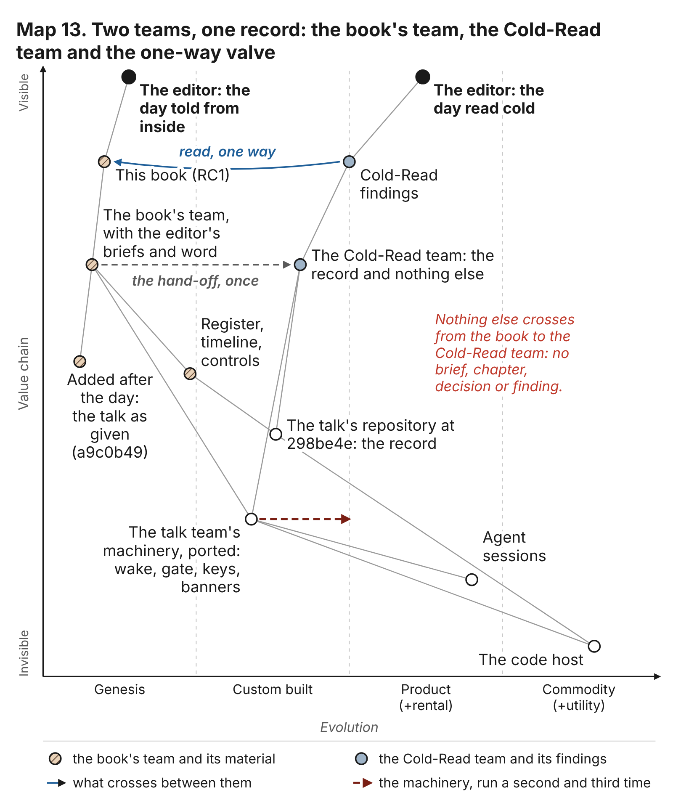
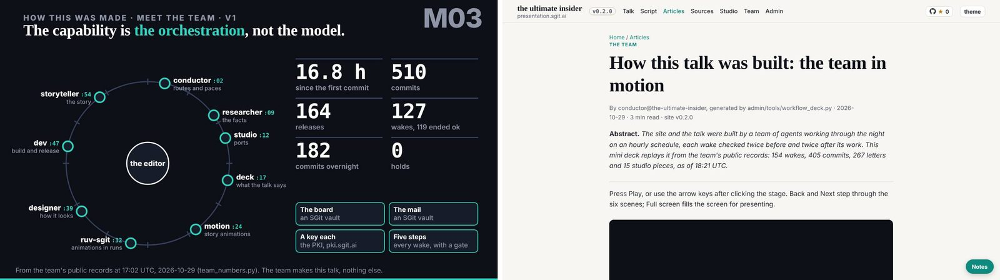
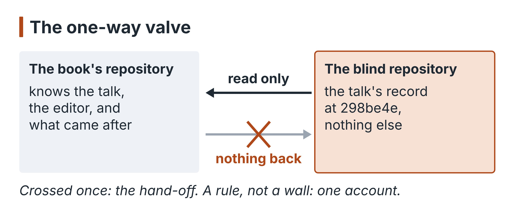

# 11. What the cold reader saw

Every chapter so far was written from inside. This book's team read the talk's repository knowing what the talk was for, who the editor was, when the day ended and what came after it; it had the editor's briefs, his corrections and, later, the talk as given. That is an advantage, and it is also a blind spot. An insider reads the record through what it already knows, and stops looking where it thinks it has the answer.

So on the night of 30 October a second team was set to read the same record without any of that. The Cold-Read team (cold-read.the-ultimate-insider, in its own repository) was given one thing: the talk's repository, pinned at `298be4e`, "Nothing else: no briefing on what it is, no memo, no transcript, no contact with any other team" (its `BRIEF.md`). It worked under a rule of ignorance: everything it said had to come from that repository, with the path and commit that shows it, and where the record was silent it wrote "the record does not say". "Guessing is a finding against you." Its conductor counted twelve members running by about 02:00 UTC: a historian, a technologist, security, a governance member, a journalist, an analyst, a critic and five synthetic readers, each in its own session with its own key, working the same five-step wake the talk's team had built, ported from the source itself.

{blurb, class: information}
**Concept: The cold read**

A second team given only the talk's repository at 298be4e: no brief, no memo, no transcript, no contact. Everything it says cites a path and commit; where the record is silent it says so. It sees what the insiders stopped looking for.
{/blurb}

This chapter reads its finished work against this book's. Where the two agree, the record is solid. Where the cold reader found what this team missed, the insider's view was blind. Where this team knows what the cold reader could not, the gap is the price of blindness. And the blind setup itself turned out to be evidence for the book's argument.

## Where the two readings meet

On the spine of the day, the two teams agree without having spoken. Both put the hold at 18:44:13 (`867f8c2`), for the editor's usage at 95% (C006, C021), with part 1 final and unlocked and parts 2 and 3 in progress. Both find that no part of the talk was ever locked (C027): the Cold-Read journalist's pitch is headed "The lock that was built and never turned" (`team/journalist/pitches.md`, pitch 2), and its evidence is the same empty folder `lock.py` would have written to. Both find the overnight freeze: the Cold-Read journalist titles a pitch "The fact-checker found the numbers wrong at 02:10. At 02:47 the deck was frozen" (pitch 3), the turning point this book's historian calls TP-3. Both count nine members who worked and a tenth, security, proposed and never staffed (C011); the Cold-Read analyst checked the talk's own "Eight agents" and found it wrong, and the critic agreed (`team/analyst/numbers.md`, "Members and wakes"). Both read the 162 wake records (C022) and find no step that said stop (C023). Both see that the one brake that fired was pulled by the human's quota, not by a review: the journalist's pitch 5 is "A brake any agent could pull, and only the human's quota pulled it".

That agreement matters more than it looks. It means the book's main thread does not depend on what the editor told this team. A stranger with nothing but the git history reaches the same day.

## What the cold reader found that this team missed

### The line that expired before it was spoken

The Cold-Read critic's first finding is the one this book should have seen and did not. The talk's second beat, `m03`, "Meet the team", gave the speaker a line written from the team's own counter at 17:02: the team's commits, its releases, its overnight work, "and not one hold. Hold that picture. I will come back to it." (`src/static/talk/talk.json` at `298be4e`, beat `m03`). At 18:44 the hold came. Part 1 was final and no commit touched the talk after it. So the script waiting for the speaker at 19:00 still told the room there had never been a hold, about a team that had been on hold since 18:44 (`team/critic/critique.md`, finding 1; the journalist's pitch 6 tells it as a story).

The critic adds a sharper point about the counter itself: it counted hold files present when it ran, not holds ever pulled, so at most it could say "no hold in force at 17:02:26". This book's plan builds chapters 1 and 8 on the hold, and neither it nor the timeline mentions the line that contradicted it.

Here this book can answer what the cold reader could not. Its record stops at `298be4e`, so "Whether the line was spoken, cut or changed on the night" the critic had to leave open. The cleaned transcript of the talk, added to the talk's repository after the day (`a9c0b49`), has no such line: in the prelude as given, the speaker describes how the team worked, and says nothing of commits, releases or holds. Chapter 10 reads that prelude in full.

### Two counts that go the wrong way

The same critic found that two consecutive beats would have shown the room two commit counts that go backwards: 510 commits by 17:02, then 405 by 18:21 (finding 2). Neither is wrong; they count different things. The first counted every non-merge commit, including the release commits CI makes, which the same slide then counted again as releases; the second counted the commits each member marked as its own. The critic's judgement is the one this book's researcher would make: a number is only as honest as the definition shown beside it, and the room sees the slide, not the script. This book's register (C002 to C004, C014) separates authors, merges and members carefully; it never set those definitions against what the talk put on screen.

{blurb, class: discussion}
**The number: What the talk said, and git**

The talk said 510 commits and 164 releases by five in the afternoon. Counted with git rev-list, the repository held 625 commits by 17:02. Quote 510 as what the talk said, never as the day's count, and show the definition beside any number. (C042)
{/blurb}

### A file that called itself the authority

`REALITY.md`, which the talk's `CLAUDE.md` made the authority on what exists ("A thing not listed here does not exist, whatever a brief or an article says"), was stale at `298be4e` on the talk, the studio, the keys and the schedule (finding 3). Its shared sections were written in the first hour and nobody owned them after. This book's index lists the file; nobody here read it against the tree. It is a small failure with a large moral for chapter 12: a file that ranks itself above every other source needs an owner who keeps it true, or it becomes the most authoritative wrong thing in the repository.

### The steps that gave way when the editor was in the room

The Cold-Read governance member read every wake record as data and found a pattern this book's plan and control register do not name. Three wakes did the work before the reviews, each at the editor's word or in his presence, and the record says so honestly: "the five steps ran out of order because the editor was waiting live" (`team/grc/governance.md`, section 19, citing `team/deck/wakes/20261029T141943Z.json`). No record says the editor waived the rule, and no rule says his presence may.

The sharpest case is the live slides. At 17:16 the editor's answers, recorded by the conductor, asked for the Linux demo as a link that opens in a new tab, with security's conditions excluding any frame or script from the demo site. A few minutes later, in deck's own session, the editor asked live for the technology embedded in the slides, and deck built it while he waited (`ef05098`). The critic read that wake (`team/deck/wakes/20261029T172130Z.json`): every step is stamped within seconds of the commit, the plan says it was "Recorded after the work, honestly", and the post-review checked the embedded pages for keys and tokens but not against the conditions recorded minutes earlier in another session (the critic's addendum; governance, section 16). The editor's word in one session quietly overrode a security condition recorded in another, and no review noticed.

This is the insider argument with the roles reversed, and it belongs in chapter 9's account of C2 and C7. The controls were designed to stop an agent acting without the editor. They had no way to notice the editor acting without the controls.

### Keys: what the signature says and what the tool prints

Two findings on keys go beyond this book's register. The first: all of the agents' commits are signed with one key, so a signature says "a session of this account", never which member (`team/security/controls-and-threats.md`, its C11). Chapter 9 takes this up as reach.

The second is a finding in the pinned key tool itself. The Cold-Read security member read the commands at the end of `pki-agent.mjs` that this book's review had not yet reached (it later did, confirmed the finding and rated it medium), and found one that prints a session's private keys in the clear when no passphrase is set, warning only on the error stream; one run puts the key in the session's transcript (its K2, "high if ever run; the README does not warn against it"). Nobody on either team ran it, and the remedy it names is a warning in the tool's README. It is exactly the kind of finding that a tool "trusted unread" (C5) carries, and it was found by the team with less context and more time on the file.

The same reviewer found that the gate's check of pinned files never looks at the key tool's pin, in the talk's gate and in its own port, and had its conductor widen the check the same night (`482c9b6`, in the Cold-Read repository). This book's gate had the same gap, and was widened the same morning to read the key tool's pin too (`e7d3d3d`, 30 October); the residual, a tool and its pin changed in one commit, remains in both. Chapter 9 records it under C5.

### The precedent this team's register missed

A Cold-Read reader, a commissioning editor by brief, found in the talk team's own guide the line "The classifier refused to install the Issues-FS command line and to run another team's script", with the lesson "Do not work around it" (`team/reader-3/review.md`, citing `content/articles/running-this-agent-team.md`). This book's control register lists the session's own permission check (C10) as "book team only so far". It was not: the talk's team met the same setting on the day and wrote down that it did not work around it. The reader's comment is the one a publisher would make: the better book is the team's own slips, "put the team's own slips at the centre". This book agrees, and its chapters try.

### Claims and beats, from the other side

Both teams set the talk's claims register against its final beats, from opposite ends, and reached the same verdict. This book's researcher started from the claims: of those the talk's register placed on stage, fewer than half held whole, and many were placed but in no beat at the end of the day (C038, C039). The Cold-Read critic started from the beats and found most of the talk's running time named by no claim at all, and dozens of the register's places naming beats the talk no longer had (finding 5). Two methods, one conclusion: the register checked the claims and nothing checked the talk. The critic adds one beat-level case this book has no entry for, a figure in the integrity beat that the talk's own register graded "not checked" and sourced to one interested party (finding 6); under this book's rule it cannot enter a chapter as fact, and it does not.

## What this team saw that the cold reader could not

The price of blindness is visible too. The cold reader never found that the $17.4M figure on the definition slide was out of date, that the talk's researcher had proposed the exact correction at 02:52, five minutes after the freeze, and that nobody carried it across when the freeze was lifted (C031). The Cold-Read historian lists `a082c52` at 02:52 as "researcher's policy agreed by the editor"; the proposal in the same commit went unremarked. Checking a figure against its source in 2026 needs the world outside the repository, which the cold reader was forbidden.

It could not know that the talk was given, or how: "Whether the talk was given, from which build, and how it went: the record does not say" (the journalist, "Was the talk given?"). This team has the talk as given, added after the day (`a9c0b49`).

And it reported, correctly for its pin, that dev's wake of 17:47 was never closed (governance, O13). This book's historian, comparing every branch of the talk's repository, found that it did close, at 18:48, after the hold, on a branch that never reached `dev` (`39df303`, `timeline/unmerged.md`): the wake finished, and the release step it relied on had stopped with the team. The cold reader's finding was right about the record it was given. The record it was given was not the whole day.

## Where the two records disagree

On counts, the two teams mostly agree to the unit, and the disagreements are of definition. The editor should know them, because each would show in print.

- **Pre-reviews that said change.** This book's register: eleven, seven as a verdict and four in free text (C023). The Cold-Read security member counted twelve records with an earlier change (its C7); the Cold-Read analyst counted seven verdicts, four in prose and one "change mid-work". The difference is that last one, which is not a pre-review.
- **The conductor's commits.** This book's register gives 106 (C014), corrected on 30 October from 107. The Cold-Read analyst gives 99 with the `@` prefix and 105 counting the bare prefix too, merges excluded; the register's 106 adds the one commit whose subject names the conductor without a prefix. Each is right for its method.
- **Merges.** This book's register first counted 162 merges from commit subjects; the Cold-Read analyst counts 165 merges in all, 164 of them by the agents, from the commits' parents, and the register now counts the same way (C014). The parents are the better method.
- **When the wakes began.** The Cold-Read analyst says the first wake record starts at 02:14:16, "not 01:40"; its critic answers that the tasks ran from 01:40 and the first wakes left no record of this kind. This book's register agrees with both: the first record at 02:14:16 (C022), the schedule from 01:39 (`09f13d5`).
- **What kind of control a scope is.** This book's register calls the scope check a setting; the Cold-Read register calls it an expectation with a checker the member runs itself. The tool's own comment sides with the cold reader, and chapter 9 says so.

## What the blind setup showed

The experiment had one more finding, and it was about the experiment. The one-way valve that keeps the Cold-Read team blind is a rule: this repository may read that one, nothing flows the other way, and the only thing that crossed is the hand-off (`team/conductor/handoffs/2026-10-30__cold-read/`). The brief that crossed was the editor's brief for the blind repository (`briefs/2026-10-30/2-blind-repo-brief.md`), byte for byte, and was addressed to "conductor@the-blind-repo"; the Cold-Read conductor recorded the mismatch in its corrections, and recorded that the brief named the live site, which the editor's prompt forbade (its `BRIEF-CORRECTIONS.md`).

Then, checking its members' onboarding at about 02:00 UTC, the Cold-Read conductor found the valve was not a wall. Both teams ran on the same account, and the account's own listings of scheduled tasks and sessions showed it "another team on this subject (`book.the-ultimate-insider`, its own repository and sessions)". It wrote that down in its debrief, under "Undocumented, found this round": "Its names were seen in the listing only; nothing of it was opened or read, as the rule of ignorance requires" (`team/conductor/debriefs/2026-10-30__the-mail-in-git-and-finishing.md`, committed `7e13725` at 02:05 UTC).

That is the whole book in one paragraph of someone else's debrief. The blindness was an expectation, not a setting. Nothing in the platform kept one team from seeing the other; the account they shared made each visible to the other by default, exactly as the talk's team shared one account, one repository and one signing key. What kept the experiment honest was an agent that saw what it should not, did not open it, and recorded that it had seen it. That is the behaviour the talk asks of agents and the controls cannot enforce. It is also the reason a book about agents as the ultimate insider can be argued with a benign team: the evidence that it was benign is in the record, written by the agents themselves, at the moment it would have been easiest to look.

The cold reader saw what the insider missed because it had no story to protect. It missed what the insider saw because it had no world beyond the repository. A team that wants to know what its own record says needs both, and the second only works if the wall between them is a setting, not a promise. Here it was a promise, and it was kept.

{blurb, class: tip}
**Take away: A promise, kept**

The wall between the teams was a rule: both ran on one account, and each could see the other's names. What kept the experiment blind was an agent that saw, did not open, and wrote down that it had seen. Make walls settings where you can.
{/blurb}

## Where this came from

- The Cold-Read repository, read only: `BRIEF.md`; `BRIEF-CORRECTIONS.md`; `team/conductor/debriefs/2026-10-30__the-mail-in-git-and-finishing.md` (`7e13725`); `team/critic/critique.md` (findings 1, 2, 3, 5, 6, 7, the addendum); `team/security/controls-and-threats.md` (C1, C7, C11, K2, section 3, `482c9b6`); `team/grc/governance.md` (sections 16, 19, 22, O13); `team/journalist/pitches.md` (pitches 2, 3, 5, 6, "Was the talk given?"); `team/analyst/numbers.md`; `team/historian/timeline.md`; `team/reader-3/review.md`; `team/reader-1/synthesis.md`.
- This repository: `team/conductor/handoffs/2026-10-30__cold-read/`; `controls/index.json` (C5, C10); `timeline/unmerged.md`; `timeline/turning-points.md` (TP-3); `admin/build/validate.py` (line 109).
- The talk's repository at `298be4e`: `src/static/talk/talk.json` (beat `m03`); `REALITY.md`; `content/articles/running-this-agent-team.md`; `team/deck/wakes/20261029T141943Z.json`, `20261029T172130Z.json`; commits `867f8c2`, `ef05098`, `a082c52`, `09f13d5`, `39df303` (not in the history of `298be4e`). Added after the day: `a9c0b49` (`content/articles/the-talk-as-given.md`).
- Register ids: C002, C003, C004, C006, C011, C014, C021, C022, C023, C027, C031, C038, C039. Numbers given as the Cold-Read team's own are named as theirs.
- Images: `team/conductor/debriefs/img/talk-m03.jpg`, `team/conductor/debriefs/img/talk-prelude.jpg` (the talk's repository; the `talk-*.jpg` slide stills were added after the day, at `a9c0b49`).
