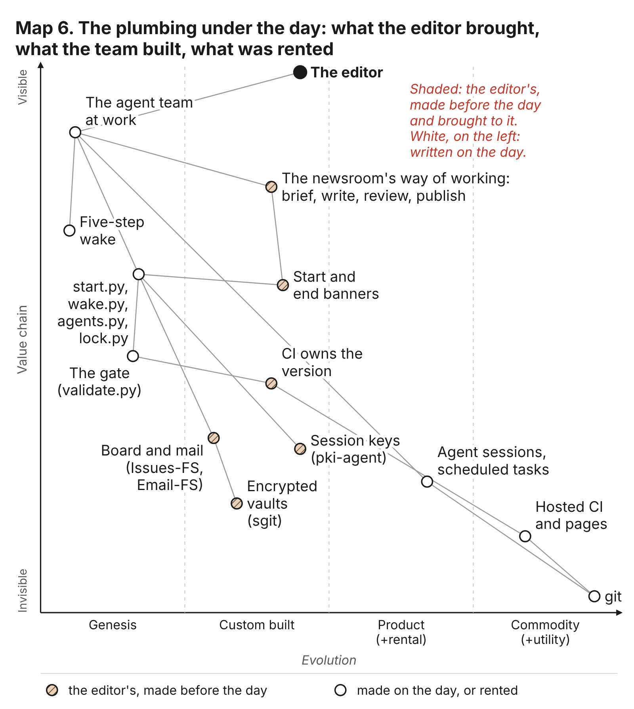
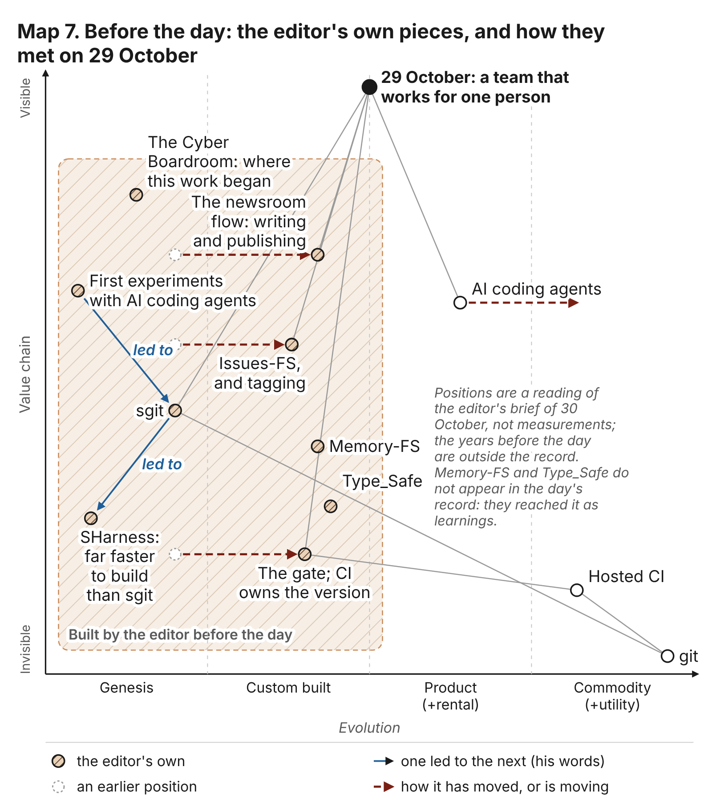

# What was already there

The chapters before this one tell a day. An empty repository at a quarter past midnight; a site, a gate and a release pipeline within the half hour; a schedule, a hold and a review around every piece of work before three in the morning; a talk on stage at seven in the evening. Read in order, it can look like a team inventing its way of working as it went. Some of it was invented that night: the five steps of the wake were the editor's word on the day itself (chapter 4), and the lock tool was built in the last hours (chapter 8). But most of what the team stood on was not new on 29 October. It arrived in the first commit already formed, with its reasons written down somewhere else.

The clue is in the first line of a file. The talk's release workflow, `.github/workflows/release.yml`, opens with the words "CI owns the version" and a link to an article on the editor's newsroom. The rule, and the reason for it, were older than the repository. The same is true of the gate, of the markdown copy beside every page, of the brief that is never edited, of the board and mailroom made of plain files, of the key each session makes for itself, and of the hold. Each came from somewhere, usually from an incident, and each was carried into the talk's repository by an agent that had read where it came from.

This chapter explains the day by what was already there. The first half is the plumbing: each piece explained for a reader who has never seen it, with the quality it serves and the chapters where it shows. The second half is the line of work behind it, told from the editor's public writing and public repositories, one piece leading to the next over what his brief calls about two and a half years. The close says what that means for a reader who wants to repeat the day without having spent the years.

One rule for reading it. The dates and counts here come from a research dossier of public sources, not yet from the claims register. Each is marked "(dossier: ...)" so the researcher can register it, and the chapter uses as few as it can.

## What "plumbing" means here

The editor's word for it, in his brief for this chapter, is plumbing: "the sort of plumbing and core CI pipeline, sorry, non-functional requirements, and like quality and workflows". The correction in the middle is the useful part. A functional requirement says what a thing does: the talk has slides, the player counts down. A non-functional requirement says how well and how safely it does it, and whether anyone can tell afterwards what happened. His own site on the subject, nfrs.sgit.ai, lists them as "the whole version control, reliability, resilience, security, backups, consistency, explainability, and documentation" (dossier: the newsroom and the network of sites).

The day leaned on five of them, and the rest of the chapter names them each time:

- **Traceability.** Anyone can find out afterwards who did what, at whose word, and why. This book exists because the day had it.
- **Reversibility.** Any step can be stepped back from, because every state was kept and numbered.
- **Legibility.** A person, or a new agent, can read the state of the work without asking anyone. It is what lets one person run a team while asleep.
- **Safety.** Something stands between an agent's reach and harm: a check that refuses, a review that sends back, a brake anyone can pull.
- **Pace.** The work goes fast without the speed breaking the other four. The talk's line for it is that brakes are what let you go faster.

None of the pieces below is clever. Most are a file, a folder or a short script. Each turns something a person would otherwise have to remember, watch or ask about into a record a tool can check.

<!-- figure: Map 6, the plumbing under the day (team/conductor/rc1/maps/06-the-plumbing-under-the-day.json): what the editor brought, what the team built on the day, what was rented, on a Wardley map -->

## The plumbing, piece by piece

### CI owns the version

Every release of the site gets a number, such as v0.1.209, and nobody types it. The continuous integration service, the machine that builds and publishes on every push, reads the latest tag, adds one, writes the version file, tags the commit and publishes. On the working branch, `dev`, it bumps the last number; on the public branch, `main`, the middle one. The talk's rules say it in one line: never write the version file, never put a number in a commit subject. This book's rules repeat it.

It serves traceability, because every release is a tagged point anyone can open; reversibility, because the release before a bad one is a named place to go back to; and pace, which is why the rule spread. When several agents push to one branch in the same hour and each works out the next number for itself, two of them pick the same one. A number only one machine may write cannot collide.

On the day, the first pass of the site was released four minutes after its commit as v0.1.0, by the pipeline, not by the agent (chapter 2). By the end of the day's work there were 210 releases (C009) from nine agents pushing to one branch (C011). Even the hold went out as a release (chapter 1, C006).

### The gate before every push

The gate is a short program, `admin/build/validate.py`, that runs after the build and before anything is published, and fails if anything is wrong. In the talk's repository it checked that links resolve, that every page has its markdown twin and is listed for machine readers, that no script loads from another host, that every beat of the talk has a slide, that no em-dash is in the prose, and that nothing shaped like a private key or a known token sits in any tracked file. A red gate is no release.

It serves safety, in the only form the day had that a tool enforced on every member: a check no member wrote and none could turn green by asking. It also serves pace: a team whose every push is checked can push every hour without a person reading each diff. The estate's guidance lists its checks and says that every one "has each caught a real defect" (dossier: the gate). A gate is a list of past incidents, made executable.

It was in the first pass, before there was a second member (chapter 2). By 02:51 dev had added the wake records to it, so that a wake with a skipped step failed the build for everyone (chapter 4). Its limits were the day's too: its tripwire matched only patterns someone had thought of, so captured cookie values and form tokens were caught by reviews instead, one only after the push (chapter 9, control C6; C025).

### Markdown twins and llms.txt

Every page the site publishes has a plain markdown copy beside it, at the same address with `.md` on the end, generated in the same build so the two cannot drift. At the root sits `llms.txt`, a plain text index of the site written for language models. The gate fails a page with no twin.

It serves legibility for a reader that is not a person. An agent reads plain text far better than a styled page. The editor's reason, in his guide to working with an AI coding assistant, is that "what a session knows is what it reads", and public sites with an `llms.txt` are the first layer of that memory (dossier: markdown twins). A twin also serves traceability: it can be compared line by line between releases.

The talk's site had both from its first pass, built to the estate's standard (chapter 2). The team read the editor's other sites the same way to learn how to run: the conductor wrote on the day that the team's shape came from the newsroom, another of his sites and "the estate's standard" (dossier: the agent team as a recipe). The Cold-Read team, arriving with nothing but the record, read the talk's site through it too (chapter 11).

### The brief, the reality file and the corrections

Three files at the root, with three rules. `BRIEF.md` publishes the editor's request as he gave it, and is never edited. `REALITY.md` lists what exists, kept current by whoever ships: "a thing not listed here does not exist, whatever a brief or an article says". `BRIEF-CORRECTIONS.md` sits between them, for where the brief turns out to be wrong.

It serves traceability, because every later disagreement can be measured against a fixed request, and legibility, because what was wanted and what is there are kept apart. The idea is provenance, the record of where a fact came from, which was the subject of a talk the editor gave in 2024 and of an essay on news in 2025 (dossier: provenance and the claims register). His newsroom's design line is "provenance is the product".

On the day the brief was never edited, as designed; the corrections file stayed empty, which is the failure chapter 2 keeps. The talk's claims register, with three claims found not to hold (C029, C030), is the same practice applied to numbers (chapter 5), and so is this book's `claims/`.

### The wake and its sub-agents

Each member is a session that wakes at its own minute of every hour. A wake pulls the latest work, prints a start banner, and runs five steps, each leaving a verdict in a record: a sub-agent briefed as the conductor plans; a sub-agent briefed as security reviews the plan; the member works, only after both say go; security reviews the diff; the conductor checks the work against the plan. A `stop` from any step holds the team. An end banner and a debrief close it.

It serves safety, as a second reader the agent cannot skip, which the editor had written about earlier in the month (dossier: the five-step wake and holds); traceability, because every wake leaves a file; and legibility, because banners and debriefs are written for a person reading in the morning. The idea of a conductor that runs every role on a schedule "with a security role first and last" is in his newsroom from early October 2026 (dossier: the agent team as a recipe).

Chapter 4 tells it in full: 162 wake records, 160 with all five steps (C022); plans sent back eleven times, and no step saying stop all day (C023). Chapter 9 files it as control C2, an expectation with a record, because the reviewers had the member's own reach.

### Comms in git: a board and a mailroom

The team talked through files, in two layouts the editor had built earlier. The board is Issues-FS lite: each member has three folders, for issues open, blocked and done, and moves a file between them as its work changes state. The mailroom is Email-FS lite: a member asking another for work writes a message file, marked as a request, into the recipient's folder. The rule over both: read every folder, write only your own. On the talk's day they lived in public encrypted vaults; on this book's team they live in `comms/`, in git.

It serves legibility above all: the person in charge never has to ask a member to report on itself. It serves traceability, because who asked whom, and when it was answered, is in the history; and a kind of safety, because a team whose every conversation is public has no back room.

On the day (chapter 4), deck asked the researcher at 09:21 and had the answer in its next slot, with nobody chasing anyone. The failure is there too: through the afternoon, requests written in members' fallback folders were not routed, and the record of who had asked whom was split until the conductor looked.

### A key for every session

Each session makes its own key pair with a small pinned tool, `admin/tools/pki-agent.mjs`, a copy of the one the editor publishes on pki.sgit.ai, checked against a stored hash before use. It publishes the public halves in `team/<id>/key.json` with a QR image, and keeps the private halves out of the repository. "The push is the authorisation": a key is the member's because the member pushed it to its own folder.

It serves traceability of identity, and safety: a secret, such as a vault's write key, reached a session only sealed to that session's own published key. The sentence about the push came from the editor's PHP newsroom two days before the talk (dossier: session keys).

Chapters 3 and 9 (controls C4 and C5) tell how it went, and keep the limit: a key's standing rested on the push alone, so identity was exactly as strong as write access, and every member could write anywhere.

### The hold

A file. Any member may write `team/<id>/HOLD.md` and push it; every wake's start script then stops before doing anything, and each member pauses its own scheduled task. Only the editor lifts it.

It serves safety in its simplest form, a brake anyone can pull and only the person in charge can release; reversibility, because the team freezes in a known state; and pace, which is the talk's argument: a team that can be stopped in one push can be let run through the night. The idea is in the editor's writing earlier in October, as the security role's single hold message and an article on knowing when to stop (dossier: the five-step wake and holds).

The brake existed from 01:39, before the first scheduled wake (chapter 4). It fired once, at 18:44:13, at the editor's word about his usage (C006, C021, C024). Chapter 1 opens on it, chapter 8 shows it overtaking the locks, and chapter 9 records its miss: a hold stops the next wake, not one already running.

### What the pieces have in common

| Piece | What it replaces | Serves | Chapters |
|---|---|---|---|
| CI owns the version | agents agreeing a number | traceability, reversibility, pace | 1, 2, 12 |
| The gate | a person reading every diff | safety, pace | 2, 4, 9 |
| Markdown twins, `llms.txt` | explaining the site to each new reader | legibility | 2, 11 |
| Brief, reality, corrections | remembering what was asked and what exists | traceability, legibility | 2, 5 |
| The wake and its sub-agents | watching each piece of work | safety, traceability | 4, 9 |
| Board and mailroom | asking who asked whom | legibility, traceability | 4 |
| Session keys | trusting who pushed what | traceability, safety | 3, 9 |
| The hold | being awake to stop the team | safety, pace | 1, 8, 9 |

Each replaces attention with a record. And almost every one encodes an incident. The editor's article "Every mistake added a rule" says it directly: map the work, make small pieces of it ordinary, write a rule for each incident and a machine to enforce the rule (dossier: the method, written down). CI owns the version because agents on another of his sites once released on the same numbers. The gate's checks are the defects they caught. The key tool is pinned because a session may refuse to download code and run it. The rules were cheap to follow on the day because somebody had already paid for each one. Where they were paid for is the second half of this chapter.

## The two and a half years

The editor's brief describes the day as the meeting point of "the work I've been doing for the last 2.5 years", and names what met there: The Cyber Boardroom, Issues-FS and Memory-FS, tagging, the newsroom and its publishing workflow, Type_Safe, his first experiments with an AI coding assistant, sgit, SHarness and Wardley maps. "It's all one leads to the other."

What follows tells that line from public sources only: his articles, his public repositories and their histories, and the package index where his libraries are released. It is told as what each piece made possible on the day. Where his own article is the source, it is his account; where the record is silent, the chapter says so.

<!-- figure: Map 7, before the day (team/conductor/rc1/maps/07-one-piece-leads-to-the-next.json): the editor's own pieces and how they met on 29 October; positions are the conductor's reading, for the editor to challenge -->

### Before the window: a library and a release habit

The line starts before The Cyber Boardroom, with a library and a machine. OSBot-Utils is a Python library of general helpers in the editor's open source organisation, with a history that begins in February 2020 (dossier: OSBot-Utils). In October 2023 he added to it a pair of workflow actions that take the latest tag, bump the last number on `dev` or the middle one on `main`, write the version file and tag the commit; the first release tagged that way was authored by the CI service, not by him (dossier: CI owns the version). That is the rule that opens the talk's release workflow, and an article on the talk's site says so in his words: "This is the scheme I wrote for OSBot-Utils in 2023."

An older root lent the day its vocabulary. A book he began in 2018, Generation Z Developers, already had pioneers, settlers and town planners in its outlines, the three stages Simon Wardley uses for how a new thing is built, made usable and made industrial (dossier: Generation Z Developers). On the day the storyteller used those words for a map at the editor's beat on evolution (chapter 10), and chapter 0's explorer, villager and town planner are the same idea.

### The Cyber Boardroom

The brief puts the start at The Cyber Boardroom, "when I actually started really pushing it". The public record traces its arc but not that moment.

It begins with a bot: in September 2023 he published an early version of Athena, built on cloud serverless functions and a hosted language model, which became The Cyber Boardroom's advisor (dossier: Athena). His public writing on generative AI starts in February 2024, with a talk to the OWASP London chapter (dossier: the public writing starts). In April 2024 The Cyber Boardroom Ltd was incorporated, a platform to help boards and executives with cyber security, announced as the result of "nearly all of my spare time" (dossier: The Cyber Boardroom Ltd incorporated). From June 2024 the website and Athena were released to the public package index many hundreds of times, each numbered by the same CI scheme (dossier: the Cyber Boardroom website on PyPI). In July 2024 a Community Edition followed, "based on a large number of open source python packages that I'm also releasing" (dossier: the first MVP, then the Community Edition).

In his account, it taught two lessons the day used. One was what personas and output shaped to the reader are worth: the root of a team whose every member has one role. The other was the need for somewhere to keep confidential data the server cannot read, which "is what I eventually built as sgit" (dossier: The Cyber Boardroom Ltd incorporated). A third gift was open source as the default: because the libraries were public, the day's tools and records could be reused, and read by anyone, including this book.

Two other things began that year. In June 2024 he gave a talk at the OWASP global AppSec conference, "Deterministic GenAI Outputs with Provenance" (dossier: provenance, as a talk), the earliest public statement found of the idea behind the talk's claims register and this book's. And inside OSBot-Utils, a helper class began to check the types of what was assigned to it, and by June 2024 had "this more correct name", Type_Safe (dossier: Kwargs_To_Self). Type_Safe is a way of writing Python in which every value has a declared type checked when it is set, and small constrained types replace raw strings. It became the house style of his later libraries.

Here the chapter has to be careful, because the brief names Type_Safe among what met on the day. The talk's repository does not use it; its tools are standard-library Python (dossier: Type_Safe). Type_Safe reached the day only through sgit, whose command line was bootstrapped on its constrained types, and which every vault command on the day ran. It was underneath the day, two layers down, not in it.

### Graphs, files and memory

The next stretch shows less in the talk's repository than in how the later work thinks. In December 2024 he started MyFeeds, news feeds built on semantic graphs and aware of the reader's role, which in his account he paused when "the industry was silent" (dossier: MyFeeds). In early 2025 came MGraph-DB, a graph database kept in memory first, and essays on trust, fact provenance and very small payments that he later called "the foundations the newsroom now stands on" (dossier: MGraph-DB and the news essays). That graph thinking runs on into graphs.sgit.ai, where a node means nothing on its own and meaning lives in its links, and into the newsroom's graph per article (dossier: graphs.sgit.ai).

In January 2025 a talk on building a generative AI startup put the day's plumbing on his slides: "CI Pipeline, Git version control (autotagging)", "Auto-tag everything", "Document everything (large tech documents co-created with LLMs)" (dossier: My journey building a GenAI startup). It is the earliest public statement found, in his own slides, of release on every push, automatic tags, and documents written with models.

In May 2025 he started Memory-FS, a file system abstraction "to build file-based representations of documents and standards" (dossier: Memory-FS). Its idea is that memory is a set of versioned files rather than a store behind an interface, which is the idea the day ran on: a team whose memory was its folders, debriefs and wake records. But the talk's repository does not name Memory-FS. It reached the day as an idea, and through sgit, whose speed-ups name Memory-FS's reads among their sources (dossier: Memory-FS).

### The first daily use of an AI coding assistant

The brief speaks of his "first experiments" with an AI coding assistant. The public record starts later than the experiments. The earliest mention found in his public commit messages is in Memory-FS in June 2025, tests written with the assistant's help; a month later an OSBot-Utils commit adds documentation the assistant wrote from the source code (dossier: the first public trace). In October 2026 he wrote that his guide to working with an AI coding assistant "comes from about a year of doing this every day" (dossier: the first public trace), which fits.

The commits show trust growing: first tests, then documentation, then, in 2026, whole repositories. His guide sets out the method the day used: one session per topic; an agent is a session with a role file; memory is what the session reads. Every member of the talk's team was exactly that.

### From SG/Send to sgit

The lessons from The Cyber Boardroom met in early 2026. In February he started Issues-FS, an issue tracker in which the issues are files, with a lite form of three folders and the rule that an agent may read another's folder and not write into it (dossier: Issues-FS). That is the talk's board and this book's `comms/issues/`.

Days later he started SG/Send, a service for sending encrypted files in which "the decryption key is never sent to the server" (dossier: SG/Send). It gave the day its vault server, and the habit of briefs and debriefs, which the SG/Send record holds in large numbers.

In March 2026 its command line became sgit: version control with git's model, encrypted, so that a repository can live on a server that cannot read it (dossier: sgit). Its first commit after the initial one bootstraps it "with Safe_* types", which is Type_Safe arriving, and most of its commits since carry an AI coding assistant as author (dossier: sgit). On the day, sgit carried the team's board, mailroom and evidence vaults (chapter 4). Its key discipline, read keys may be published and write keys never, was written up after an incident in August 2026 in which keys that would have given the world write access were nearly published (dossier: vaults).

In June 2026 a strategy brief for SG/Send turned its priority to profitability, and "from then on the briefs turn towards risk acceptance and RiskMandate" (dossier: the turn towards RiskMandate). RiskMandate's Agent Behaviour Policies, a mandate, a grant, the gap between them and a barrier for each capability, are the shape of every member's `policy.json` on the day and the vocabulary of the talk's second half (chapters 3 and 9).

### The newsroom and its publishing workflow

The newsroom is where the plumbing became a way of working, and the source the talk's team copied most directly. Its earliest article in the public wire, from August 2026, is "Green does not mean live": a release is not done until the live site serves it (dossier: the newsroom's first articles). Within the fortnight a network of sites grew around it, each built by a script, with a gate, a markdown twin for every page and an `llms.txt` (dossier: the newsroom and the network of sites). That is the talk's site in its first commit.

In the newsroom, every article starts as a voice memo from the editor and ends as a tagged release: an agent writes it from the memo and says so, carries the provenance of every claim, says what the article does not claim, and publishes through a gate with CI owning the version (dossier: the newsroom's publishing flow). The talk's team kept the same habits: the editor's words kept verbatim in its briefs, articles with a section headed "What this does not claim", reports on itself generated from its records. This book's briefs, corrections file and chapters ending with where they came from are the same flow again.

"Tagging", in the brief, can mean two things, and the sources support both (dossier: tagging). It can mean the automatic release tags, "auto-tag everything", which every release on the day carried. Or it can mean a controlled vocabulary of tags on content, which every newsroom article carries. The talk's repository has the first and not the second.

### October 2026: the recipe written down

In the month before the talk, the editor wrote down, article by article, nearly the whole frame the talk's team ran on. At the end of September the newsroom described six agents sharing one inbox, each on its own account with a policy, and published the article the talk was cut from, "The ultimate insider: agents, the infrastructure that cannot hold them" (dossier: behaviour policies, six agents, and the talk's argument). In the first week of October came the recipe: roles that talk "in files through Email-FS lite", a conductor that runs every role on a schedule, the agent team as it runs, and the mandate stack (dossier: the agent team as a recipe). The same week his guidance for every repository on sgit.ai was written: a brief published in full, a reality file, a corrections file, one version up on every push, a gate, markdown twins and `llms.txt`. That guidance is very nearly the talk's first commit, item by item.

The following weeks added the method: every mistake adds a rule; a second reader the agent cannot skip; his guide to working with an AI coding assistant; where vault keys live; why he values Wardley maps (dossier: the method, written down). Then the keys, a directory of people and keys and an agent allowed to make its own; and the rules of the game, which files an agent may change (dossier: PKI, the rules of the game). The team did not invent its shape on the day. It read it.

### SHarness, and the last week

The last pieces arrived within days of the talk. SHarness, "a secure harness", began in late October 2026 with "a narrow problem in sgit" and was a published package the same day (dossier: SHarness). Its idea is that a behaviour policy should be executed rather than read: each process gets a policy, enforced by the operating system's kernel or a separate door the agent cannot open. It is the talk's fourth rung, a boundary outside the agent's reach (chapter 9), built as software, and it was in the talk among "a month of innovations".

SHarness also produced, by accident, the rule this chapter began with. Agents working on its site released on the same version numbers within minutes of each other; the site moved to CI-owned versions, and within two days so had the newsroom and its sister sites (dossier: CI owns the version everywhere). Then the editor added one sentence to a runbook: "pushing your public key to team's dev is the authorisation". Both rules arrived less than two days before the talk's first commit (dossier: CI owns the version everywhere), and both ran all day. The oldest rule in the plumbing and the newest met in the same week.

The brief says SHarness was "way faster compared to" sgit. The public record does not make that comparison. It gives two timelines: SHarness from a narrow problem to a site, a design and a second release in about five days; sgit from SG/Send's first commit to its first package in about six weeks, and to its present form over months (dossier: two things the brief asked for). The comparison is the editor's. If this chapter's line is right, the likely reason is that SHarness was built by a method sgit had helped to make: the guidance, the gate and the roles were in place before SHarness began, and had not been when sgit did.

### Wardley maps, all along

One habit runs under the whole line, and the brief says it "made the whole difference": Wardley maps. A Wardley map, as the editor uses it, is "a graph with two axes of context" (dossier: Wardley maps in his work). Up the side is a value chain, from a user's need at the top down to the things nobody thinks about. Across the bottom is evolution, from genesis, something new and uncertain, through custom-built and product, to commodity, something anyone can rent. Every dot is a claim; it is "a map, not a measurement". The public record shows him using them from the 2018 book outlines, through a security summit talk and a threat modelling talk, to the SG/Send strategy and a run of October 2026 articles drawn as maps; on the day, the storyteller drew its own, and some reached the talk (chapter 5; dossier: Wardley maps in his work).

They are also the way to read this chapter. Put the plumbing on a map and the two and a half years become a movement. When CI-owned versions were first written, they were custom: one library, one person's scheme. By the day they were, for him, close to a product: written down, the same on every site, ported in a commit. The same is true of the gate, the twins, the board and the keys. Custom pieces are expensive and fragile; pieces that have moved right are cheap and reliable. The day could spend its hours on the talk because its plumbing had already moved. Map 7 draws this, and its positions, like any map an agent draws for this book, are a claim for the editor to challenge. His own map site warns that a model placing components on a map "is generating consensus-shaped output with no underlying evidence" (dossier: Wardley maps in his work).

<!-- figure: a simple timeline of the line of work, from OSBot-Utils to the day, each piece with an arrow to what it led to; dates drawn only after the researcher registers them -->

## What the public record does not say

The brief asked for some things the public record does not give. They are left as questions for the editor.

- **When he went full time.** No public source names the date. The anchors around it are the Athena post of 2023, the incorporation of April 2024 announced as the work of his "spare time", the first package releases that June, and a slide in a January 2025 talk, "Last 10 months of my life. All open sourced", which points to about the spring of 2024 (dossier: two things the brief asked for). They fit his phrase. None of them is the date.
- **SHarness against sgit.** The comparison is his, and no public source makes it.
- **The first experiments with an AI coding assistant.** The earliest public trace is a commit message of June 2025; the experiments may be earlier.
- **What "tagging" means.** Release tags, content tags, or both.
- **Type_Safe and Memory-FS on the day.** The talk's repository names neither. If he sees a more direct line than the one through sgit and the idea of memory as files, it is his to say.
- **When RiskMandate was founded.** Not found in public sources.

There is a further limit. Many newsroom articles are written by an agent from his voice memos, and say so. Where this chapter quotes them for what he did or thought, it is his account, written down by an agent and checked by nobody independent. Where it cites commits, package releases or repository histories, the source is a machine record.

## A meeting point, not an invention

Read with this chapter in hand, the day looks different. Before three in the morning a team of agents had a site, a release pipeline, a gate, a board, a mailroom, a key for each member, a review around every piece of work and a brake anyone could pull. None of it was invented that night. The pipeline was a 2023 library's. The gate and the twins were the estate's guidance of early October. The board and mailroom were Issues-FS lite and Email-FS lite. The keys were pki.sgit.ai's. The vaults were sgit's, and sgit stood on Type_Safe. The team's shape was a recipe the editor had published weeks before. His own summary, written on the day, is that "almost every innovation we have been working on this month came together in it" (dossier: the day). On the evidence here, the month's innovations came together because the years had already made their parts ordinary.

That changes what the day proves. Chapter 0 calls it a counter-example to the claim that agents cannot be made to work, and it still is. But it is a counter-example from someone who had spent years building the floor the agents stood on, and had written down why each board was nailed where it was. A reader who has not done that should not expect the same day on a first try. Three things help, and chapter 12 gives the order.

**Port, do not rebuild.** The plumbing is public, which is the point of open source as a default. This book's own team took the talk team's machinery "rule for rule" and had it running in about an hour on the morning after the talk (chapter 12, `3b403fb`). The guidance for every repository is a public page; the key tool is one file with its hash. A reader can have the gate, the CI-owned version, the brief and reality files, the board and mailroom layouts and the hold on the first day, without the years.

**Expect to learn the reasons the hard way.** What cannot be ported is the incident behind each rule. A team that copies a gate does not know which defects its checks were written for, and so does not know what it cannot see. The talk's team had the editor's gate and still pushed other sites' tokens into a public commit, because no incident had yet taught the gate their shape (chapter 9, C025). Keep a corrections file and use it, so that your incidents become your rules. That is the editor's method in one sentence.

**Build first the pieces that refuse.** The pieces that served the day best were the ones a tool enforced: the version only CI writes, the gate before every push, the hold every wake reads first. The ones that rested on an agent choosing to follow them, a scope in a file the agent can edit, a review inside the member's own session, held because the team was benign (chapter 9). Put every brake you rely on outside the agent's reach, and treat the rest as expectations until they have earned more.

The day was the meeting point of a long line of work, not the invention of a new one. That is less of a story than a team inventing its own rules overnight, and more useful. It means the method is not a feat. It is plumbing, and plumbing can be copied, checked and improved by anyone willing to read where it came from. Chapter 12 is how to start.

## Where this came from

- **The dossier:** `team/conductor/rc1/research/the-two-and-a-half-years.md` (the researcher, 30 October 2026), sections 1 (timeline), 2 (the plumbing), 3 (Wardley maps) and 4 (sources). Every date and count marked "(dossier: ...)" is from it and is not yet in the claims register.
- **The editor's brief:** `briefs/2026-10-30__in-session/01-principles-maps-and-the-plumbing.md` (30 October 2026, about 10:30 UTC), quoted for "2.5 years", "one leads to the other", the plumbing and the SHarness comparison.
- **Advice:** `team/conductor/rc1/reviews/gen-zx-team.md`, section 5, change 3.
- **Maps:** `team/conductor/rc1/maps/06-the-plumbing-under-the-day.json` and `07-one-piece-leads-to-the-next.json`; positions are the conductor's reading.
- **Public sources, by name and date** (read by the researcher on 30 October 2026):
  - newsroom.sgit.ai: "Green does not mean live" (17 August 2026 in the wire); "Seven vaults, one method" (19 August 2026 in the wire); the network of sites (26 August 2026 in the wire); "Introducing fractal semantic graphs" (20 September 2026); "Six agents, one inbox" (29 September 2026); "The ultimate insider: agents, the infrastructure that cannot hold them" (30 September 2026); "Replicating the agentic inbox" (2 October 2026, revised 3 October); "The agent team as it runs" and "The mandate stack" (6 October 2026); "Every mistake added a rule" and "Knowing when to stop" (8 October 2026); "A second reader the agent cannot skip" and his guide to working with an AI coding assistant (9 October 2026); "Where the vault keys live" (10 October 2026); "Not a straight line" and "Why I love Wardley maps" (12 October 2026; the first his account, from memory); "From Send to sgit" (15 October 2026); "Generation Z developers, again" and "A directory of people and keys" (18 October 2026); "PKI everywhere" (20 October 2026); "How a memo becomes a release" (21 October 2026); "The rules of the game" (22 October 2026); "CI owns the version" and "What sgit does that git does not" (27 October 2026); "How a journalist agent publishes here" and "The push is the authorisation" (28 October 2026); "Agents have an identity now", "Introducing SHarness" and the case study of the talk (29 October 2026).
  - sgit.ai: the guidance "Every sgit repository" (first version, 6 October 2026); issues-fs.sgit.ai (22 August 2026); nfrs.sgit.ai (25 August 2026); graphs.sgit.ai (20 September 2026); pki.sgit.ai (18 October 2026); wardley-maps.sgit.ai (undated); sharness.ai; each through its `llms.txt`.
  - diniscruz.ai: "It's 2024 and, with GenAI, we can finally make AppSec work" (22 February 2024); "Deterministic GenAI Outputs with Provenance" (28 June 2024); "My journey building a GenAI startup: the power of MVPs and CI pipelines" (29 January 2025, and its slide deck); "The future of news: building trust through fact provenance" (5 February 2025); "Using Memory_FS to build a file-based representation of the GDPR standard" (2 July 2025).
  - The editor's LinkedIn articles: the Athena MVP (17 September 2023); The Cyber Boardroom Ltd created (8 April 2024); the Community Edition (30 July 2024).
  - The public package index's release histories for osbot-utils, cbr-website-beta, cbr-athena, myfeeds-ai, mgraph-db, memory-fs, issues-fs, sgit-ai and sharness-ai.
- **Commits in public repositories, as the dossier cites them:** OSBot-Utils `885128d` (first commit), `e53d055` and `753ef2c` (CI owns the version), `0df0830`, `4edb92e`, `d52dc70`, `be1aaba` (Kwargs_To_Self to Type_Safe), `9c8503d` (documentation written with an AI coding assistant); Memory-FS `de32536` (first commit), `34d99ce` (tests written with an AI coding assistant); Issues-FS `21e1f27`; SGit-AI__CLI `1b01902` and `ae9f85e` (the bootstrap with Safe_* types); myfeeds_ai `02c6dbb`.
- **The talk's repository at `298be4e`, as the dossier reads it:** `.github/workflows/release.yml` (line 1); `content/articles/introducing-this-site.md` (line 49); `admin/build/build.py`, `validate.py`, `agents.py`; `admin/tools/start.py`, `wake.py`, `pki-agent.mjs` and its README; `admin/notes/2026-10-29__first-agents-and-schedule.md`; `team/conductor/WAKE.md`; `team/conductor/HOLD.md` (`867f8c2`); the first pass of the site (`1f7c633`).
- **This book's chapters:** 0 to 5 and 8 to 12, for where each piece shows on the day.
- **Register:** C006, C009, C011, C021, C022, C023, C024, C025, C029, C030.
