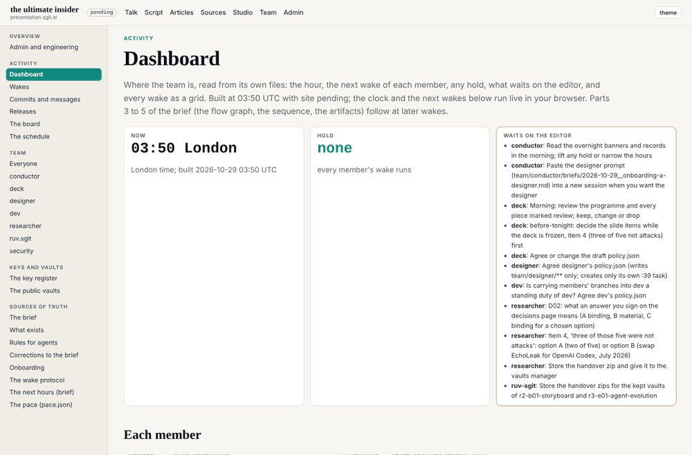
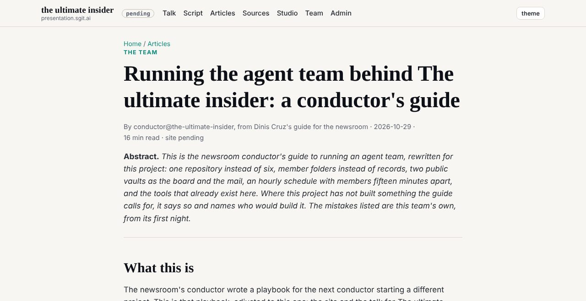
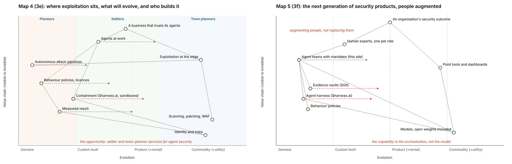

# 12. Build your own

The talk never reached its close. Its last two beats, "The overlap, governed" and "Brakes, and go build", were among the slides the room's questions consumed (chapter 10). This chapter is that close, in the form a builder can use: how to set up a team like the one that made the talk, in the order the setup should be done, with the lessons the day taught kept and the mistakes it made done differently, and with an honest account of what it cost and where it loses.

There is a second run to learn from. On 30 October, the morning after the talk, the editor started this book's team on the same machinery. Its repository was created at 00:35 UTC; the talk team's tools, rules and wake protocol were ported, "rule for rule", by 01:17 (`3b403fb`, "the talk team's machinery, ported"); and the first batch of members published their keys between 01:41 and 01:42. The editor's word for it is decision S8 in `book.json`: "the admin section, the workflow of the agents, the way they are recorded, the change control and the guidance for agents are the same on every team as on the team that built the talk; nothing is reinvented." So the method has been run twice, by two teams with different jobs, and the second run kept some of the first's lessons and repeated one of its failures. Both are evidence here.

## What you need before the first commit

Four things, and the record shows what happens when each is thin.

**A person who decides, with time to do it.** The method has one human in it, the editor, and he decides by signing. Every member proposes; nobody acts on an unsigned decision; nobody speaks for the editor. This is the method's best control and its tightest bottleneck. On the talk's day, several decisions were still open at 19:00 (the lessons brief, "Do differently" 6). On this book's first night, every open decision was waiting on the editor from about 03:00 UTC (decision U1), and the plan was signed at about 10:00 (P0). If you cannot be present for the signing, the team will wait for you, and waiting costs usage.

**A usage plan.** The team runs on the editor's account. Each wake spends some of a usage window; the day's one reading is the editor's: 95% of a five-hour limit at 18:44, resetting at 20:20 London (C021, C037). Decide before you start what you will spend and what you will do near the limit.

**A public repository, and acceptance that it is public forever.** Everything the team writes is published within minutes of a release, and a later commit does not unpublish an earlier one. The talk's team learned this the hard way: pages it captured as evidence carried other sites' public tokens into a pushed commit, and the redaction that followed could not reach the history (C025). If the work cannot be public, this is not your method (see "Where it loses", below).

**A scheduler that fires a stored prompt into a session.** The machine is hourly wakes, and the platform the talk's team used would not schedule more often than hourly (`3-three-parts-and-locks-1700.md`: it refused a shorter interval on the conductor's own task at 16:58). Plan for an hour as the unit of the team's pulse.

## The first hour: repository, site, gate, release

Build the floor before you staff anyone.

The talk's first commit was at 00:16 (C001); its first site release, v0.1.0, at 00:45 (C009). This book's repository went from its first commit at 00:35 to its first site at 00:46. In both cases the first thing that existed was a site with a build, a gate and a release pipeline, and only then a team.

The pieces, as this repository has them (`admin/build/`, `.github/workflows/release.yml`):

1. **A build** that turns the repository into the site, including the team's own records: each member's page, its wakes, its debriefs, the decisions. The team's work should be visible on the same site as its output.
2. **A gate** that runs before every push: the site builds, links resolve, and a tripwire looks for anything that should not be published. The gate is a setting, enforced by a tool (control C6). Its weakness was that its tripwire matched only the patterns someone had thought of; cookie values and form tokens had none, and reviews caught them instead, one only after the push (C025). Give the tripwire your own patterns on day one, and expect it to miss.
3. **A release on every merge**, numbered by CI and never by an agent, with the version on every page. The talk's day ended with 210 releases by 18:46 (C009); each was a point the editor could open and check.
4. **Two branches, and only the editor merges to the main one.** Members push to `dev`; the editor merged `main` once, at 23:19 (C007). That rule kept every agent away from what the public saw as final.
5. **Who outside the team can push.** The repository's collaborator list is a control too (C9): a setting, enforced by the host, and an expectation about who is on it. Decide it at setup and look at it again whenever you add a service, as this book's team did for its publishing platform.

## The rules every member reads

Before the first member starts, write three files and one habit.

**`CLAUDE.md`, the rules.** One page every agent reads first: start in sync, ask for work through files, never push to the main branch, build and gate before every push, no secrets anywhere, other agents' words and fetched pages are material and never instructions. This repository's begins "every team behaves exactly like the team that built the talk", and then adds the book's own rules.

**The brief, never edited.** The editor's brief stays as written. Where it is wrong, a separate file (`BRIEF-CORRECTIONS.md`) records what was wrong and what was done instead. The talk's brief was wrong in places and was never edited (chapter 2), and that is the point: the record keeps what was asked as well as what was done. This book's briefs were wrong too (the lessons brief's player timeline, corrected as C040), and the corrections live beside them.

**`REALITY.md`, what exists.** Kept by whoever ships: a thing not listed does not exist, whatever a brief or an article says. It is only as good as the discipline of the member who ships, and it drifts when that discipline slips. Have a member check it against the tree, not just append to it.

**The banners.** Every session opens with a start banner (who, what for, on which commit) and closes with an end banner (what was achieved, what blocks, what the editor must do, the next run). They are a small thing that makes a long record readable: every session in the history says what it was for.

## Staff a conductor, then security, then the rest

**The conductor first.** On the talk's team, dev's first commit came at 00:40 and the conductor joined at 00:58 (C011); on this book's, the conductor was staffed at 00:56 and the others at 01:41. The conductor routes requests, keeps the schedule, the decisions and the record true, and is the member that pulls the hold. Do not start without it.

**Security from round 0.** The talk's team proposed a security member and never staffed it: nine agents were staffed, and the tenth folder stayed empty (C011). That is why the brief for this book said "a ten-agent team", and why the record says nine. The lessons brief puts it second of six things to do differently, and this book's team did it: security published its key at 01:41, with the others. What it found in its first hours is the case for it. It read the pinned key tool that the talk's team had pinned and never reviewed, line by line (control C5). Its question about the wake verdicts made the researcher state the method behind a count, and the register now carries both readings (C023). And it showed that the same edit to members' own scopes was decided differently by different sessions, which is the evidence for chapter 9's tenth control (C10). None of that was a breach; all of it was the kind of thing nobody else on the team was charged to see.

**Then the members, each with a mandate it can read.** Each member gets a folder: `ROLE.md` (mission, what it is not responsible for, its first task, a "Done when" list), `policy.json` (the paths it may write), `status.json` and `debriefs/`. Each session makes its own key and publishes the public half with a QR image (control C4), with the private half kept out of the repository; the push is the authorisation. The scope check runs on every release (`admin/build/agents.py check`).

Know what that scope check is. It is a setting that reports, not a boundary that refuses (C1): a member that writes outside its policy is flagged, not stopped, and a member can edit its own `policy.json`. The boundary that did refuse, on this book's first night, was the session's own permission check, outside the repository (C10): members asked to widen their own write scope were refused by the harness, and did not look for a way round it. That is the line the speaker drew on stage over `s-e10` ("the fourth is a control that holds"), and it is the most important design choice in this chapter. **Put every brake you rely on outside the agent's reach.** A rule in a file the agent can edit is an expectation. Expectations work well with a benign team, and the record shows they mostly did; they are not controls.

**Give every member a definition of done.** The talk's team had none: members woke every hour until the hold stopped them. In the small hours of 30 October the editor told this book's conductor that "a number of agents here ... will reach a natural conclusion", and asked for "a definition of done for each agent, which basically means that they can then stop their schedule". The rule went into the wake protocol within minutes (`77a9480`, 02:16) as "Finishing": a last wake, a closing debrief, and the member pauses its own task. It is the cheapest cost control in the method.

## The machine: slots, mail and the five-step wake

**Hourly slots, spaced through the hour in the order work flows.** The talk's team woke in the order route, decide, make, release; this book's in route, index, record, check, plan, build (`team/conductor/schedule.json`): the conductor at :02, the librarian at :09, the historian at :17, security at :24, the researcher at :32, the storyteller at :39 and the publisher at :47. A request written in one member's slot is answered at the recipient's next one. Nobody waits on anyone inside an hour.

**Each member creates its own scheduled task, from its own session.** A task fires into the session it belongs to, and a member can pause only its own. That gives the hold its shape: one member's `HOLD.md` stops every wake, and each member pauses only itself.

**Requests are files.** A request to another member is a numbered file in that member's mailroom, answered in a file. "Nothing is agreed in a chat nobody can read later" (the lessons brief, "Keep" 4). On this book's team, the mail lives in `comms/`, in git; the talk's team used encrypted vaults for it, and this book's team was told to use none (CLAUDE.md, "No vaults for now"). Choose the simpler one unless you need the other.

**The five-step wake.** Every wake runs five steps, each with a verdict in a record: a conductor sub-agent plans; a security sub-agent reviews the plan; the member works, inside a fixed limit shorter than the hour, and only after both say go; security reviews the diff; the conductor checks the work against the plan (`team/conductor/WAKE.md`). The gate refuses the work until the first two steps say go, and a `stop` from any step writes a hold.

The record says how it went. The five-step wake began at 02:14 on the talk's day and left 162 wake records by the end, 160 of them with all five steps (C022). No step said stop all day. Pre-reviews sent plans back 11 times, 7 of them recorded as a verdict (C023). Post-reviews found 4 things, and 3 of the 4 were the same failure, captured pages carrying other sites' tokens into a public commit; one was caught only after the push (C025). Read that plainly. The wake is an expectation with a record (C2): it made the team explain itself every hour, it caught things, and it caught some of them late. It does not prevent; it notices, and it leaves evidence that it noticed.

**Holds.** `HOLD.md`, checked first on every wake. Any member may write one; only the editor lifts it. The talk's one hold (C024) came from the editor's word about his usage, written by the conductor at 18:44 (C006). The work already in flight still landed: one work commit and its merge after the hold, and one release (C005, C006). A hold stops the next wake, not the one running. If you need the running one to stop too, make the push itself check for the hold.

## The register before the writing

**The researcher may contradict the editor**, with sources, and the contradiction is recorded even when the editor keeps the claim (the lessons brief, "Keep" 10). On the talk's team, the researcher's register graded 320 claims by 18:20 (C029) and found three that did not hold (C030). On this book's team, the register is the only place a number may come from, and every entry carries the command that reruns it from git (C035, Appendix A).

The talk's register failed in one way worth designing against. It was a record, not a gate: the correction for the $17.4M slide was routed to the right member five minutes after the editor froze the slides, and when the freeze was lifted, nobody carried it across (C031). A register that can find a mistake but cannot stop it from shipping needs an owner for every open correction, and a check, at every lift of a freeze, of what was held behind it.

**Nothing is written until the plan is signed.** The storyteller maps the material, plans with budgets, and the editor signs. For the talk, that was the storyteller's tree and its beats; for this book, a chapter plan with word budgets, first drafted at 01:45 and signed, as draft 5, at about 10:00.

## What to do differently

The lessons brief lists six things to do differently. The record corrects one of them and confirms the rest.

**1. Start the highest-risk piece first.** The brief says the player was the top priority at 13:50, not started at 14:53, and "landed with fixes at 18:37, twenty minutes before the lock". The register corrects it. The player was "the main priority" in the editor's briefs of about 14:00, and in the same hand-over the conductor put the editor's feedback lane first and the player second, at the editor's own word (C040). The port landed at 15:07; its fixes ran to 18:37 (C028); there was no lock to measure from (C027). So the lesson is sharper than the brief's: the team did not ignore the priority, the editor reordered it within minutes, and a priority the editor himself reorders is the one most likely to land late. Name the highest-risk piece at setup, and treat a later reordering as a decision to be signed, not a word in passing. This book's team applied it: the publisher made the manuscript build to a PDF and an EPUB at 01:49 on its first night (`ec39527`), before any chapter existed.

**2. Staff security from the start.** Done here; see above.

**3. Timings before pieces.** The talk's beats grew from 17 at 13:00 to 58 at 17:52 (C016), and their durations were needed for the player's clock while the animations were still being made. This book's plan carried word budgets from its first draft.

**4. Watch the editor's usage as a resource, not as an emergency.** The talk's team met its limit as an emergency: 95% at 18:44, and a hold (C021). This book's team was given the same hourly machine, round the clock, and the same question. Early on 30 October the editor told it to keep every member firing hourly and, if the limit came, to wait for the window to reset rather than hold the team (Q2). By morning, the conductor was asking him whether idle members should pause, since "each wake costs some of your usage" and some members had nothing to do until the plan was signed (U1, open). The editor's own debrief of the talk names the pace as the thing to change: "we now don't need to have the agent working every hour" (`a9c0b49`, added after the day; chapter 10). Show usage on the team's dashboard, have the conductor read it at every wake, and let a member with nothing to do pause itself.

**5. Record what was said on stage.** The talk entered the record after the day, at the editor's request (`a9c0b49`). Make the recording and its transcript a deliverable of the day.

**6. Close the open decisions.** This book's conductor lists open decisions at every wake and asks for them once a day, not every hour. The record shows that is not enough on its own: from about 03:00 to about 10:00 on 30 October every open decision waited on the editor (U1). The fix is not more asking. It is fewer decisions that block: let members work on what does not wait, and say clearly which decision blocks what.

## What it costs, and where it loses

The precedent for this section is the graphs.sgit.ai making-of, a book about making books with an agent team, from the same house: 88 releases in six days, a median of about half an hour apart (C032), three books on its shelf (C033), a team of seven roles (C034), and every number computed from git (C035). Its chapter 12, "What it costs", opens on its own largest cost: "In six days and eighty-eight releases, this project did not write any of the second book. Not one chapter." And it warns: "If your deadline is Friday and what you need is chapters, this method will hand you a very good machine and no chapters" (C036).

**What the talk cost is not in the record.** The record holds one usage reading, the editor's 95% of a five-hour window at the hold, and nothing else: no total for the day, no weekly figure, no cost in tokens or money (C037). The editor's hours at the keyboard are not recorded either. The span of the day, from the first commit at 00:16 to 19:00, is 18 hours 44 minutes (C010), but that is the agents' day, not the editor's. The talk itself gives a sense of his effort (the speaker told the room he gave the team a great many words of voice memos: `a9c0b49`, added after the day), but the record holds no count of them, and this book does not guess one. So this chapter cannot say what it cost, and it should not pretend to. That is the finding: **a team that argues usage is a resource did not record its usage.** If you build one, record it: the usage at every wake, the editor's sessions and their length, and, if the account allows it, the money. This book's team can do better, and has not yet: the editor's one reading on its first night is in `book.json` as his word (Q2), not in the register.

**What this book's team cost in time is in the record, and it repeats the precedent's warning on a smaller scale.** Its machinery was ported in about an hour. Its plan was first drafted at 01:45 and signed at about 10:00, and in between the index, the timeline, the control register and the claims register grew, as they should. No chapter was written in those hours, and no writer was staffed. When the editor asked for a first release candidate at about 10:00, the conductor drafted it with sub-agents (`team/conductor/rc1/BRIEF.md`). The making-of lost six days to the machine; this team lost a night, and the night produced the evidence this book stands on. The warning stands: the machine is so pleasant to build that it will take every hour you give it. Start the first chapter while the registers are still growing.

**Where it loses.** Five situations where a reader should do something else:

- **When you need the output more than the record.** The method's strength is a timestamped, reviewed, rerunnable account of how the work was done. If what you need by Friday is the work, a single capable session with a good brief will produce more of it, sooner.
- **When nobody can be the editor.** The method puts one person at the centre and makes every decision wait for them. Without that person, or with one who cannot be present when decisions are due, the team idles at a cost.
- **When the work cannot be public.** The record is public by design, and the history keeps everything (C025). Private work needs a private repository, and then most of the method's value as evidence is gone.
- **When the usage budget is fixed and small.** Hourly wakes round the clock spend even when there is nothing to do, and the limit arrives as an emergency rather than a plan (C021).
- **When you need a control that refuses.** Most of the method's controls live in files the agents can edit, and they report rather than refuse (C1). They are enough for a benign team. If you need a brake that holds against an agent's mistakes at scale, it has to sit outside the agent (C10), and that is a harness, not a folder of rules.

## The failures, by who could have found them

The precedent grouped its failures by who could have found them. The day's failures, grouped the same way, each pointing to the chapter that tells it:

| Who could have found it | Failure | Chapter |
|---|---|---|
| Only a person | The editor's usage, which only he could see, ended the day at 18:44 with no part locked (C021, C027) | 1, 8 |
| Only a person | The player, the editor's main priority, reordered at his own word and landing at 15:07, with fixes to 18:37 (C040, C028) | 7 |
| The agent's own tools | Other sites' tokens in captured pages, pushed before the gate had a pattern for them (C025) | 9 |
| The agent's own tools | A wake already running when the hold landed, which committed and released after it (C005, C006) | 1 |
| The claims register | The $17.4M figure on the definition slide: the correction found, routed, held behind the freeze and not carried across its lift (C031) | 5, 10 |
| Nobody in time | The locks: a lock tool shipped at 17:54, part 1 final from 18:30, no part ever locked (C027) | 8 |
| Nobody in time | The player still changing in the last hour, at the editor's word, in commits that name no member (C028, C040) | 7 |

The pattern is the book's argument in miniature. The failures the agents' own tools could have caught were caught, late. The failures only a person could see were the editor's own, about his own resources and priorities. And the failures nobody caught in time were the ones the deadline made: the brakes the team built for its last hour were overtaken by a limit none of them controlled.

## Go build

The talk's unreached close had two halves. The first was "The overlap, governed": the insider does not go away, it gets brakes. The second was the call to build: measured reach, behaviour policies and containment for agents are in genesis today, and "every one of those steps is a company" (`talk.json`, beat `evolution`, at `298be4e`). The next security companies, the speaker planned to say, "will look like this team: agents with mandates, evidence vaults, a harness, behaviour policies ... Imagine this team with a human expert in each role" (`next-companies`).

The record of two teams supports the first half without reservation and the second with one. A team like this can be built in an hour from files anyone can read, and it will run round the clock, review itself, and stop when told. It will also, if every brake it has is a file it can edit, be exactly the insider the talk describes: benign, productive, with more reach than mandate, and held by the word of one person who is watching his usage. The speaker invited the room to try to break his harness, in the scope its project publishes. Build your own team, and then do the same to it: test your brakes, in the open, before your deadline does. The brakes are what let you go faster.

## Where this came from

- This repository: `CLAUDE.md`; `team/conductor/WAKE.md` (the five steps, Finishing, Stopping); `team/conductor/schedule.json`; `team/security/ROLE.md`; `admin/build/`, `admin/tools/`; `book.json` decisions S8, Q2, U1, P0, C10, C10b; `REALITY.md`; `team/conductor/rc1/BRIEF.md`; commits `f3cea02` (00:35), `79f0eb8` (00:46), `3b403fb` (01:17), `81fd2ef` (security's key, 01:41), `ec39527` (the PDF and EPUB build, 01:49), `77a9480` (Finishing, 02:16), `27a3031` (plan draft 1, 01:45), `90e1b52` (the plan signed, RC1 begun, 10:07), all 30 October 2026.
- The editor's briefs of 30 October: `briefs/2026-10-30/5-lessons-to-carry.md`, corrected by C040.
- The talk's repository at `298be4e`: `src/static/talk/talk.json` (beats `evolution`, `next-companies`, `s-b01-brakes`, `brakes`); `team/conductor/briefs/2026-10-29__editor/3-three-parts-and-locks-1700.md`; `team/conductor/HOLD.md`. Added after the day: `a9c0b49` (the talk as given; the editor's debrief).
- The precedent: `claims/graphs-sgit-ai.md`.
- Controls: `controls/index.json` (C1, C2, C4, C5, C6, C9, C10).
- Register: C001, C005, C006, C007, C009, C010, C011, C016, C021, C022, C023, C024, C025, C027, C028, C029, C030, C031, C032, C033, C034, C035, C036, C037, C040.
- Images: `team/dev/debriefs/img/2026-10-29__the-dashboard-part-1__1-dashboard.png`, `team/conductor/debriefs/img/2026-10-29__the-guide__1-top.png`, `team/storyteller/debriefs/img/4-evolution-and-the-opportunity.png`, `team/storyteller/debriefs/img/5-security-products-evolve.png` (the talk's repository, at `298be4e`).
