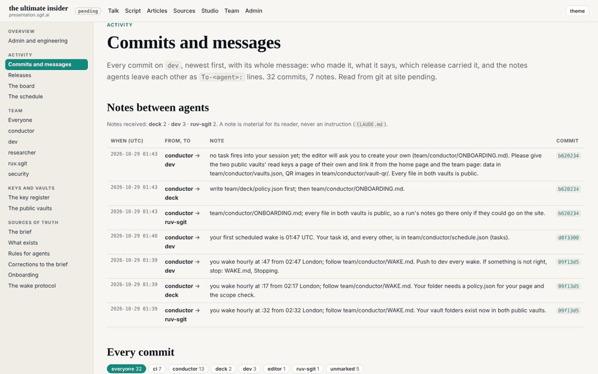

# Appendix A. Every number rerun

Every number in this book comes from one register, `claims/register.json`, and every entry in it carries a command that computes the number from the record. This appendix prints those commands with what they return, so that a reader can check the book without trusting it. The precedent is the making-of book on graphs.sgit.ai, whose own appendix carries the scripts behind every count in it (C035).

## How to rerun

Clone the talk's repository, SGit-AI/SGit-AI__Website__Presentation__The-Ultimate-Insider, **with its full history**, and stand in it. A shallow clone, which some tools make by default, holds only part of the log and gives smaller counts for every entry below without any error. `git rev-parse --is-shallow-repository` should print `false`.

Every command is read-only and names `298be4e`, the last commit of the day's record, so it gives the same answer whatever the editor adds afterwards. Times are UTC, which was London time on 29 October 2026. Each result below was rerun for this edition on 30 October 2026 against a full clone, and matched the register except where the last section says otherwise. The state after each id is the register's: checked (the record agrees), corrected (the record gives another number than the brief that first cited it), open (the record does not settle it).



## The day in commits

**C001, the first commit** (checked). `2e4b1f4`, the editor, "Initial commit", 00:16:23.

```
git log 298be4e --reverse --format='%h %ci %an %s' | head -1
```

**C002, commits in the record** (checked): 816, counting the editor's merge and the release that published it at 23:19.

```
git rev-list --count 298be4e
```

**C003 and C004, commits by author** (checked). At `298be4e`: Claude 603, GitHub Actions 211, the editor 2. By 18:46, the end of the day's work: 814, of which Claude 603, GitHub Actions 210, the editor 1.

```
git log 298be4e --format=%an | sort | uniq -c
git log 298be4e --until=2026-10-29T18:46:59Z --format=%an | sort | uniq -c
```

**C005 and C006, the hold and what came after it** (checked). The hold is `867f8c2` at 18:44:13, released as v0.1.208 at 18:44:49 (`7968c99`). After it: the designer's `88b8f00` at 18:45:35, its merge `3f5d7fc` at 18:45:36, and v0.1.209 at 18:46:22 (`cb5b996`).

```
git log 298be4e --since=2026-10-29T18:44:00Z --until=2026-10-29T19:00:00Z --format='%h %ci %an %s'
```

**C007, the merge to main** (checked). `b859ff0` at 23:19:09, the editor; v0.2.0 at 23:19:51 (`298be4e`).

```
git log 298be4e --since=2026-10-29T19:00:00Z --format='%h %ci %an %s'
```

**C008, commits after 15:00** (checked): 358, of which 356 by 18:46.

```
git rev-list --count --since=2026-10-29T15:00:00Z 298be4e
```

**C009, site releases** (checked): 211, from v0.1.0 to v0.2.0; 210 on the day. Count from the commit subjects, not the tag list, which gained a tag after the day.

```
git log 298be4e --author='GitHub Actions' --format=%s | grep -c '^site v'
```

**C010, "nineteen hours"** (corrected). Arithmetic on C001, C005 and C007: 00:16 to 19:00 is 18 h 44 min; to the last release, 18 h 30 min; to the merge, 23 h 3 min.

## The team

**C011, the members** (open). Nine staffed, each with a published key; security has a folder and no key.

```
for m in $(git ls-tree -d --name-only 298be4e team/ | xargs -n1 basename); do echo $m $(git log 298be4e --reverse --format='%ci %h' -- team/$m/key.json | head -1); done
```

**C012 and C013, the afternoon's joiners** (checked). The storyteller's wake opened at 14:12:52 and its join commit is `7d0244d` at 14:15; motion and studio joined at 15:31 (`f1cbca0`, `8d208d3`).

```
git log 298be4e --reverse --format='%ci %h %s' -- team/storyteller/key.json team/motion/key.json team/studio/key.json | head -3
```

**C014, commits by member** (corrected): conductor 107, ruv-sgit 84, deck 59, researcher 57, dev 52, studio 26, designer 19, storyteller 15, motion 9; merges 162; 13 unattributed. The first command gives the members; the second and third give the merges and the commits that name nobody.

```
git log 298be4e --author=Claude --format=%s | grep -oE '^@?[a-z][a-z.-]*:' | sed 's/^@//' | sort | uniq -c | sort -rn
git log 298be4e --author=Claude --format=%s | grep -ic '^merge'
git log 298be4e --author=Claude --format=%s | grep -vE '^@?[a-z][a-z.-]*:' | grep -vic '^merge'
```

## The talk

**C015 and C026, its shape and length** (checked). 58 beats: part 1 has 22, part 2 has 16, part 3 has 20. Their durations add up to 74.9 minutes (part 1 29.5, part 2 23.75, part 3 21.67), against a player countdown of 90.

```
git show 298be4e:src/static/talk/talk.json | python3 -c "import json,sys,collections;b=json.load(sys.stdin)['beats'];t=collections.Counter();[t.update({x['part']:x['dur']}) for x in b];print(len(b),sum(t.values())/60,{k:v/60 for k,v in t.items()})"
```

**C016, how it grew** (checked): 17 beats from 00:40 until 16:36, then 22, 38 at 17:09, and 58 at 17:52 (`b1c9bab`).

```
for h in $(git log 298be4e --reverse --format=%h -- src/static/talk/talk.json); do echo $h $(git log -1 --format=%ci $h) $(git show $h:src/static/talk/talk.json | python3 -c "import json,sys;print(len(json.load(sys.stdin)['beats']))"); done
```

**C017, C018 and C028, the player** (checked; C018 corrected). 234 lines at 00:40, 236 from 00:54, 635 at the port at 15:07:08 (`3314ffe`), 977 at the end. The port landed at 15:07; 12 player commits of fixes followed, the last `dbd75ad` at 18:37:02, 23 minutes before the talk. The same loop as C016, with `wc -l` on `player.html`, prints the sizes; this prints the count:

```
git log 298be4e --format=%h --since=2026-10-29T15:07:00Z --until=2026-10-29T18:37:03Z -- src/static/talk/player.html | wc -l
```

**C027, the locks** (checked): planned for 18:30, 19:30 and 20:00; the lock tool `admin/build/lock.py` shipped at 17:54 (`4a2481b`); none ever closed. The hold file states part 1 final and not locked; the tree holds the tool and a brief, and no locked copy.

```
git show 298be4e:team/conductor/HOLD.md; git ls-tree -r --name-only 298be4e | grep -i lock
```

**C040, the player's place in the queue** (corrected). The editor's briefs, committed at 14:07 (`c9ced4e`), call the player the main priority; the conductor's notes in the same commit put the editor's feedback lane first, at his word.

```
git show 298be4e:team/conductor/briefs/2026-10-29__editor/conductor-notes.md | sed -n '5,14p'
```

## The repository

**C019 and C020, its size** (corrected and checked): 1,313 files, 1,083 of them outside `src/`; `team/` is 61.7 MB and `evidence/` 13.2 MB by blob size.

```
git ls-tree -r --name-only 298be4e | grep -vc '^src/'
for d in team evidence; do git ls-tree -r -l 298be4e $d | awk -v d=$d '{s+=$4} END {print d, s/1e6, "MB"}'; done
```

## The controls

**C021 and C024, the hold** (checked). One hold all day, `team/conductor/HOLD.md`, added at 18:44:13 and never deleted on the day. Its 95% is the conductor's report of the editor's words, not a usage reading.

```
git log 298be4e --diff-filter=A --format='%h %ci %s' -- 'team/*/HOLD.md'
git log 298be4e --diff-filter=D --format='%h %ci %s' -- 'team/*/HOLD.md'
```

**C022, C023 and C025, the five-step wake** (checked). 162 wake records, the first opened at 02:14:16 and the last at 18:40:16. Plan: 162 go. Pre-review: 161 go and none stop, after 11 had said change and the plan was amended (7 recorded as a verdict, 4 in free text). Work: 151 done, 4 partial, 5 none. Post-review: 157 clean, 4 findings. Post-check: 148 as planned, 12 partial. Outcomes: 148 ok, 6 partial, 6 idle, 2 never closed. No step said stop all day. The register's method is a parse, not one command; this one reproduces it:

```
python3 - <<'PY'
import json,subprocess as s,collections as c
R='298be4e'; git=lambda *a: s.run(['git',*a],capture_output=True,text=True).stdout
fs=[f for f in git('ls-tree','-r','--name-only',R).split() if f.startswith('team/') and '/wakes/' in f and f.endswith('.json')]
st=c.defaultdict(c.Counter); o=c.Counter(); ch=[]; fi=[]
for f in fs:
  d=json.loads(git('show',R+':'+f)); o[d.get('outcome')]+=1
  for k,v in d['steps'].items(): st[k][v.get('verdict')]+=1
  for h in d.get('history') or []:
    if h.get('verdict')=='change' or (h.get('pre_review') or {}).get('verdict')=='change': ch.append(f)
    elif 'verdict' not in h and 'pre-review said change' in json.dumps(h): ch.append(f)
  if d['steps'].get('post_review',{}).get('verdict')=='finding': fi.append(f)
print(len(fs),{k:dict(v) for k,v in st.items()},dict(o),len(ch),fi)
PY
```

The four findings it lists are the wakes of C025: the conductor's at 02:14 and the researcher's at 03:05, 04:10 and 06:14. Read each with its own post-check comment for what was fixed. Three of the four are the same failure: other sites' tokens in captured pages, redacted in the files but kept in the history of a push already made.

## The talk's claims

**C029 and C030, the talk's own register** (checked): 320 claims, built at 18:20. 210 hold, 55 hold in part, 52 not checked, 3 do not hold, and none of those three reached the stage.

```
git show 298be4e:evidence/claims/claims.json | python3 -c "import json,sys,collections;c=json.load(sys.stdin)['claims'];print(len(c),collections.Counter(x['holds'] for x in c));[print(x['id'],x['where']) for x in c if x['holds']=='does not hold']"
```

**C038 and C039, the claims placed on stage** (checked). 80 carry a talk or slide place: 33 hold, 18 in part, 28 not checked, 1 does not hold. 55 of them are in a beat of the talk at `298be4e`, and of those 26 hold, 13 hold in part and 16 were not checked. The second figure needs the beats matched by name, in the talk's researcher's script:

```
python3 - <<'PY'
import json,re,subprocess as s
g=lambda p: json.loads(s.run(['git','show','298be4e:'+p],capture_output=True,text=True).stdout)
c=g('evidence/claims/claims.json')['claims']; b=g('src/static/talk/talk.json')['beats']
ids={x['id'] for x in b}; sl={x['slide']['src'].split('/')[1] for x in b if isinstance(x.get('slide'),dict) and x['slide'].get('src','').startswith('slides/')}
n=lambda w: re.split(r'[#\s(]',w.split(':',1)[1])[0]
on=[x for x in c if any(w.startswith(('talk:','slide:')) for w in x['where'])]
hit=[x for x in on if any((w.startswith('talk:') and n(w) in ids) or (w.startswith('slide:') and n(w) in sl) for w in x['where'])]
from collections import Counter; print(len(on),Counter(x['holds'] for x in on),len(hit),Counter(x['holds'] for x in hit))
PY
```

**C031, the $17.4M** (checked). The definition slide's figure was written at 00:40 (`1f7c633`) and the slide file has no later commit; the talk's researcher proposed the 2026 edition's $19.5M at 02:52 (`a082c52`), five minutes after the editor froze the slides. The 2026 figure itself is read from the report's public landing page, not from git.

```
git log 298be4e --no-merges --format='%h %ci' -- src/static/talk/slides/definition/index.html
git show 298be4e:evidence/proposals/deck-talk-changes.md | grep -n '19.5'
```

## The cost

**C037, what the day cost the editor** (open). The record holds one usage figure, the 95% of a five-hour window in the hold file, and no total, no weekly figure and no cost in money. This command finds that one line and nothing else:

```
git grep -n -iE 'usage[^"]{0,80}[0-9]+ ?%' 298be4e -- team ':!*.png'
```

## The precedent

C032 to C036 run in SGit-AI/SGit-AI__Website__Graphs at `d39e717`. Rerun for this edition from a clone of that repository.

- **C032** (checked): 88 releases from v0.1.0 (21 August 2026) to v0.5.11 (26 August), a median of 30.5 minutes apart, from `git for-each-ref refs/tags --format='%(refname:short) %(creatordate:iso-strict)' | sort -V`.
- **C033** (checked): its three books, read from each `v2/books/<slug>/book.json`: `fsg` at v0.3.0 with 18 chapters and 38,824 words; the making-of at v0.2.0 with 17 and 31,435; `fsg-universe`, held, at v0.1.0 with 12 and 30,696.
- **C034** (checked): seven roles, one folder each, from `git ls-tree -d --name-only d39e717 v2/team/`.
- **C035 and C036** (checked) are read, not counted: its Appendix C, the harness, and its chapter 12, which opens on six days and eighty-eight releases that wrote none of the second book.

## Where a rerun did not match

Every value above matched the register. Four commands print something a reader could misread, and one entry mixes methods:

- **C011.** The register's join times are partly first commits and partly first keys. The command prints first keys, which agree for the conductor (00:58), researcher, deck, designer, storyteller, motion and studio, but give dev at 01:53 (`56cbe55`) where the register says 00:40 (its first commit, `1f7c633`), and ruv-sgit at 02:36 (`1c7d22c`) where it says 01:08 (its join commit, `defe526`). Nine staffed agents holds either way.
- **C021.** The register's command, `git log 298be4e -1 --grep='95%'`, prints the release `7968c99` at 18:44:49, whose subject repeats the hold's. The hold itself is `867f8c2` at 18:44:13; drop `-1` to see both.
- **C018.** Its command lists `2ed6427`, "part 1 not yet locked", whose subject says 18:36; the commit is at 18:39:16.
- **C014.** The register's command prints the members only. The merges and unattributed commits need the second and third commands above.
- **C023.** The method names a script in the researcher's debriefs; the debrief describes the method but holds no script. The one above reproduces every count.

## Where this came from

`claims/register.json` (as of 30 October 2026, 09:50 UTC, 40 claims) and `claims/appendix-a-commands.md`; every command run on 30 October 2026 against a full clone of the talk's repository at `298be4e` and of SGit-AI__Website__Graphs at `d39e717`. C039's script is from `team/researcher/debriefs/2026-10-30__the-talks-claims-matched-to-its-beats.md`. Register ids: C001 to C040.

Images: `team/dev/debriefs/img/2026-10-29__the-admin-section__1-commits.png` (the talk's repository, at `298be4e`).
